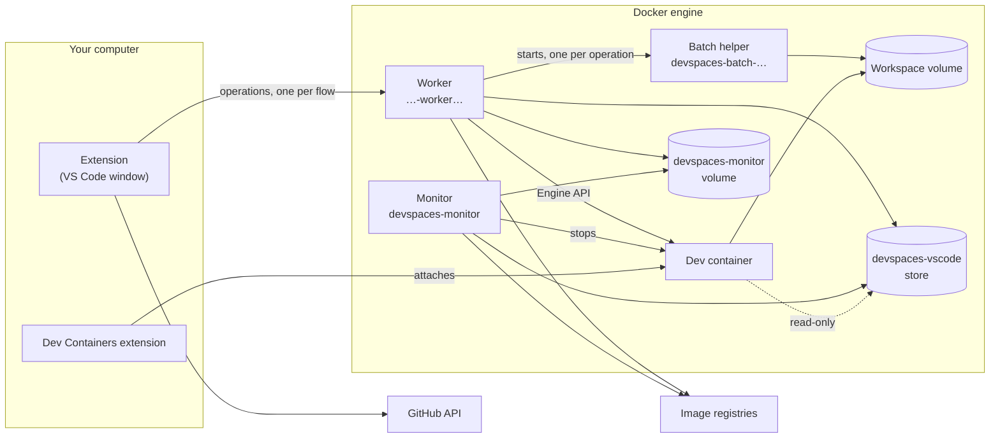
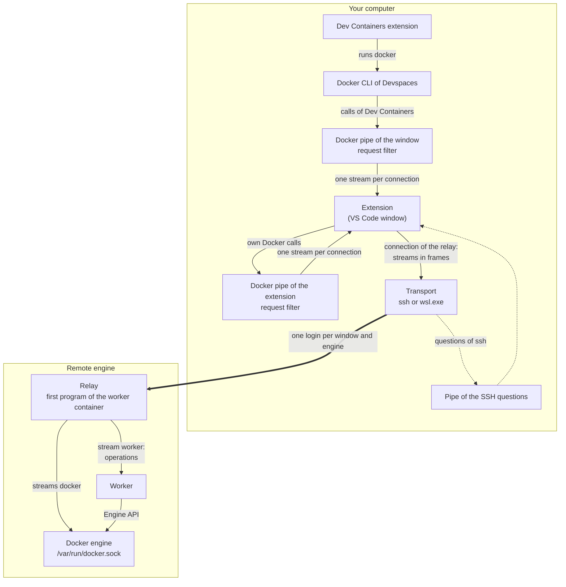

# Architecture

This document describes how Devspaces works inside: its components, the main flows, where it keeps its data, how it names things, and how it is tested. The user guide is [guide.md](guide.md); the security model is in [security.md](security.md). [remote-connection.md](remote-connection.md) shows with diagrams how the parts of the connection to a remote host and to the WSL distribution of Devspaces work together.

## Overview

Devspaces opens a GitHub repository in a dev container, a *devspace*, on a Docker engine: a host of the own list of Devspaces, which is its VM or a remote engine reached over SSH (see [Remote Docker hosts](#remote-docker-hosts)), never the Docker of the computer ([`R-ENG-001`](requirements.md#r-eng-001)). A devspace is a Docker volume with a clone of the repository, an image built from its Dev Container configuration, and a container created from that image. The VS Code window connects to the container through the Dev Containers extension.



On a remote engine (an SSH host, or the WSL distribution of Devspaces on Windows), more parts carry the operations and the Docker connections from your computer to the engine:



The diagram shows a remote engine: an SSH host, or the WSL distribution of Devspaces on Windows. One process of the transport per window and engine (on an SSH host, one SSH login) carries the worker channel and the Docker connections of the window (see [The connection of the relay](#the-connection-of-the-relay)). The relay splits it into streams: one stream to the worker, and one stream for each Docker connection.

- **Operations.** The extension sends the worker one operation per flow on the stream `worker` (see [The worker and the helper channel](#the-worker-and-the-helper-channel)).
- **The Docker pipe of the window.** The Dev Containers extension runs the Docker CLI of Devspaces with `DOCKER_HOST` set to the Docker pipe of the window. The extension serves that pipe and makes each of its connections a stream `docker`, which the relay connects to the Docker socket of the engine.
- **The Docker pipe of the extension.** The Docker calls of Devspaces itself use a second pipe. On an SSH host, they use it only while the connection of the relay is open; otherwise a call that only reads runs on the shell before the relay, and any other call uses `ssh://<host>`. The calls of the view "Docker Hosts" run on the shell before the relay also when they change something, and also on the VM of Devspaces, so that they share one login of the host (see [The shell before the relay](#the-shell-before-the-relay)). The work in the background on the helper image (its build and its rebuild from a newer base image) waits for that connection and never logs in itself (see [The helper image](#the-helper-image)). On the WSL distribution, each connection of this pipe runs its own `wsl.exe … docker system dial-stdio`.
- **The request filter.** Both pipes let only the requests of the Docker API on their own list through (see [The Docker pipe](#the-docker-pipe)). So the Dev Containers extension can attach the window to the container, but it cannot create, build or remove anything on the engine.
- **The pipe of the SSH questions.** When an SSH login asks for a host key, a password or a passphrase, `ssh` asks through `SSH_ASKPASS`, and the extension shows the question in VS Code (see [Login without setup](#login-without-setup)).

On a local Docker, which only the tests of the engine use, there is no transport, relay or pipe: the extension starts the worker with `docker run -i` and talks to it over the standard input and output of that command, and the Dev Containers extension uses that Docker directly. [remote-connection.md](remote-connection.md) shows the remote parts in more detail.

The rule that holds everything together: **the extension sets up the worker, and the worker does all work on the engine.** The extension decides, asks the user, keeps the local records, and holds the secrets. It sends the worker one operation per flow. The worker runs the whole flow next to the engine, so that a remote engine costs one login per window instead of one per Docker call. Local and remote engines work the same way; only the way to the engine differs: the current Docker context for the local Docker, and the transport with the relay and the Docker pipes for a remote engine.

## Components

### The extension

The extension runs in the local extension host of each window (`extensionKind: ["ui"]`). It activates at startup and on `onResolveRemoteAuthority:attached-container`, so that a window that VS Code restores runs the open flow before it connects. Its code is in `src/vscode/` (the VS Code adapters) and `src/core/` (the logic, which never imports `vscode`).

Before the first use of Devspaces on the computer, the activation does no Docker work in the background. The first use is the first devspace: `registry.json` exists, or the marker `used` (see [The local records](#the-local-records)). Before it, the activation only reads the Docker host of Devspaces, for the title of the view: it runs no `docker info`, restores no lost registry, builds no helper image, and starts no worker. The window of a container whose name starts with `devspaces-` does this work also before the first use, so that it finds its devspace after its storage folder was lost (`backgroundWorkAtStart` in `src/vscode/windowDevspace.ts`).

Its parts:

- **UI**: the sidebar tree (`sidebar.ts`, `treeModel.ts`, `treeView.ts`), the view "Docker Hosts" below it (`dockerHostsView.ts`, `dockerHostsModel.ts`, `vmCommands.ts`, see [The view Docker Hosts](#the-view-docker-hosts)), the status bar item, the switcher, the progress notifications, the welcome views with the Docker setup (on Windows, `wsl --status` runs only while the view shows the setup, at a click on Install WSL 2, and for up to 30 minutes after an installation started), and the repository groups editor (a webview with a strict content security policy). The regular expressions of the setting `repositoryGroups` never run on the extension host: the sidebar (`groupMatcher.ts`) and the preview of the editor run them in a worker thread, `dist/groupsPreviewWorker.js`, with a time limit: in the sidebar one second for each entry, in the editor one second for the whole preview. The sidebar keeps the places of the names until the setting changes; after the time limit, it lists the repositories without groups.
- **Discovery** (`src/core/discovery/`): lists the repositories with a Dev Container configuration through the GitHub GraphQL API. List requests read 100 repositories each; lookup requests check up to 50 repositories for `.devcontainer/devcontainer.json`, `.devcontainer.json`, and `.devcontainer/<folder>/devcontainer.json`. At most four requests run at the same time. The result is stored per account, with the repositories without a configuration (`withoutConfiguration`, with their data: the sidebar lists them with a default image), and a refresh looks up only the repositories whose `pushedAt` or default branch changed. With the setting `owners`, only those owners are asked. Each repository carries the permission of the account (`viewerPermission`: `ADMIN`, `MAINTAIN`, `WRITE`, `TRIAGE`, `READ`); a list of an older version has none until its next refresh.
- **Accounts** (`auth.ts`, `accountOffers.ts`, `src/core/accountChoice.ts`, `src/core/discovery/mergeDiscovery.ts`): the accounts of Devspaces are the GitHub accounts of VS Code (`vscode.authentication.getAccounts`) that return a session with `repo` and `read:org` to a call with the account and without a dialog, in the order of their logins; they are read again after each change of the sessions. Every call to the GitHub authentication names its account, because an interactive call without one changes the account preference of the extension in VS Code. The sidebar refreshes the list of each account one after the other with its own token and merges the lists in memory (`mergeDiscovery`: one entry per repository, with the accounts that have access and their permission in `access`; the accounts of the complete lists with their organizations in `accounts`). `accountChoice.ts` holds the rules of the account of a new devspace (rank by permission, owner login, organization membership, login); the controller applies them (`repositoryTargetFor`: an existing devspace of an account of Devspaces first, then the question about a devspace of an account that Devspaces does not use, then the rules). `AccountOffers` shows the one notification for an account of VS Code that Devspaces does not use yet, and remembers its ID in the global state of the extension (`offeredGitHubAccounts`).
- **Controller and operations** (`controller.ts`, `src/core/pipeline/devspaceOperations.ts`): turn each command into one worker operation, answer the worker's requests, and connect the window afterwards.
- **Bootstrap** (`src/core/docker/bootstrapDocker.ts`): the Docker CLI calls of the extension. It checks that the engine of the Docker host answers (it starts no Docker of this computer), checks and builds the helper image, starts the worker, and tests a new remote host. The only other Docker commands of the extension are those of **Remove Devspaces from This Docker Engine…** (`src/core/docker/engineRemoval.ts`, see [Remove from an engine](#remove-from-an-engine)), because that command also removes the worker, and those of the view "Docker Hosts" (`src/core/hosts/hostObjects.ts`, see [The view Docker Hosts](#the-view-docker-hosts)), because it shows and removes the helper containers too, each through the same runner. Every call of one operation runs on the Docker host that the operation read at its start: with `DOCKER_HOST` set to `ssh://<host>` (or to the Docker pipe of the extension) for a host of the list, also the VM of Devspaces; only in the tests of the engine, with `DOCKER_CONTEXT` set to the local Docker context that it read. So a switch in the middle cannot move it to another engine.
- **Session coordination** (`sessionCoordinator.ts`, `src/core/session/`): the window status files, the heartbeats, the release when a window closes or switches, and the sweep of the storage folder.
- **Connection** (`connectionAdapter.ts`): opens the folder URI `vscode-remote://attached-container+<hex of {"containerName": …}>/<folder>` with `vscode.openFolder`, and tells which devspace a window is connected to. Only this adapter and `src/core/devContainers.ts` know internals of the Dev Containers extension.

### The worker and the helper channel

The worker is a container per window and Docker engine, named so that `docker ps` shows which window it belongs to. In the window of a devspace, the worker on the engine of the devspace is `<devspace>-worker<number>`, after the resource name of the devspace (see [Naming](#naming)), for example `devspaces-acme-api-sturdy-kahn-worker1`. Every other worker is `devspaces-<window>-worker<number>`, for example `devspaces-api-worker1`, where `<window>` is the name that the title of the window starts with: the name of its saved workspace file, else the name of its first folder, else `window`; in lower case with only letters, digits, and `-`, and cut to at most 24 characters, at the end of a word where that keeps at least 12, so that a worker name is short (at most 43 characters up to the number 99). Without `-` before the number, a worker name is never the name of a container of Docker Compose (`<project>-<service>-<number>`, also of a service `worker`). The number tells apart the workers of windows with the same name on one engine (two windows of one folder, two devspaces of one repository on other engines, or the windows of two computers that use one remote engine). A worker starts with the number 1. When Docker refuses the name because another container has it, the extension lists the containers of the engine and starts the worker with the lowest free number (the next number when the list fails); an open fails when Docker has refused 10 names. The helper channel is its connection to the extension: the standard input and output of the `docker run` with which the extension starts it, with the Docker CLI on the engine (the local Docker context, or `ssh://<host>`). On a remote engine whose host is an SSH alias or address, the extension runs the same `docker run` on that host with one SSH login, the command ends with `startRelay` instead of `startChannel`, and the channel runs on a stream of the relay (see [The connection of the relay](#the-connection-of-the-relay)):

```text
docker run --rm -i --pull never --name <worker name>
  --label nimblescape.devspaces.worker-run=true --label nimblescape.devspaces.worker-channel=<protocol>-<hash>
  --network bridge --log-driver none --cap-drop ALL --security-opt no-new-privileges
  --mount type=bind,source=<engine socket>,target=/var/run/docker.sock
  --mount type=volume,source=devspaces-monitor,target=/state
  --mount type=volume,source=devspaces-vscode,target=/vscode,volume-nocopy
  --env DEVSPACES_VERSION=<version>
  devspaces-worker:<tag> node -e <pipe loader> /opt/devspace/channel.js <sha256> startChannel
```

The extension and the worker talk over the standard input and output of that `docker run`, one JSON message per line (`src/core/helperChannel/protocol.ts`). Both sides check every message strictly. After `hello` (protocol version 3), the worker answers `probe` with the version, the API versions and the identity of its engine, and runs `sweep`, which prunes stopped helper containers older than 10 minutes.

- **Operations** (`OPERATIONS` in `src/helperChannel/operations.ts`), one per flow, each with typed parameters: `open`, `prepare`, `stop`, `delete`, `deleteCheck`, `listConfigurations`, `refresh`, `windowState`, `tokenRemove`, `reconcile` (the registry rebuilt from the volumes), `heartbeat`, `recordGitState`, `monitorEnsure`, `monitorRunNow`, `probe`, and `sweep`. No Docker command crosses the channel.
- **Requests**: during an operation, the worker asks the extension through `ask` messages and waits for the answer: `question` (a dialog for the user), `local` (window state and other facts of this computer), `record` (a specific change of the local records), and `secret` (the GitHub token, or the login of the registry of one image or Feature, which the request names; the extension answers one request at a time and refuses a second one meanwhile, gives the logins of at most 8 registries in an open, and logs each request). Each operation may send only its own kinds of requests (`FLOW_REQUESTS`), and record changes only for its own devspace (`SCOPED_REQUESTS`). The extension binds each operation to one GitHub account in its own memory (`extensionHostSide(deps, account)` in `src/vscode/hostSide.ts`), next to its repository and Docker host: the requests for the account, the token and the registry logins are answered for that account only, and an operation of no account gets none. The worker never names an account.
- **Progress and output**: `progress`, `log`, and `out` messages go to the Devspaces log and the progress notification. The worker masks every secret of the operation in everything it sends.
- **Lifetime**: the extension opens a worker at the first operation on an engine and closes it after 10 minutes without one. It pings every 15 seconds. The worker ends by itself when its input ends, after 60 seconds of silence, or after 15 minutes without an operation; `--rm` removes it.
- **The current build** ([`R-DS-008`](requirements.md#r-ds-008)): the heartbeats of a window keep its worker busy, so the worker would run from the helper image of its start for as long as the window is open. So each heartbeat also looks whether the helper tag that the container of the worker was started from (`Config.Image` of its inspect; on a remote engine, the container of the connection of the relay) is still on the image of that container (`runsFromEarlierBuild` in `src/helperChannel/flowOperations.ts`, within 5 seconds; a failed look is no answer). When the Monitor or a window built the tag again, the answer says `earlierBuild`, and the window renews the worker (`HelperChannels.renew` in `src/core/helperChannel/helperChannels.ts`): it starts a worker from the current build beside the earlier one, as work in the background, outside of any operation and of any flow of the user, so that its login asks nothing; the helper image is only checked, never built, and on a remote engine the worker never starts on the open connection of the relay (`newConnection`, see [The connection of the relay](#the-connection-of-the-relay)). After the checks of its open, the operations go to the new worker, and the earlier worker is closed at once when no operation runs on it, else at the first check of the idle workers (every minute) after its last operation ended. When the new worker cannot be opened (for example on an SSH host whose login asks for a password), the earlier worker stays, the log says why, and the next renew of that engine waits one hour (`CHANNEL_RENEW_RETRY_MS`). **Remove Devspaces from This Docker Engine…** closes the earlier worker too, and the worker of a renew that runs.
- **Engine access**: every Docker action of the worker goes through one port, `DockerEngine` (`src/core/worker/dockerEngine.ts`), over the Docker Engine API on the socket (`src/helperChannel/engineApi.ts`, `engineClient.ts`). The worker starts no `docker` process of its own. Every command that it runs in a container is a named entry of one registry (`CONTAINER_SCRIPTS` in `src/core/worker/containerScripts.ts`), run through `exec` with positional arguments, secrets only on standard input, and its output masked.
- **The pipeline**: the logic of the flows (`DevspaceService` in `src/core/pipeline/`, the host access policy in `src/core/policy/`, the image check in `src/core/imageCheck/`) runs only in the worker. A test checks that the extension's bundle contains none of it.
- **Network**: the worker has outbound network on the default bridge, and no published port. Its HTTPS goes through the proxy of the Docker daemon, with the header `User-Agent: nimblescape-devspaces/<version>`. The extension gives the worker its version in the variable `DEVSPACES_VERSION`, and the worker gives the same variable to the Monitor that it creates. No bundle holds the version, so a new version without a change of the code builds the same files.

### The helper image

All containers of Devspaces run from one image per engine, `devspaces-worker:<12 hex>` (the helper image of the code; Docker shows the name of the worker), built locally from `resources/helper/Dockerfile`: Node.js 26 (the current LTS version) on Debian, Git, the Docker CLI with Buildx and Compose, tini, `flock`, `setpriv`, the user `devspace-git`, and the Dev Container CLI of the exact version that `package.json` pins as a devDependency. The tag is a hash of the Dockerfile, the CLI version, and a generation number, so a change of any of them builds a new image.

After an installation or update, the extension builds a missing image in the background, before an open needs it, once Devspaces was used on the computer (see [The extension](#the-extension)); before that, the first Start or Refresh builds it. The choice of another Docker host, also at the end of the setup of the VM of Devspaces, starts this background build on that host (once per host in a window, and again on a host where the first try found Docker not running, such as the VM of Devspaces that a window tried at its start before the setup; never on an engine with the removal mark of "Remove Devspaces from This Docker Engine…"), so that the first Start there does not wait for it. The extension also builds a missing image when a refresh finds it missing on an engine that answers ("Devspaces: preparing `<host>`…" in the status bar). A Start, Stop, or Delete builds it at once. While the image is missing, the rows of that engine show `State unknown`. The maintenance runs when a worker is prepared for an open, and in the background prebuild: a weekly check of the base image's digest (only when the Monitor of the engine did not check it within that week, see below), and a rebuild with `--pull --no-cache` when the check found a newer base (only with `updateImagesOnConnect` on; a rebuild that takes longer than 15 minutes counts as failed). The windows remove no helper image: the cleanup of the Monitor does ([`R-DS-007`](requirements.md#r-ds-007), see [The cleanup of the engine](#the-cleanup-of-the-engine)). Its state is in `helper.json` (local engine) and `helper-remote-<hash>.json` (each remote engine).

The extension builds the image the same way on every engine, the Lima VM and the WSL distribution of Devspaces, and an SSH host; only the way to the engine differs ([`R-ENG-006`](requirements.md#r-eng-006)). The build runs in a container of the build image of Devspaces on the engine (`BootstrapDocker.buildImage`, `src/core/docker/buildxImage.ts`): `docker run --rm -i --pull never --name devspaces-build-<16 hex> --label nimblescape.devspaces.build-run=true --network none --log-driver none --cap-drop ALL --security-opt no-new-privileges --mount type=bind,source=<socket>,target=/var/run/docker.sock --entrypoint /buildx devspaces-buildx:<version> build --builder default --load --progress plain -t <tag> -f Dockerfile --build-arg HTTP_PROXY --build-arg http_proxy … [--no-cache] --label … --build-arg … -`. The build image is `docker/buildx-bin` of Docker (only the program buildx), pinned by its version and the digest of its image index for all platforms in `src/core/docker/buildxPin.json`. buildx talks only to the Docker socket of the engine, the source of the socket mount of the worker there (the socket of a rootless engine, else `/var/run/docker.sock`; on the local Docker the socket of its endpoint), so the container needs no network. Only the token of a registry would buildx fetch itself, so before the build the extension pulls the base images of the Dockerfile (`extractBaseImages`) with `docker pull`: with `--pull` always, else when the engine does not have one; the build then finds them on the engine. The Docker CLI sends its logins for that pull, and the engine pulls through its proxy, as for `docker build --pull`. A failed pull fails the build. A Dockerfile without a base image that can be read is built with `docker build`. `--builder default` is the builder of the engine (the docker driver), which keeps the image in the engine (`--load`), also when `docker buildx use` chose another builder there. The Docker CLI that runs the container sets the proxy variables of its configuration (`proxies` of `~/.docker/config.json`) in the container, and buildx gives them to the build because of the build arguments without a value (`HTTP_PROXY`, `HTTPS_PROXY`, `NO_PROXY`, `FTP_PROXY`, `ALL_PROXY`, each also in lower case; a variable that is not set is left out), as `docker build` does with these settings. So no proxy URL, which can hold a password, appears in the arguments or in the log. The folder of the Dockerfile goes as a tar archive on the standard input of the container (`contextTar.ts`: the files at the top of the folder, sorted, with the owner 0 and the time 0, and the mode 0755, which the Docker CLI on Windows gives every file of a context for an engine on Linux; at most 1 MiB; a folder in it is refused). So every build uses BuildKit, also with the Docker CLI of Devspaces, which has no buildx: the classic builder of Docker runs each `LABEL`, `ENTRYPOINT` and `CMD` step as a container and commits it (one to two minutes for each such step in a slow virtual machine). The build output goes to the log as before, and the image is found by its build label. The build image has the tag `devspaces-buildx:<version>` on the engine. When that tag is missing, the extension pulls the pinned digest (`docker pull docker/buildx-bin@sha256:…`, at most 10 minutes) when no image of that digest is there, tags it, and removes the name of its pull again (only after a pull of its own, so that a name of the user stays). The cleanup of the Monitor removes the tags of older versions (see [The cleanup of the engine](#the-cleanup-of-the-engine)). A window that tagged it meanwhile counts as done. After a Cancel or another failure of the `docker run`, `docker rm -f` removes the container in the background, so that its build stops (after a Cancel that found no container, once more 10 seconds later, for a container that Docker created after it); the Docker CLI on macOS and Linux also stops it with `kill` at its own stop, the Docker CLI on Windows does not. When the build image cannot be prepared (for example without a connection to Docker Hub, or with its pull limit), when the context cannot be packed, the Dockerfile is not at the top of its folder or names no base image that can be read, or when Docker cannot run the container (exit code 125), the log says so and the extension builds with `docker build` of the Docker CLI that sends the calls, as before; a build in the container that ran and failed is the result, with no second build. The workflow "Buildx image" (`.github/workflows/buildx-image.yml`, `scripts/buildx-pin.mjs`), which the workflow "Daily checks" (`.github/workflows/daily-checks.yml`) runs every day, proposes a newer buildx as a pull request, and checks that Docker Hub still has the pinned digest.

On an SSH host, the work in the background on the helper image never logs in to the host ([`R-ENG-002`](requirements.md#r-eng-002)). The prebuild waits, when it is due, for the connection of the relay of the window to the host (`HostPipes.whenDockerHost`, without a time limit; its time limit of 15 minutes starts after it), asks nothing before it (no SSH check, no `docker info`), and runs through the Docker pipe of the extension. The build of a missing image that a refresh asks for runs there only while that connection is open; otherwise the next Start, Stop or Delete builds it. Both run as an operation with `withoutLogin` (`runWithDockerTarget` in `src/core/docker/dockerTargets.ts`): when the connection ended, `BootstrapDocker` refuses their next call that would log in (`ssh://<host>`, or the shell before the relay), and the work stops as cancelled, so that an open that joined its build builds for itself. The maintenance that changes the engine there (the rebuild) runs only through that connection (`mayChangeEngine` of `HelperImages`): an open before the connection uses the existing image and puts the rebuild off, and the prebuild runs it once the connection is open. A missing tag is still built by the open, with a login of its own, before its connection, because the container of the connection runs the helper image.

The Monitor keeps the helper image of its own tag up to date on its engine ([`R-DS-003`](requirements.md#r-ds-003)), as a part of the background run (see [The background run](#the-background-run)), so that an open does not rebuild it. The helper image holds its own Dockerfile (`/usr/local/share/devspaces/helper/Dockerfile`), so the Monitor reads it in its own container and computes the same tag as the window that created it (`helperImageTag` in `src/core/helper/helperImageBuild.ts`). Each build that pulled its base image with a known digest (the first build of a window, the rebuild of a window, the rebuild of the Monitor) carries that digest in the label `nimblescape.devspaces.worker-base-digest`. The Monitor asks the registry of the base image anonymously for its digest. When the label names another digest or none, it builds the tag again with `docker build --pull --no-cache` and the Docker CLI of its own container over the socket of the engine, within 15 minutes (`src/remoteMonitor/helperRefresh.ts`). It does nothing when the tag is not on the engine, and it never removes the previous image: the Monitor still runs from it, and the cleanup of the engine removes it when no container uses it anymore. It writes the result into `/state/helper-image.json` (`src/core/remoteMonitor/helperCheck.ts`): the time of the check and the digest when the image is current after the run, or only the time of the attempt when the registry gave no digest or the build failed.

The answer of each heartbeat of a window carries this record (`helperCheck`), and the window takes it into the state of the helper image of that engine (`recordEngineHelperCheck` in `src/core/helper/helperImage.ts`). A check of the Monitor that is newer than the check of the window counts as the weekly check of the window and drops a rebuild that an older check asked for; a check with the digest that the window asked for drops that rebuild too. So the window checks the base image only when the Monitor did not do it for 7 days, and an open does not rebuild the image after the Monitor did. A record of the Monitor for another tag or another base image, or one that is older than a build of the window without `--pull`, changes nothing, and a check whose time is more than 60 seconds later than the clock of the computer is not taken. When the Monitor cannot check or build the image, for example behind a proxy that only the computer knows, the windows check and build it as before.

### Pipe loading

The worker, its batch helpers, and the Monitor all get their code the same way (`src/core/loader/pipeLoader.ts`). The container runs a one-line `node -e` loader with the path, the SHA-256 hash, and the entry function of its bundle on its command line. The writer sends the bundle as the first line of standard input. The loader checks its length and hash, stores it in the container (`/opt/devspace/channel.js`, `batch.js`, or `monitor.js`), puts the rest of the input that it read back in front of the standard input, and calls its entry. The entry gets the standard input paused and as bytes, and reads it as text (the worker, the batch helpers) or as bytes (the relay). A container that restarts with a stored file of the right hash starts it without reading its input, which is how the Monitor survives a restart by Docker. Every failure of the loader exits with code 3. No code goes into an argument or a variable of a container.

The worker's bundle, `dist/helperChannel.js`, is one program with five uses, each with its own entry (`src/helperChannel/main.ts`):

- **Worker**: `startChannel`.
- **Relay**: `startRelay` (`src/helperChannel/relay.ts`, see [The relay](#the-relay)), the first program of the worker container on a remote engine.
- **Batch helpers**: `startBatchHelper`.
- **Monitor**: `startMonitor` (`src/remoteMonitor/main.ts`). The commands over `docker exec` run `node /opt/devspace/monitor.js <command>`.
- **Host access analysis**: threads of the worker (`src/core/helper/configurationAnalysisWorker.ts`). The worker starts each thread from its own stored file, after it checked the SHA-256 hash of that file again.

Nothing in the bundle runs with `eval`. The bundle holds fixed scripts as text, which run with `node -e` or `sh -c`: the one-line pipe loader, and the scripts that the worker and the steps of the batch helpers run in containers.

### Remote Docker hosts

Devspaces keeps its own list of SSH hosts with Docker (`remote-docker.json`, `src/core/storage/remoteDockerState.ts`); its own VM can be such a host too: on Windows its WSL distribution (see [The WSL distribution of Devspaces](#the-wsl-distribution-of-devspaces)), on macOS and Linux its Lima VM (see [The Lima VM of Devspaces](#the-lima-vm-of-devspaces)). One of them is the *Docker host of Devspaces*, for every window on this computer; Devspaces never uses the Docker of the computer. Devspaces never creates, changes, or uses a Docker context for a remote host, and it changes no setting, no `DOCKER_HOST`, and no setting of the Dev Containers extension, so the `docker` command in the terminals of the user keeps its target (`src/vscode/remoteDockerCommands.ts`):

- **The commands**: **Use a Remote Docker Host…**, and the choice of the Docker host in the first row of the view, list the hosts of the list, the other hosts of the SSH config, the SSH hosts of the Docker contexts of the user, and the own VM of Devspaces when it exists (on Windows the WSL distribution, on macOS and Linux the Lima VM), each host once, or take a typed SSH address. While the own VM does not exist, its group offers its setup instead (`devspaces.setUpWslDistribution` or `devspaces.setUpLimaVm`), so that every platform can go back to the VM from a remote host. It tests the host with one SSH login, the shell before the relay, which may ask for a password or an unknown host key in VS Code (see [Login without setup](#login-without-setup)), and runs `docker info` of the Docker CLI of the host on it (on a computer without a Docker CLI after the download of the Docker CLI of Devspaces, see [The Docker CLI of Devspaces](#the-docker-cli-of-devspaces)), reads the socket of a rootless engine on the same login, and then makes the host the Docker host of Devspaces; the host joins the end of the list. **Remove a Host from the List…** (in both choices of a host) forgets a host: when Devspaces uses it, Devspaces has no Docker host afterwards, and the sidebar shows the Docker setup. Its devspaces stay on that computer, without rows in the sidebar until the host is added again.
- **The Docker calls**: an operation reads the Docker host of Devspaces at its start (`DockerTargets.resolve`). For a host of the list, its calls get `DOCKER_HOST=ssh://<host>` (or the Docker pipe of the extension, see [The Docker pipe](#the-docker-pipe)), without `DOCKER_CONTEXT` and the TLS variables, so neither a Docker context nor `DOCKER_HOST` of the user decides where they go.
- **Never the Docker of this computer** ([`R-ENG-001`](requirements.md#r-eng-001)): on every platform, Devspaces never uses the Docker of this computer (`usesComputerDocker` in `src/core/docker/dockerHost.ts`), also when Docker Desktop or Docker Engine is installed. Without a host of the list, `DockerTargets` gives `NO_DOCKER_HOST_TARGET` and reads no Docker context of this computer: a target that is not supported, whose operations are refused with a message that names the Docker setup, whose reads of the view and of the restore only log it, and whose host matches no devspace. The sidebar shows the Docker setup, and its header names no Docker host. The same holds while the Docker host of Devspaces is its own VM and that VM does not exist, for example after its removal outside of Devspaces (`withoutMissingVm` in `src/core/docker/dockerTargets.ts`): the choice stays in `remote-docker.json`, the setup in the view or a link sets the VM up again, and Devspaces then uses it. Whether the Lima VM exists comes from the folder of its instance at each read (`LimaVm.exists`, no process); the registration of the WSL distribution needs `wsl.exe` and the registry, so the window keeps the last answer of the reads that run anyway (its scheduled task at the start of the window and after the setup or the removal, the Docker context of `createDockerContext`), and a distribution counts as existing before the first answer. While Devspaces uses its own VM, the first row of the view and its title name it as local ("Local Docker host: VM of Devspaces", "Local VM of Devspaces"), not as a remote host. The choice of the Docker host has no local Docker, and there is no command for it. An operation starts no Docker of this computer (`ensureDockerRunning` only checks a local Docker, which only the tests of the engine use). A link to Devspaces sets up the VM (`Controller.dockerForLink`). Devspaces that an older version made in the Docker of this computer are not moved: they stay there, and the view does not show them.
- **The window of a devspace** knows its Docker host from its devspace: a window that VS Code restores, or that Open Recent opens, runs its open flow on that host, whatever host Devspaces uses now (`Controller.withHostOf`), without a question. So does every command that names a devspace (its row, the status bar item: `Controller.withCommandTarget`), **Close and Keep Running**, and an operation that a window hands off to its empty window (`runEmptyWindowTasks`); the reopen at startup opens only a devspace of the Docker host of Devspaces. A host that is not supported now (the local Docker set to an SSH host or another endpoint) refuses the operation as before. Its Dev Containers extension reaches a remote host through the Docker pipe of the window (see [The Docker pipe](#the-docker-pipe)). The heartbeats find the engine of a devspace in the same way (`hostEngine` in `src/core/session/windowHeartbeats.ts`).

### The relay

The relay is an entry of the worker's bundle (`src/helperChannel/relay.ts`; its frames and streams are in `src/core/relay/`, the same code for both sides). On a remote engine, it is the first program of the worker container, so that one connection (one SSH login) carries the worker channel and the Docker connections of the window (see [The connection of the relay](#the-connection-of-the-relay) and [The Docker pipe](#the-docker-pipe)).

- **Start**: the pipe loader stores the bundle and calls `startRelay`, which reads its input as bytes. The relay sends its HELLO first; the extension sends nothing before it.
- **Frames** (`frames.ts`): each frame has a header of 9 bytes (its kind, the number of its stream, and the length of its payload) and a payload of at most 64 KiB. The kinds are HELLO, OPEN, DATA, END, CLOSE, CREDIT, EXIT, and PING. Stream 0 is the connection itself (HELLO, PING); the extension opens the streams 1, 2, 3, … in this order, at most 256 at a time (an OPEN beyond that breaks the rules). Both sides check every frame and end the connection at a frame that breaks the rules. The reason of CLOSE is one line of plain text.
- **Targets**: OPEN names one of two targets. `worker` starts the worker as a process of the relay, with the pipe loader and the same stored file, hash, and environment, so the worker starts as it does without the relay. At most one worker runs at a time. Its stream ends with EXIT (its exit code or signal) after its last output, and the end of the stream ends the input of the worker. When the extension closes the stream, the relay stops the worker with SIGTERM, and with SIGKILL after 45 seconds. A worker stream that comes while a worker runs waits until that worker ended, and then starts a new worker on the same connection; a newer worker stream closes an older one that waits. `docker` connects the stream to the Docker socket of the container (`/var/run/docker.sock`). The relay opens no other socket, host, or port.
- **Flow control** (`mux.ts`): each direction of a stream has a credit of 256 KiB. The sender sends at most that many bytes that the receiver did not take yet, and then waits for CREDIT. Each DATA frame counts 256 bytes more than its payload, so that many small frames cannot hold more memory than the credit. END ends one direction after its data (Docker needs this for `docker exec -i`, when the input ends before the output); CLOSE ends both directions at once. The frames of the connection (CREDIT, OPEN, CLOSE, PING) go first. A frame of the worker stream goes next, but never two in a row while another stream has a frame: a large Docker transfer delays the worker channel by at most one frame, and a long answer of the worker does not stop the Docker streams. The other streams go in turn, one frame each.
- **Lifetime**: each side sends PING when it sent nothing else for 15 seconds, and ends the connection when no frame came for 60 seconds (the extension counts from the HELLO on). The relay ends when its input ends, after a frame that breaks the rules, after this silence, and at SIGTERM, SIGINT, and SIGHUP. It closes every stream, stops the worker as above, and exits when the worker ended, after the frames that wait in its output went (at most 5 seconds more). Both sides measure the time with a monotonic clock, so a step of the wall clock does not end the connection.

The design ([remote-devspaces-one-ssh-login.md](design/remote-devspaces-one-ssh-login.md#the-relay)) calls the worker channel "stream 0". Here the worker has a stream of its own with the target `worker`, so that a new worker gets a new stream on the same connection.

### The connection of the relay

The extension starts the relay on a remote engine with one SSH login (`src/core/relay/`). The local engine, and a remote host that is no SSH alias or address, start the worker with the Docker CLI as before.

- **Transport** (`transport.ts`): `ssh -o BatchMode=yes -o ConnectTimeout=15 -T [-p <port>] [-l <user>] -- <host> sh -s`, with `SSH_ASKPASS_REQUIRE=never`, as the SSH check. A login of a flow of the user has `-x` in place of `-o BatchMode=yes` and gets the environment of the questions in VS Code (see [Login without setup](#login-without-setup)). Its standard input and output are bytes (`ProcessRunner.startBytes`). For the WSL distribution of Devspaces, `wsl.exe` takes the place of `ssh` (`wslHostTransport`, see [The WSL distribution of Devspaces](#the-wsl-distribution-of-devspaces)).
- **Start script** (`startScript.ts`): the extension writes one line, `printf '%s\n' <marker>; exec 'docker' 'run' … 'startRelay'`, with every word in single quotes. The marker is `devspaces-start-` and 32 random hex digits, new for each connection. `sh` reads the whole line before it runs it, and the extension writes nothing more until it sees the marker followed by a line feed in the output, so `docker run` gets all the input after the line. This was checked with dash, bash, and BusyBox ash.
- **Open** (`connection.ts`): what the login prints on the standard output before the marker (for example the text of a login script, at most 64 KiB) is ignored, and only its size goes to the log. The error output of the transport (`ssh`, the relay, and the worker share it) is kept: its last 8 KiB, without long lines (`readableStderr`), are the reason of a failure. After the marker, the extension writes the bundle line for the pipe loader and waits for the HELLO of the relay. The open fails when the transport ends before the HELLO, or its output ends and it does not end within 1 second, with the end of its error output as the reason (for example the refusal of `docker run` when another container has the name of the worker, so the next name is tried as before), and after 120 seconds.
- **Worker**: the helper channel runs on a stream with the target `worker`, as it runs on the standard input and output of `docker run`, but without the bundle line (the relay stored the bundle). Its answer to `hello` must come within what is left of the 120 seconds of the open, and gets at least 15 seconds. A new worker of the engine (after the end of the last one) runs on the open connection, without a new login and without the checks of a start (the list of worker names, the socket of the engine); only the identity of its engine is checked again, through that connection (see [The Docker pipe](#the-docker-pipe)). For a new connection, the identity of the engine is read before its start, without the worker (on the shell before the relay, whose login the connection then takes over), and compared with the engine of its worker after the start. A worker that reaches another engine than the Docker CLI closes a connection that its open started, never one that it found open.
- **One connection per host** (`connections.ts`): a window keeps at most one connection per Docker host (the part after `ssh://`), which the worker channel, the Docker pipe of the window, and the Docker pipe of the extension for the host share; so the helper channels of the window are kept per SSH host too. A new connection carries Docker streams only after its worker passed the checks of the open (the engine identity). A worker starts on the open connection of the host without a new login, except after a build of a missing helper image on the engine by this window (a rebuild of the existing tag, which runs through the connection, keeps it), for a worker from the current build in the place of a worker from an earlier build (see [The worker and the helper channel](#the-worker-and-the-helper-channel), [`R-DS-008`](requirements.md#r-ds-008)), and when the connection is older than one hour, as the window checks its helper image again after one hour (another window or computer may have built it): the container of the connection runs the image from before, so the next worker opens a new connection, and the old one keeps its streams until they end. A worker that is stopped closes only its stream, never the connection, which carries the Docker streams of the window too. When a worker cannot be opened on the open connection, the same open tries a new connection at once. There, the worker gets 15 seconds to answer, because the relay starts it only after the last worker of the connection ended (at most 45 seconds for a worker that hangs); after that, the open tries a new connection. A connection ends after 10 minutes without a stream (checked every minute; a stream that started and ended between two checks counts as use), when **Remove Devspaces from This Docker Engine…** removes the worker of the engine, and when the transport ends. Then the extension ends the input of `ssh`, and stops it when it has not ended after 5 seconds. The relay ends with its input, and `--rm` removes the container. When the window closes, `ssh` is stopped at once, and the relay sees the end of its input.
- **Logins**: the start of the worker is one SSH login: the login of the shell before the relay, when the checks before it opened one (see [The shell before the relay](#the-shell-before-the-relay)), else a new one. The Docker calls of the Dev Containers extension use the same login, and so do the Docker calls of the extension itself in an operation on the host while the connection is open (see [The Docker pipe](#the-docker-pipe)). The checks before a connection that only read (the SSH check, `docker info`, the check of the helper image, the socket of a rootless engine, and the identity of the engine of a new connection, read before its start) run on the shell before the relay, also while another connection to the host is open: the check of a new connection must not depend on the connection that the worker may have failed on. A build of a missing helper image by an open still logs in itself (`ssh://<host>`), and so does each call of a flow of the user that changes something before the connection. The work in the background never logs in (see [The helper image](#the-helper-image)).

### The shell before the relay

The checks before a connection of the relay to an SSH host run on the login that the connection then uses (`src/core/relay/remoteShell.ts`, `remoteShells.ts`), so that the open of a window logs in to the host once.

- **Login**: the SSH check before the Docker calls of an operation on the host, or the first Docker call of such an operation that the shell takes (see below), starts the transport of the relay (`ssh … sh -s`, with the same options). The extension writes `printf '%s\n' <marker>; printf '%s\n' <marker> >&2`, with the marker `devspaces-ready-` and 32 random hex digits, and the shell is open when the marker came on both outputs. What the login prints before the marker (at most 64 KiB on each output) is ignored, and only its size goes to the log. This login is the SSH check of the host (see [Remote Docker host](guide.md#remote-docker-host)): it fails with the error output of `ssh` (for example for an unknown host key outside of a flow of the user), and after 30 seconds without an answer; that time stops while a question of the login is open in VS Code (see [Login without setup](#login-without-setup)). The login to the WSL distribution of Devspaces starts the distribution when it does not run (the virtual machine of WSL, and systemd), so its time limit is 2 minutes (`WSL_SHELL_LOGIN_TIMEOUT_MS`): in a slow virtual machine (Windows in a virtual machine), the first start after a restart of Windows takes more than 30 seconds. When WSL itself runs out of time to start the distribution (`Wsl/Service/CreateInstance/ERROR_TIMEOUT`, `wslStartTimedOut`), the login starts again, up to 3 times in all (`WSL_START_ATTEMPTS`, logged); the second start is faster, because the virtual machine of WSL runs then. The progress of the test of the distribution says that its first start can take some minutes. After the login, `docker info` on the distribution has 3 minutes (`WSL_INFO_TIMEOUT_MS`, `engineInfoTimeoutOf`; 45 seconds on another host), in the test of the host and in the step "Docker start" of an operation: the start of the distribution starts Docker with systemd, which takes about 45 seconds in such a virtual machine, and the call waits for it. The test of a host before a switch uses it too, always with a new login (an open shell to the host ends at once, and a command on it ends with it), and runs `docker info` on it. A window keeps at most one shell per host.
- **Commands**: each command is one line for `sh`: `<command> </dev/null; printf '\n%s %s\n' <marker> "$?"; printf '\n%s\n' <marker> >&2`, with a new marker `devspaces-done-` and 32 random hex digits for each command. The output of the command is what comes before the marker on each output, and its exit code follows the marker. A command with input gets it as a here-document that ends with its marker, never from the input of the shell. The extension writes the next line only after both markers of a command came, so the shell never reads ahead into it. The commands of a window run one after the other on the shell of the host. A command that does not end within its time limit, or whose operation is cancelled, stops the shell, and so does a command that prints more than 16 MiB on one output; the next call logs in again.
- **Which calls**: a Docker call of an operation on the host that only reads (`info`, `inspect`, `ps`, `images`, the lists of volumes and networks, …) while the host has no Docker pipe of the extension (see [The Docker pipe](#the-docker-pipe)). It runs as `docker` with each word in single quotes, so the Docker CLI of the other computer asks its engine, as `docker system dial-stdio` of the Docker CLI does there. A call with an option before its command (`-H`, `--context`, `--config` name an endpoint or files of this computer), `docker version` (its client part would be that of the other computer), the commands of the Docker contexts, a call with input, a folder, output listeners, or an environment of its own, and a call that changes something (`build`, `run`, `rm`, …) log in themselves with `ssh://<host>` as before. The shell also reads the runtime folder for the socket of a rootless engine (`printf %s "$XDG_RUNTIME_DIR"`).
- **The shared shell of the view Docker Hosts** (`runWithDockerTarget` with `onShell`, `isSharedShellCall` in `bootstrapDocker.ts`): every Docker call of the view (see [The view Docker Hosts](#the-view-docker-hosts)) runs on this shell, also its actions (`docker container stop`, `start` and `rm`, `docker image rm`, `docker volume rm`, `docker network rm`) and the reads of the report page (the reader of the shared volumes, `docker run` exactly as `volumeReaderArgs` makes it, `isVolumeReaderCall`; and Show Log of the Monitor, `docker logs` exactly as `monitorLogArgs` makes it, `isMonitorLogCall`), and also on the VM of Devspaces, whose Docker pipe would make a connection of its own for each call (`docker system dial-stdio`); there `docker builder prune` runs on the shell too. On an SSH host, `docker builder prune` keeps a login of its own (`ssh://<host>` with `BUILDX_BUILDER=default`), because the Docker CLI of the host would run it as `docker buildx prune` on the buildx builder that the account there uses, which can be another engine. So the reads and the actions of the view on a host share one login (one `ssh` or `wsl.exe`), which stays open while they use it and closes 2 minutes after the last command, instead of one connection per call. On an SSH host with an open connection of the relay, the calls go through the Docker pipe of the extension, which shares the login of the relay, also the reader (as `docker run --rm`, like the build container) and Show Log of the Monitor (the pipe lets through the log of the container `devspaces-monitor` only). A call that the shell cannot carry (input, a folder, output listeners) goes the usual way: `ssh://<host>`, or the pipe on the VM. A shell that ends during a command gives that command the exit code of `ssh` (255), so a call that changes something never runs twice. Each action is a flow of the user (its progress notification), so a new login for it may ask for a password. Before a stop or a removal of the VM, its shell ends with the other connections of the window to the VM (`RemoteShells.close`, [`R-VM-010`](requirements.md#r-vm-010)), also with a command that runs on it. In the WSL distribution, the shell also ends when the idle script of the keeper of the window ended (`WslKeeperDeps.onIdleEnded`): nothing runs there anymore, and the open `wsl.exe` would hold the distribution for up to 2 more minutes ([`R-VM-004`](requirements.md#r-vm-004)). The Lima VM powers itself off with an open shell. A connection of the relay to the VM does not take over its shell while a command runs or waits on it (`RemoteShell.busy`): it logs in itself, which asks nothing there, so that the open of a devspace never waits for a long action of the view (for example **Remove Unused Build Cache…**). On an SSH host, the takeover waits for the commands before it, because a new login may ask for the password again. While the utilization page of a host samples on its shell, a connection of the relay in a flow of the user or to the VM does not take that shell over (`RemoteShells.keep`, see [The utilization samples](#the-utilization-samples)).
- **Takeover**: the next connection of the relay to the host takes the login over (`takeOver`, also of a login that is still in progress): it waits for the commands before it and then writes its start script into the idle shell (see [The connection of the relay](#the-connection-of-the-relay)); the log says so. From then on, the shell takes no command, and the next check or call logs in again. When no shell is open, the connection logs in itself.
- **Lifetime**: a shell that no command used for 2 minutes is closed: its input ends, and it is stopped when it has not ended after 5 seconds. When the window closes, every shell is stopped at once. When the login ends during a command (the network was lost), that command gets the exit code of `ssh` and its error output, and the next call logs in again.
- **Logins of an open**: the open of a window of a devspace on an SSH host logs in once: the shell for the SSH check, `docker info`, the check of the helper image, the identity of the engine, and the socket folder of a rootless engine, which the connection of the relay then takes over. A build of the helper image (when its tag is missing) adds a login, and so does a worker name that Docker refused (its list and the next connection use a new shell). The test of the job **vscode attach remote** (`test/vscode/attach/remote.test.ts`) counts the logins of an open on another computer and allows one.

### Login without setup

An SSH login of a flow of the user may ask in VS Code, so a host needs neither a key nor a host key in `known_hosts` beforehand (`src/core/sshAskpass.ts`, `src/vscode/sshLoginPrompts.ts`).

- **Which logins**: a login that starts within a progress notification of a command (Start, Open, Stop and the other operations, `runWithProgress`) or within the test of a host of **Use a Remote Docker Host…** (`withNotificationProgress`); both mark their task with `withSshPrompts`, with the signal of their **Cancel**. These are the shell before the relay and a connection of the relay that logs in itself (both start with the same `startLogin` of `extension.ts`). A timer or listener that such a flow started does not count after the flow ended. Every other login (the refresh of the sidebar, the heartbeats, a build in the background, the Docker calls with `ssh://<host>`, `docker system dial-stdio`) keeps `BatchMode=yes` and `SSH_ASKPASS_REQUIRE=never`. So a window never asks without a reason that the user sees: such a login fails at once as before, and the next flow of the user asks. A flow that finds such a login of the background, or a login of another flow, to its host in progress waits for it, and logs in anew (with questions) when it was refused, for example after the **Cancel** of the other flow; not after its time limit (`RemoteShells.open`).
- **How**: such a login runs `ssh` without `BatchMode=yes` and with `-x` (no X11 forwarding), with `SSH_ASKPASS` set to the helper of Devspaces and `SSH_ASKPASS_REQUIRE=force` (OpenSSH 8.4 and later). An older `ssh` (also the OpenSSH 8.1 of Windows 10) uses `SSH_ASKPASS` only when `DISPLAY` is set and it has no terminal, so `DISPLAY` is set when it is not set. The helper `askpass.js` (mode 0600, in the folder `askpass` of the storage of the extension) runs with the executable of VS Code as Node.js (`ELECTRON_RUN_AS_NODE=1`). On Linux and macOS, `SSH_ASKPASS` names the launcher `askpass.sh` (mode 0700, next to it), which sets `ELECTRON_RUN_AS_NODE` only for the helper; its text is the same on every computer, because the paths come from variables of the environment of `ssh`. On Windows, `SSH_ASKPASS` is the command `"<Code.exe>" "<askpass.js>"`, which Win32-OpenSSH starts with `CreateProcess` as it is, and the environment of `ssh` has `ELECTRON_RUN_AS_NODE=1` (the programs that `ssh` starts, for example a `ProxyCommand`, get it too; only an Electron app reads it). A batch file is no launcher on Windows: Win32-OpenSSH puts the question in double quotes with `\"` for a quote in it, which `cmd.exe` does not know, so a `"` and a `&` in the text of a keyboard-interactive question of the host would run a command, and a line break would cut the question of a host key. The files are written again only when their text changed. The helper sends the question of `ssh` with the token of its login to a pipe of the extension host as one line of JSON (`SSH_ASKPASS_PROMPT` too), and prints the answer. Without an answer it ends with exit code 1, which `ssh` takes as a cancel.
- **The pipe**: one per extension host, prepared at the activation: a Unix socket `askpass` in a new private folder `devspaces-<random id>` (mode 0700, the socket mode 0600; in the same base folder as the Docker pipes), or on Windows the named pipe `\\.\pipe\devspaces-askpass-<random id>`. It is removed when the window closes. Each login gets a new random token (256 bits). A question with a token that the window does not know, of a login that ended, or after a cancel in the same login, is not asked. A login that starts before the pipe listens asks nothing (logged once).
- **The questions**: one dialog at a time. An unknown host key (`ssh` asks "Are you sure you want to continue connecting") shows a modal dialog with the text of `ssh`, which names the fingerprint; **Accept and Connect** answers `yes`, and `ssh` writes the key to `known_hosts` itself. A host key that changed is refused by `ssh` without a question. A password, the passphrase of a key, or a code of a keyboard-interactive login is typed in an input box that hides it; the same question again in the same login says that the answer was not accepted (another question, for example the password after the passphrase of a key, does not). `SSH_ASKPASS_PROMPT=confirm` shows a modal dialog, and `none` an information message. The text of a question (at most 2000 characters, without control characters) is plain text. The log names the kind of each question and the fingerprint of a host key, never an answer. While a question is open, the time limit of the login stops (`SshLoginPrompts`): the 30 seconds of the shell before the relay, and the 120 seconds of a connection of the relay that logs in itself; it starts anew when the question closes. The **Cancel** of the flow closes its open questions (the input box; a modal dialog cannot be closed, and its answer then counts as none), and its logins ask nothing more, so they fail at once.

### The key of Devspaces

After a login with the password of the account, Devspaces offers once to log in with its own key next time, so a host needs no setup of a key by the user either (`src/core/sshKey.ts`, `src/vscode/sshKeyOffer.ts`).

- **When**: after the login of the shell before the relay of a flow of the user (see [Login without setup](#login-without-setup)) asked for the password of the account (a question of `ssh` that names a password and no passphrase), a modal dialog asks "Log in to `<host>` without a password next time?" (`RemoteShellStart.afterLogin`). The calls get the shell at once, and their commands run in order with the command of the key; the relay takes the shell over only after the answer and the setup. **Use a Key** sets the key up. **Not for This Host** is recorded with the host (`sshKey: "declined"` in `remote-docker.json`), and the host is not asked again until it is removed from the list and added again. A closed dialog answers neither, and the next login with a password asks again. A login that had the key and still asked for a password does not ask while the key is in `authorized_keys` of the host (a command on the shell looks): there a key does not replace the password (for example a jump host, or a server that wants a key and a password). A connection of the relay that logs in itself does not ask. The shell is not closed for a time without use while the dialog is open (`RemoteShell.keepOpenDuring`).
- **The key**: `~/.ssh/devspaces_ed25519` (and `devspaces_ed25519.pub`) in the home folder of the user, one Ed25519 key without a passphrase for all hosts. `ssh-keygen -q -t ed25519 -N '' -C devspaces@<name of this computer> -f <file>` creates it only when the file is not there; `ssh-keygen` never writes over a private key, so another window that created it at the same time wins; a `.pub` file without the private key stops the setup, because `ssh-keygen` would write over it. `~/.ssh` is created with mode 0700 when it is missing. The public key is read from the private key (`ssh-keygen -y -f <file>`), so a missing or another `.pub` file does not count. Devspaces changes no other file in `~/.ssh` of this computer, no SSH config, and no agent.
- **On the host**: one command on the same shell (`authorizedKeysCommand`, as `ssh-copy-id` does): in the home folder with `umask 077`, `mkdir -p .ssh`, and the line `ssh-ed25519 <key> devspaces@<name of this computer>` is added to `.ssh/authorized_keys` only when the key is not in a line of it that is no comment (also with another comment), after a line feed when the last line has none; `restorecon` when the host has it (SELinux); in a subshell, so the folder and the umask of the shell stay as they are. A new folder gets mode 0700 and a new file 0600; an existing file keeps its mode and its lines. Time limit: 30 seconds.
- **The check**: a login without questions that may use only this key, on a connection of its own that no `ControlMaster` of the SSH config shares (`BatchMode=yes`, `-i <key>`, `IdentitiesOnly=yes`, `PreferredAuthentications=publickey`, `ControlMaster=no`, `ControlPath=none`), runs `true`. Only when it works, the host is recorded with `sshKey: "installed"`, and an information message says that Devspaces logs in with its key from now on. A failure (no `ssh-keygen`, the command on the host failed, or the check login failed, for example because the SSH server allows no keys or refuses the modes of the home folder) is logged and shown in a warning; nothing is recorded, so the next login with a password asks again. When the setup added the line and then failed (the check login, or the record), the line is removed again (`removeAuthorizedKeyCommand`: only lines that are exactly that line; a copy of the file with its mode and owner gets the other lines and then replaces it, so a failed write leaves the file as it was; a file that is a symbolic link is not changed, and the log asks the user to remove the line), so no key that Devspaces does not use stays on the host. **Not for This Host** in the warning records `declined`, for a host where a key does not help (for example a jump host that asks for its password).
- **Use**: every later SSH login of Devspaces to a host with `installed` gives the key with `-i`, while the key file exists: the shell before the relay and a connection of the relay that logs in itself (`sshHostTransport`), the SSH check and the read of the socket of a rootless engine (`checkSshLogin`, `readRootlessSocket`), and `docker system dial-stdio` of the Docker pipes. Only for such a host, because `ssh` does not try its default key files when the command line names a key and the SSH config names none. The state is read without waiting (`RemoteDockerState.sshKeyNow`), again only after the file changed. The Docker CLI takes no options of `ssh` for `ssh://<host>`, so for its calls to such a host (`BootstrapDocker`, option `sshEnv`, and `docker -H ssh://<host> info` of the test of a host without the shell) the folder `ssh-wrapper` of the storage of the extension comes first in PATH: its `ssh` (a shell script with mode 0700; on Windows `ssh.cmd`, which the Docker CLI finds through PATHEXT) runs the `ssh` of this computer (`DEVSPACES_SSH`) with `-i` and the key (`DEVSPACES_SSH_IDENTITY`) before the arguments of the Docker CLI. The wrapper is written at the activation (a wrapper of an earlier activation with the same text is used before that), and again at the next such call after a failure.
- **Removal**: the user deletes the line with `devspaces@<name of this computer>` from `~/.ssh/authorized_keys` on the host, and the two key files on this computer. Without the key file, or without the line on the host, the next login asks for the password again, and the offer comes again; **Not for This Host** then ends it.

### The Docker pipe

The window of a devspace on an SSH host reaches its engine through a Docker pipe on this computer (`src/core/relay/dockerPipe.ts`, `pipeAddress.ts`, `windowPipe.ts`), so that the Docker calls of the Dev Containers extension need no SSH login of their own. The extension has such a pipe for its own Docker calls too (`hostPipes.ts`, see below).

- **Address**: the authority of the window names the pipe as `settings.host` instead of a Docker context (`src/vscode/connection/authority.ts`); the Dev Containers extension gives its Docker calls DOCKER_HOST from it. On Windows it is the named pipe `\\.\pipe\devspaces-<id>` (`npipe:////./pipe/devspaces-<id>`); elsewhere the socket `docker.sock` in the folder `devspaces-<id>` of `XDG_RUNTIME_DIR`, else of the temporary folder of Node.js, else of `/tmp`, the first that exists, in which this user can make a folder, and where the path has at most 103 bytes (the limit of macOS). The id is the start (16 hex digits) of the SHA-256 of the ID of this computer, the Docker host, and the container. So each open of a devspace gives the same window URI, and VS Code finds an open window of it. A window that opens its own devspace again keeps the address in its authority when it is the pipe of that devspace (an extension host with another runtime or temporary folder made it) and the folder of its socket folder still exists, so the same URI reloads the window. The status file of the window records the address (`dockerHost`), so another window shows exactly this window.
- **Which windows**: every devspace on an SSH host (an alias or an address), and in the WSL distribution of Devspaces. Without `ssh` on this computer (for the WSL distribution: without `wsl.exe`), its window does not open, and the message says that `ssh` (or WSL) is missing: the Dev Containers extension would ask the local Docker and report the container as one that "no longer exists". A devspace on the local Docker has no Docker host in the authority. A window that VS Code restores with the Docker context of an earlier version in its authority keeps it.
- **Serving**: a window whose authority names a Docker pipe serves it while it activates, before activate() returns, because VS Code resolves the authority only after that, and before its session starts, so that a window that does not serve its pipe never names the devspace in its status file. It serves the address only when the address is the one that this computer makes for the devspace of the window (the id must match). When the devspace is not known (the registry lost it, and the window could not restore it), the host is a host of the list of Devspaces, or the SSH host of a Docker context of this computer, for which the id matches, and the window stays connected as a container window until a restore of the registry finds its devspace. When it does not serve it (another computer made it, the devspace is unknown, or it cannot listen), the window closes its remote connection with a message before the Dev Containers extension uses the address, and the log says why: nothing would answer there, or on Windows a named pipe of that name that another program serves. For a socket, the folder is created with mode 0700 (an existing one must be a folder of this user, not a link, and is set to 0700), a socket of an earlier extension host that nobody serves (its connect is refused) is removed, and the socket gets mode 0600. While another program serves the address, the window waits up to 15 seconds for its end before it refuses the address: the extension host of the same window before a reload can still serve it. A socket that another window serves is not taken. Every hour the socket and its folder get a new time, so that the cleanups of temporary folders (macOS after 3 days, systemd-tmpfiles after 10 days, `XDG_RUNTIME_DIR` after 6 hours) do not remove them; when the socket was removed anyway, the pipe listens again. When another file replaced the socket, the pipe leaves it as it is, and the log says so once; a reload of the window serves the pipe again. The pipe closes at once when the window closes (the release of the window does not use it), and its socket and folder are removed.
- **Connections**: each connection of the pipe becomes one stream with the target `docker` on the connection of the relay to the host of the devspace, both directions with their ends (`bridge.ts`), once its first bytes came (a Docker client always asks first, so a connection that closes at once opens nothing; one whose first bytes do not come within 30 seconds is closed). When no connection is open (for example after 10 minutes without a stream, or after the network was lost), the worker of the engine opens one as a read in the background does: the helper image is only checked, never built, and after a failed open of the worker the next try waits as for the refresh. The engine is the host of the devspace over SSH, whatever host Devspaces uses now. The log names the method and path of the first request of the first 50 connections of the window, without the query, and after them the number of the further connections each hour. Connections that come while the worker opens the connection wait for that one open, at most 30 seconds; after that wait, the next connections log in themselves at once, as below, until the connection is open. Each connection of the pipe takes the open connection of the relay to the host first, also one that another open made (for example the worker of an operation). When no connection of the relay can be had (for example the worker cannot start on the host), the window still works: each connection of the pipe runs its own `docker system dial-stdio` as below, with one SSH login each, and the log says it once. The relay is tried again for the first connection after 60 seconds. A single connection that the connection of the relay cannot carry (it ended meanwhile, or has no stream left) logs in itself too. A connection that cannot reach the engine at all is closed, and the log says why.
- **The Docker calls of the extension** (`hostPipes.ts`): the Docker CLI of the extension (`BootstrapDocker`) reaches an SSH host through a Docker pipe of its own while a connection of the relay to the host is open, so that its calls need no SSH login of their own either. The WSL distribution of Devspaces has such a pipe too, which its calls always use (see [The WSL distribution of Devspaces](#the-wsl-distribution-of-devspaces)); the rest of this item is about SSH hosts. There is one such pipe per host in each extension host, served from the first time that a connection of the relay to the host passed its checks until the window closes (then its socket and folder are removed). Its address has the form of the pipe of a window (a socket in a private folder, or a named pipe on Windows) with a new random id, and no window URI names it. A Docker call of an operation on the host gets DOCKER_HOST with this pipe instead of `ssh://<host>`, without DOCKER_CONTEXT and the TLS variables of the Docker CLI, only while the connection is open and the pipe listens (with its own socket in place, not removed and not replaced by another file); otherwise it gets `ssh://<host>` as before, with one login. The start of a worker without the relay (`docker run -i` with its input open) never uses it. The work in the background on the helper image uses only this pipe: it waits until the pipe serves the open connection, and a call of it without the pipe is refused instead of a login (see [The helper image](#the-helper-image)). Each connection of the pipe becomes a Docker stream of the open connection; when that connection ended between the choice and the connect of the Docker CLI, or cannot carry another stream, this connection of the pipe runs its own `docker system dial-stdio` as below. While the calls go through the pipe, the SSH check before an operation on the host (the login of the shell before the relay, see [Remote Docker host](guide.md#remote-docker-host)) is skipped, because the Docker CLI starts no `ssh`. The removal of **Remove Devspaces from This Docker Engine…** ends the connection before it removes the containers of Devspaces, and its calls after that log in themselves (`docker -H ssh://<host>`) without a new check: the connection was such a login without questions, and it carried the calls of the inventory a moment before. The identity of the engine that a new worker on the open connection is compared with (see [The connection of the relay](#the-connection-of-the-relay)) is read through this pipe too: the engine of the open connection passed the same check at its own open, at most one hour before (a new worker starts on a connection only within one hour of its open). A worker on a new connection is compared with the identity that was read before its start, on the shell before the relay (see [The shell before the relay](#the-shell-before-the-relay)) or with a login of its own. A pipe that does not serve its address anymore (its socket was removed or replaced) is replaced by a new pipe at a new address when the next connection of the relay to the host passes its checks. A builder that `docker buildx use` chose for a Docker context of the user does not apply to these calls, so the Docker CLI builds the helper image there with the builder of the engine, which keeps the image in the engine. The pipe logs the request lines of its first 50 connections, as the pipe of a window does. A pipe that cannot listen is logged, and the next connection of the relay that passes its checks tries again. Before a window of a local devspace connects, the log shows the inspects of the container through the Docker contexts (`attachDiagnostics.ts`), the Docker that the Dev Containers extension asks there; before a window with a Docker pipe connects, the log names its pipe instead, because each inspect would log in once more.
- **Request filter** (`dockerRequests.ts`, `dockerPipeRules.ts`): each pipe lets through only the requests of the Docker API on its list, by method and path (without the version of the API and the query). The pipe of a window has the requests of the Dev Containers extension for the attach (reads, the start of the container, exec); the pipe of the extension has the requests of `BootstrapDocker` (reads, the build of the helper image with `POST /build`, `/session` and `/grpc`, and the removals of **Remove Devspaces from This Docker Engine…**). The parser follows the requests of a connection one after the other (keep-alive) with their bodies (`Content-Length` or chunked) and decides about each one before any byte of it goes on; a head over 64 KiB, a CR, LF or NUL alone in the head, two lengths, a length with a transfer coding, another transfer coding, trailer fields, and a path with other characters than those of names, IDs and image references are refused. A request with `Upgrade` must be the first one of its connection and holds the next bytes of the client until the answer of the engine: after `101` the bytes pass unchanged, after any other answer the direction of the client ends. A refused request gets `403` with the message of the Docker API, nothing of it reaches the engine, the connection closes, and the log has a warning. The query and the body are not checked. The CI job "vscode attach remote" fails on any refused request; the lists come from its requests and from the Docker calls in the code ([remote-connection.md, The request filter](remote-connection.md#the-request-filter)).
- **Engine with the removal mark**: a window of a devspace that the user kept on such an engine (see [Remove from an engine](#remove-from-an-engine)) starts no worker there. Each connection of its pipe runs `ssh … <host> docker system dial-stdio` instead, with the same options as the transport of the relay, as the Docker CLI does for an SSH host. The mark is read again for a connection when the last read is older than 2 seconds. The removal removes the container of the relay too, and with it the Docker connections of the open windows of devspaces on that engine: such a window loses its connection once, and its next Docker connections use `dial-stdio`. While the Docker CLI reads slower than the engine writes, the output of `ssh` waits. When `ssh` ended, the connection ends once its output is written, also when the Docker CLI still sends.

### The Docker CLI of Devspaces

The window of a devspace on an SSH host runs the Dev Containers extension with the Docker CLI of Devspaces (`src/core/docker/ownDockerCli.ts`, `archive.ts`, `src/vscode/ownDockerCliWindow.ts`), and the Docker calls of Devspaces on an SSH host use it in every window: one tested version, which needs no installation on this computer, so a computer without Docker can use a remote host.

- **Pin**: `src/core/docker/dockerCliPin.json` names one version of the static builds of Docker Inc. on `download.docker.com` and, for each platform, the URL, the size in bytes, and the SHA-256 of its archive: `win/static/stable/x86_64` (a zip archive), `mac/static/stable/x86_64` and `aarch64`, and `linux/static/stable/x86_64` and `aarch64` (gzip-compressed tar archives). Docker publishes no checksums and no signatures for these files, so `scripts/docker-cli-pin.mjs` computes the size and the hash from its own download of each file. The pin also names the Docker API versions that this version speaks (`api`: its oldest and its newest one), which the script measures with the Linux build of its computer against a fake engine, in a container of the local Docker engine without network and without the files of the computer, because nothing checks a new CLI before its pin (see **API versions**). Windows 11 on Arm gets the x86_64 build, which it runs in emulation. On another platform, for example Windows 10 on Arm or Linux on 32-bit Arm, the window uses the Docker CLI of this computer, as before.
- **Download**: only from `https://download.docker.com` without another port, with the User-Agent of Devspaces (`dockerDownload.ts`); a redirect fails it. A `Content-Length` that differs from the size of the pin stops the download before its body. The SHA-256 is computed while the bytes arrive; a file whose size or hash differs from the pin is removed before anything is read out of it. A download that receives no bytes for 30 seconds stops, also before the server answers.
- **Unpack** (`archive.ts`): only the entry `docker/docker` (tar) or `docker/docker.exe` (zip) is written, as a new file (the open fails when the file exists) with mode 0755 and at most 200 MiB. The tar reader knows the ustar and GNU forms with GNU long names and pax `path` records; the zip reader knows stored and deflated entries without zip64 and without encryption. The archive is removed afterwards, also after a failure.
- **Place**: `<global storage>/docker-cli/<version>/docker[.exe]`. The program is written as a part with a random name and then renamed, so no window runs a part. The calls of one extension host at the same time share one download; another window may download the same version meanwhile, and the last rename wins with the same content. Each download removes the folders of older versions (on Windows, a program that a window still runs stays until the next download), never a newer one (after a downgrade of Devspaces, the folder of the newer version stays), and the parts of an earlier download that are older than one hour (of a window that closed during its download). A window that still runs an older version of Devspaces after an update then finds no program in its folder: its Dev Containers extension takes the next `docker` of PATH, the Docker CLI of this computer if it has one, until the window reloads.
- **Use**: a window whose authority names a Docker pipe (see [The Docker pipe](#the-docker-pipe)) puts the folder of the CLI first in PATH of its extension host while it activates, before it serves its pipe, so the Dev Containers extension, which runs in the same extension host, starts this CLI for every Docker call of the window. When the CLI is not installed yet (the first such window, also after an update of Devspaces with a new version), the window downloads it with a progress notification that can be cancelled, before it looks up its devspace and serves its pipe. Only that window downloads: the window that opens it does not, so the open, its Cancel and its checks stay as they are. When the download fails, the window uses the Docker CLI of this computer, if it has one, and shows a message. A window of a devspace on the local Docker keeps PATH as it was. The Docker calls of Devspaces itself (`BootstrapDocker`, option `ownCli`) in an operation on an SSH host use this CLI in every window once it is installed, else the Docker CLI of this computer; this includes the test of a host before it joins the list (`testRemoteDockerHost` runs as such a call). Its other calls (the local Docker, the Docker contexts of the user, the Docker setup) keep the Docker CLI of this computer and fail without it as before, so `isInstalled` is true outside of an operation on an SSH host only with that CLI, and `canRunRemote` says whether either CLI runs the calls on an SSH host.
- **Without Docker on this computer**: the Docker setup in the sidebar offers **Use a Remote Docker Host…** next to the setup of the VM of Devspaces. On a computer without a Docker CLI, that command downloads the Docker CLI of Devspaces with the same notification after the choice of the host and before its test; when the download fails or is cancelled, it sets no host. The host that Devspaces uses already counts as a new choice while no CLI reaches it (for example after its Docker CLI of Devspaces was removed). `DockerTargets.resolve` reads the host of the list only while a CLI for an SSH host exists (`canRunRemote`), else it gives `NO_DOCKER_HOST_TARGET`, which shows the Docker setup. The setup follows each read of the Docker host (`DockerSetup.onDockerHostChanged`), so it hides when Devspaces uses a host of its list, also after the choice of another window, and shows again when Devspaces has no host. The checks before a flow ask for a CLI for the engine of that flow (`BootstrapDocker.canRunOn`), so the worker reads the containers of the remote host also without the Docker CLI of this computer. Outside of an operation, a Docker call would reach the Docker of this computer, so the sidebar asks `docker info` on the engine whose states it read (only when the read did not find already that Docker does not answer), and the answer of a host of the list never updates the Docker setup. Where Docker publishes no Docker CLI for this computer (Windows 10 on Arm), the command says to install Docker.
- **API versions** (`src/core/docker/dockerApiVersion.ts`): the CLI asks the engine for its newest Docker API version (`/_ping`) and speaks the lower of that and its own newest one, but never one below its own oldest one: with an older engine it speaks its newest one, which that engine refuses. The engine refuses a version below its minimum (`DOCKER_MIN_API_VERSION` of dockerd: 1.40 by default, 1.44 in Docker 29.0 to 29.2). So the CLI works with an engine when the newest API version of the engine is at least the oldest one of the CLI, and the minimum of the engine is at most the newest one of the CLI; the CLI 29.9.2 speaks 1.40 to 1.56, so it works with Docker Engine 19.03 and later while the engine accepts 1.56. The probe of the worker reads both versions of its engine (`ApiVersion` and `MinAPIVersion` of `GET /version`), and the open of a worker on a remote engine checks them against the `api` of the pin (`ChannelOpenDeps.dockerCliApi`). An engine that does not fit gets no worker: its flows (Start, Open, Stop, the refresh of the view) fail with a message that names both versions and the way out (an update of that engine, or a newer version of Devspaces and until then `DOCKER_MIN_API_VERSION` of dockerd), before a window of a devspace there opens and fails in its attach. The call that reads the engine identity runs with the Docker CLI of Devspaces where it is the CLI of the operation (the WSL distribution, the open connection of the relay, an SSH host without the shell before the relay), and fails then with the error of the engine for the newest API version of that CLI (`client version 1.56 is too new` or `is too old`, `dockerApiErrorMismatch`, which takes it only when the versions of that error do not fit the CLI either): such a failure of the call before the start refuses the open before any login or worker, and of the call after it, the worker; any other failure, or a worker on another engine, stays the one of the identity check. On the open connection of the relay, the refusal opens no new connection. The calls before the worker run with that CLI there too: the failure of `docker info` in the step "Docker start" of an operation (`ensureDockerHostReachable`, `RemoteReachabilityDeps.dockerCliApi`) and of the calls of the helper image (`HelperChannelsOptions.dockerCliApi`) with that error get the same message; the error of an engine before Docker 17.04 (`client is newer than server`) counts too. Other calls of that CLI (the test of a new host without the shell before the relay, the start of a worker without the relay) show the error of the engine, which names both versions. The check applies where the windows of devspaces run the Docker CLI of Devspaces: in the window of a devspace when it put that CLI first in PATH, and in another window wherever Docker publishes it for this computer, also before its first download (the window of the devspace downloads it). Where a window runs the Docker CLI of this computer for a remote engine instead (in the window of a devspace without the Docker CLI of Devspaces in PATH, after a failed download or without a build for this computer, and in the other windows without such a build), the same check runs with that CLI (`localDockerCliApi`). It reads `docker version --format '{{.Client.Version}} {{.Client.APIVersion}}'` once, in the background, with `DOCKER_HOST` set to an address that nobody serves and without `DOCKER_CONTEXT`: the CLI prints its own versions also without an engine. A Docker CLI names only its newest API version, so only an engine whose minimum is newer than it is refused (`cliTooOld`, from the probe or from the error `is too old`), with the message to update the Docker CLI of this computer; an engine that is older than the oldest version of that CLI keeps the error of Docker. The local Docker is not checked (its windows keep the Docker CLI of this computer, which comes with that engine), nor are the reads on the shell before the relay, which run the Docker CLI of the SSH host with its own engine.
- **Upkeep**: the workflow `.github/workflows/docker-cli.yml`, which the workflow "Daily checks" (`.github/workflows/daily-checks.yml`) runs every day, downloads the files of the pin again and fails when one of them changed or when the CLI speaks other API versions than the pin names. When Docker published a newer version for all platforms of the pin, it opens a pull request with the new pin, its API versions measured, and starts CI on it; the job "vscode attach remote" downloads that version in the window of a devspace on a Docker engine over SSH and checks that the Dev Containers extension runs it. A new version reaches the users only with a new version of Devspaces.

### The WSL distribution of Devspaces

On Windows, Devspaces can use a WSL distribution of its own, `devspaces`, as a host of its list, with Docker Engine inside it (`hostAccessOf` in `src/core/docker/dockerHost.ts`, `wslHostTransport` in `src/core/relay/transport.ts`). It is reached with `wsl.exe` instead of `ssh`: the relay, the shell before the relay, the Docker pipes, and the Docker CLI of Devspaces work as for an SSH host, without a login and without a question. Devspaces sets the distribution up itself (**Setup** below). A distribution of that name that the user made works too, when the Docker CLI of root reaches its engine (`/var/run/docker.sock`); Devspaces never changes or removes such a distribution.

- **The host**: `wsl:<distribution>`, here `wsl:devspaces`; the name of the distribution has only letters, digits, `.`, `_`, and `-`, and at most 64 characters. A host that is an SSH address stays an SSH host (`wsl:2222` is the host `wsl` with the port 2222). **Use a Remote Docker Host…** offers `wsl:devspaces` in the group **WSL** when `wsl.exe --list --quiet` names the distribution `devspaces` (only on Windows; an older `wsl.exe` writes this list in UTF-16, which is read too). Other distributions are not offered. Its test is a new shell before the relay and `docker info` on it, as for an SSH host with the shells. The target of the host has the endpoint `wsl://devspaces`, which is no endpoint of the Docker CLI.
- **Transport**: `wsl.exe -d devspaces -u root --cd / --exec sh -s`, with `WSL_UTF8=1`, so that the messages of `wsl.exe` itself are UTF-8 and not UTF-16. `--exec` runs `sh` without the login shell of the distribution, and `--cd /` starts it in the root folder of the distribution instead of the Windows folder of VS Code. `wsl.exe` starts the distribution when it does not run. The commands run as root of the distribution, which the Windows user owns; nothing asks.
- **The check before an operation**: the start of the shell before the relay, in place of the SSH check; a success counts for a minute. A distribution that is not registered fails with the message of `wsl.exe` (`WSL_E_DISTRO_NOT_FOUND`), and the message names the missing distribution; without `wsl.exe` (on another computer) it fails at once, and the message says that WSL is missing. The open of a window takes this shell over as its connection of the relay, as for an SSH host.
- **The Docker calls of the extension**: always through the Docker pipe of the extension for the distribution (see [The Docker pipe](#the-docker-pipe)), which listens from the first Docker call of an operation there (`BootstrapDockerOptions.servePipe`) until the window closes; calls at the same time wait for the same start. The calls of the view "Docker Hosts" are the exception: they run on the shell before the relay (see [The shell before the relay](#the-shell-before-the-relay)), and only a call that the shell cannot carry goes through the pipe. Each connection of this pipe runs its own `wsl.exe -d devspaces -u root --cd / --exec docker system dial-stdio`, also while a connection of the relay is open, so that these calls never depend on that connection, also not the checks of a new connection (`runWithoutPipe`). `ssh://` is never used for the distribution: while its pipe cannot listen (logged once; it tries again after 10 seconds), a call that only reads runs on the shell before the relay, and any other call fails with the message that the host cannot be reached. A worker starts there only behind the relay; without `wsl.exe`, its open fails with the message that `wsl.exe` was not found.
- **Start and stop of the distribution** (`src/core/docker/wslLifetime.ts`, `src/core/docker/wslKeeper.ts`): every `wsl.exe` of Devspaces there starts the distribution and its Docker engine when it does not run; in the distribution that Devspaces set up, systemd starts Docker. WSL stops the distribution 15 seconds after the last `wsl.exe` for it ended (`instanceIdleTimeout` of WSL), with Docker and the containers in it. So:
  - **Work in the background**: a Docker call that no flow of the user started (the refresh of the sidebar, the rebuild of a lost registry in a window that is not the window of a devspace there, and the background builds of the helper image, see [The helper image](#the-helper-image)) first asks `wsl.exe --list --running --quiet` whether the distribution runs (`WslLifetime.leavesStopped`; the names without case), unless the keeper of the window runs there. When it does not run, or while it stops for the window (`WslKeeper.stopping`, see the keeper below; then WSL is not asked), the call does not run and the distribution stays stopped or stops. The refresh then knows that nothing runs there, and the sidebar shows the devspaces there as stopped, with **Start**, as for a Docker Desktop that does not run. The Monitor there always ends when idle ([`R-DS-003`](requirements.md#r-ds-003)), so no such call starts the distribution for it. When the list cannot be read, the call runs as before. Calls at the same time share one `wsl.exe --list --running --quiet`. As for a Docker Desktop that does not run, a lost registry is then restored by the next **Refresh**, or by the next window that starts while the distribution runs. Between the check and the call, WSL may stop the distribution; then the call starts it once.
  - **Flows of the user**: a flow with its progress notification (Start, Open, Rebuild, Stop, Delete, **Update All Images Now**, the test of the host, **Remove Devspaces from This Docker Engine…**) starts the distribution, and so does the window of a devspace there when it connects, also when VS Code restores it, and its rebuild of a lost registry (`mayStart` of `reconcileInWorker`: only in a window whose Docker pipe is for the distribution, by the ID of the pipe in its authority; also when the registry still knows the devspace of the window).
  - **The keeper and the idle script** (`WslKeeper.keep`, [`R-VM-004`](requirements.md#r-vm-004); only in the distribution `devspaces`: in another distribution of the user, it would hold the distribution while any container of the user runs there; a distribution `devspaces` that the user made gets it as the one of Devspaces): each `wsl.exe` that a window starts for the distribution (a shell before the relay, a connection of the relay, or a connection of a Docker pipe; `WslLifetime.use`) starts the keeper of the distribution, at most once a minute, and not while the keeper that this window started still runs or waits: `wslg.exe -d devspaces -u root --cd / --shell-type none sh -c <script>` (`KEEPER_SCRIPT`, one line without a double quote and a backslash, so that the quoting of the command line on Windows cannot change it). `wslg.exe` (`%ProgramFiles%\WSL\wslg.exe`, from WSL of the Microsoft Store) runs a command in a distribution as `wsl.exe` does, but without a console window: `--shell-type none` runs `sh` without a shell of the user, and the words from `sh` on are the command, as for `wsl.exe --exec` (`WslgMain` in `src/windows/common/WslClient.cpp` of microsoft/WSL); it waits for the end of that command. Without `wslg.exe`, `wsl.exe --exec` runs the script. The keeper is no child of VS Code (`launchDetachedProcess`, with `windowsHide`), so it runs on after VS Code closed. Its script holds the lock `/run/devspaces-keeper` (`flock`), so one keeper runs at a time: a new keeper waits for it up to 10 minutes (`KEEPER_LOCK_WAIT_SECONDS`, longer than the two last checks of the idle script of the keeper that runs) and then ends, so that a keeper that ends just after the start of a new one hands over to it. A window starts a new keeper only after the one that it started ended (`launchDetachedProcess` tells the end while the window runs), so each window has at most one that runs or waits, and starts one about every 11 minutes while another keeper runs (for example the one of another window). With the lock, the script runs the idle script of the image of the VM, `/usr/lib/devspaces/idle` (see [The image of the VM](#the-image-of-the-vm)), the same script as the service `devspaces-idle` of Lima, which systemd does not start in WSL (`ConditionVirtualization=!wsl`): every minute, the first time one minute after its start, it looks whether the package upgrade of the VM runs, Docker Engine starts or stops, a program is connected to the socket of Docker Engine, or any container runs, also one that Devspaces did not start, because WSL would stop it with the distribution (`docker ps` with a time limit of 30 seconds; a Docker Engine that does not answer counts as busy). It ends after two checks in a row at which nothing ran, and the keeper ends with it. The idle script does not get the lock, so the lock goes with the end of the keeper. Its output goes to `/var/log/devspaces-idle.log` in the distribution, after a line with the time of the start (`WSL_IDLE_LOG`; each keeper keeps the last 300 lines). A keeper that ends within 10 seconds after its start (`KEEPER_EARLY_END_MS`, for example without a writable `/run`, in a distribution without the idle script, which an earlier version of Devspaces set up, with exit code 127, for which the log says to remove the distribution and set it up again, or with a `wslg.exe` that does not wait) is logged with its exit code, once while it stays so. No other process of Devspaces holds the distribution for its idle state: while a window is open and nothing runs there, WSL stops it too. So the distribution runs while something runs there, also after VS Code closed, as with Docker Desktop: a devspace that keeps running when closed, a Monitor that keeps running, a devspace whose window closed until the Monitor stopped it, and a worker or a relay until it closes 10 minutes after its last operation or stream (CHANNEL_IDLE_CLOSE_MS, RELAY_IDLE_CLOSE_MS), so that the distribution does not stop while a flow of the user runs there (for example the first Start, which builds the helper image and pulls the image of the devspace before its container runs). WSL stops it 15 seconds after the keeper and the last other `wsl.exe` of Devspaces there ended, 1 to 2 minutes after the last container stopped; a keeper of another window that waited for the lock then takes over and runs the idle script too, so with several windows that started a keeper, it can take a few minutes more (each waits at most 10 minutes). After the idle script of its keeper ended (exit code 0), the distribution stops for that window for a minute (`WslKeeper.stopping`): its work in the background starts no keeper and leaves the distribution alone (below), as the VM of Lima powers off; a flow of the user starts a keeper at once. While a window is open, the refresh of the sidebar uses the worker of the window there, so a window whose view refreshes more often than every 10 minutes (for example because it gets the focus again and again) keeps its worker and so the distribution running.
- **Messages**: the reasons of a failure name WSL, never SSH or the network; the error output of every `wsl.exe` process of Devspaces is read as text, also when an older `wsl.exe` writes it in UTF-16 (`wslProcess` in `src/core/relay/transport.ts`).
- **The window of a devspace** in the distribution gets a Docker pipe, as a devspace on an SSH host does; each of its connections is a stream of the connection of the relay, or after its end its own `wsl.exe … docker system dial-stdio`.
- **Removal**: **Remove Devspaces from This Docker Engine…** works as on any engine. The commands that its log names for what is left run the Docker CLI of the distribution: `wsl -d devspaces -u root -- docker …`.
- **The row of the VM** in the view "Docker Hosts" ([`R-VM-010`](requirements.md#r-vm-010), see [The view Docker Hosts](#the-view-docker-hosts)): its state comes from the registry of the Windows user (`WslSetup.registration`: only a distribution that Devspaces set up) and from `wsl.exe --list --running --quiet` (`WslLifetime.running`), its space from the `.vhdx` files of `%LOCALAPPDATA%\nimblescape\devspaces\wsl` (`src/core/vm/vmState.ts`); no `wsl.exe` runs in the distribution for it. **Stop the VM…** runs `wsl.exe --terminate devspaces` (`WslSetup.stop`) after the connections of the window to the distribution ended; the keeper of the window ends with it, so the work in the background leaves the distribution stopped afterwards (`WslLifetime.leavesStopped`). **Remove the VM…** is **Remove the WSL Distribution of Devspaces…**.
- **Setup** (`src/core/docker/wslSetup.ts`, `src/vscode/wslSetupCommands.ts`): **Set Up Docker for Devspaces in WSL…**, also the button **Set Up Docker for Devspaces** of the Docker setup in the sidebar on Windows, and a link to Devspaces while the current Docker host is the local Docker and no Docker CLI runs its calls (`Controller.dockerForLink`, after the sign-in and the lookup of the repository, before the operation of the link: `WslSetupCommands.ensureDockerHost`). A distribution that Devspaces set up is used as it is, without a new setup and without a question (the choice of the host under the lock), for the command and for a link: its VM upgrades its packages itself ([`R-VM-007`](requirements.md#r-vm-007)), and a distribution of an older version of Devspaces is not converted. The setup of a new distribution asks no question: the click or the link is the decision, and the log names the download and the folder (`WslSetupTexts.setUpLog`). A distribution of the user is offered in a modal question, because the link waits for the answer. The choice of the host (`RemoteDockerCommands.useHost`) downloads the Docker CLI of Devspaces when the computer has none. When the distribution is not used afterwards, the link opens nothing; without a WSL setup (not Windows, or no LOCALAPPDATA), the link goes on as before. One setup or removal at a time, also across the windows: the work after the check (steps 5 to 7, the removal, and the removal of old files) runs while the window holds the lock folder `%LOCALAPPDATA%\nimblescape\devspaces\wsl.lock` (`WslSetup.locked`, with `withLockFolder` of the global storage). Its holder refreshes it every 15 seconds, so that a lock older than a minute is of a window that ended and is taken over; another window waits one second for it and then says that a setup or a removal runs in another window. After the computer slept for more than a minute, another window can take the lock before its holder refreshes it; then WSL still registers the name `devspaces` only once. An open question holds no lock. Under the lock, the command first checks the registration again (step 2): when another window set up or removed the distribution after the first check, it changes nothing and says so. The choice of the host after the setup, and the removal of the host from the list after the removal, run under the lock too. Without LOCALAPPDATA, the commands say that it is missing.
  1. **WSL**: for a new distribution (step 2 runs first, so that a distribution that exists is also used with an older WSL), `wsl.exe --version` must name WSL 2.4.4 or later, which `--install --from-file` with `--name` and `--location` needs. An older `wsl.exe` knows no `--version`: then `wsl.exe --status` tells whether WSL is installed (too old: "wsl --update") or missing (the setup runs **Install WSL 2** of the Docker setup next, without a question, see **After the installation of WSL** below). A short call of `wsl.exe` that does not end within 15 seconds fails as "WSL does not answer". Before the download, two checks stop the setup with a message, so that no download waits for a virtual machine that cannot start: the record of the installation of WSL (below) says that Windows has not restarted since Devspaces started that installation (`restartNeeded`); and `wsl.exe --status` names a missing feature of the virtual machine (`HCS_E_SERVICE_NOT_AVAILABLE`, `HCS_E_HYPERV_NOT_INSTALLED`, `0x80370102`, or the link `aka.ms/enablevirtualization`; `vmUnavailable`, `WslSetup.checkVirtualMachine`). The message of `vmUnavailable` says to restart Windows after the installation of WSL, or to turn on virtualization (in the firmware, or nested virtualization when Windows runs in a virtual machine). When `--status` cannot be read, the setup goes on (logged).
  2. **Which distribution**: `wsl.exe --list --quiet`. Not registered: a new setup. Registered, and the registry of the Windows user names a folder in `<folder>` as its folder (also after links, junctions and short names are resolved) (`disk`, or `disk-2` and so on, step 6) (the value `BasePath` of its key under `HKCU\Software\Microsoft\Windows\CurrentVersion\Lxss`; read with `reg.exe export` into a new temporary folder, because a `.reg` file is UTF-16, while the output of `reg.exe query` has the code page of the console): Devspaces uses it as it is (`RemoteDockerCommands.useHost` tests it). Without any distribution, `wsl.exe --list` fails with the code `WSL_E_DEFAULT_DISTRO_NOT_FOUND` in its output (in every language of Windows): not registered. When it fails otherwise, the registry alone decides; when the registry cannot be read either, the setup goes on as for a new distribution (its registration fails when the name exists), and the removal stops with a message, unless WSL is not installed (neither `wsl.exe --version` nor `--status` ends with exit code 0). A distribution whose key in the registry has no plain `BasePath` counts as one of the user. When WSL lists the distribution but the registry cannot be read (logged; for example when the administrator turned off the registry tools), the setup and the removal stop with a message: Devspaces never guesses that it set up a distribution. Registered with its disk elsewhere: a distribution of the user, which is only offered for use (**Use It**, as **Use a Remote Docker Host…**).
  3. **The file**: the `.wsl` file of the image of the VM of Devspaces ([`R-VM-002`](requirements.md#r-vm-002), [The image of the VM](#the-image-of-the-vm)) for `x64` (`amd64`) or `arm64`, with its name, digest and size from the pin in the code (`src/core/vm/vmImagePin.json`, `vmImageFile`), so no request comes before the download. The architecture is the one of Windows (`PROCESSOR_ARCHITECTURE` under `HKLM\SYSTEM\CurrentControlSet\Control\Session Manager\Environment`, read with `reg.exe query`, `readWindowsArch`), not the one of VS Code: an x64 VS Code on Windows on Arm runs in emulation, and its `process.arch` is `x64`. When the registry cannot be read, `process.arch` decides (logged). Without a file for the architecture in the pin, the setup stops with `noImage`.
  4. **The log**: a new setup asks no question. The log names the version of the image, its repository on `ghcr.io`, the size of the `.wsl` file, and the folder.
  5. **Download**: to `%LOCALAPPDATA%\nimblescape\devspaces\wsl\download\<name of the file>`, for example `devspaces-vm-amd64.wsl`. The folder is outside of the storage of VS Code, which is in the roaming profile of the Windows user, so that the virtual disk stays on this computer. The download is the one of the disk for Lima (`downloadVmImage`): the anonymous token of `ghcr.io`, then the blob of the digest, which `ghcr.io` redirects to the storage of GitHub; the file must have the SHA-256 of the digest and the size of the pin. The download stops when no bytes arrive for a minute. The progress shows the megabytes. When the file of an earlier setup is there with the SHA-256 of the pin (a regular file, not a link), it is used again without a download, and the log says so.
  6. **Register**: `wsl.exe --install --from-file <file> --name devspaces --location <folder>\disk --version 2 --no-launch`, for the Windows user, as WSL 2 also when the default of the user is WSL 1 (which has no systemd); then the file is removed. When the registration fails because WSL cannot start its virtual machine (the marks of step 1 in its output), the error is `vmUnavailable`, and the file stays for the next setup (step 5); a registration that ran out of time (`Wsl/Service/CreateInstance/ERROR_TIMEOUT`) stays `registerFailed`. Before the download, files in `<folder>\disk` that no distribution of the registry uses (the virtual disk of a setup that did not end) are removed, so that WSL creates the new disk in an empty folder; when a distribution uses them, when neither the registry nor `wsl.exe --list` tells (without the registry, only the distribution `devspaces` can have its disk there, because Devspaces registers no other one), when the registry does not tell the folder of a distribution, or when the folder cannot be read, nothing is removed on a guess (and when the removal fails, for example for a file that WSL has open, nothing more is tried), and the new distribution gets the first empty folder `disk-2`, `disk-3` and so on, up to `disk-20`. When the registration does not end within 15 minutes, WSL may still end it; the next setup then finds the distribution in step 2. Windows removes no file that WSL still has open (the download, the virtual disk): such a removal fails and changes nothing. When `wsl.exe` cannot start for another reason than a missing file, the message says that WSL does not answer, so that the removal does not take it for a missing WSL. WSL makes the new distribution its default when it has none, so the registry is read right after it, also after a cancel that took effect after the registration (`WslSetup.separate`, below).
  7. **First start**: the image brings systemd, Docker Engine (enabled for systemd) and `/etc/wsl.conf` (systemd on; root as the default user; the drives of Windows not mounted; no start of Windows programs from the distribution), and `/etc/wsl-distribution.conf` (no shortcut in the Start menu, no profile of Windows Terminal), so no script sets up Docker and the distribution needs no restart. The progress shows the first start (`start`, which can take some minutes in a slow virtual machine). A script waits up to 180 seconds for `docker info` (each call at most 30 seconds, so that a start of Docker that hangs still ends with its reason) and gives the version of the engine (in a slow virtual machine, Docker needs about 45 seconds to start); it runs as root on `wsl.exe -d devspaces -u root --cd / --exec sh -s` and ends within 5 minutes. With systemd, WSL waits for the start of the distribution only a short time (its kernel boot timeout is 30 seconds); in a slow virtual machine, the start can fail with `Wsl/Service/CreateInstance/ERROR_TIMEOUT` while the distribution goes on with its start. So a start that failed with this code before the time limit of the wait runs again, up to 3 times (`WslSetup.waitForDocker`, logged); other failures are not repeated, and the error is `dockerNotRunning`.
  8. **Use**: Devspaces makes `wsl:devspaces` the Docker host of Devspaces (`RemoteDockerCommands.useHost`): on a computer without a Docker CLI, it downloads the Docker CLI of Devspaces first, then it tests the host as **Use a Remote Docker Host…** does.
  Cancel stops the step that runs, except the registration of step 6: the service of WSL would go on with it after the end of `wsl.exe`, so a Cancel during it takes effect after it. A registration that does not end within 15 minutes may still end in WSL; the next run then sees it in step 2.
  The download fills the first 70 percent of the bar of the progress; the registration and the first start have their own places, so the bar is full only at the end. The download reports only a new text or a new percent.
  **After the installation of WSL** (`src/core/docker/wslAfterInstall.ts`, `Controller.goOnAfterWslInstall`): WSL 2 runs only after the restart of Windows that its installation asks for, and `wsl --install` ends with exit code 0 also when it needs the restart. **Install WSL 2** (the button of the Docker setup, or the setup and a link when WSL is missing) runs `wsl --install --no-distribution` in a terminal without a question of Devspaces (Windows asks for administrator permission itself), and an information message says what happens. Before that, it writes the record `wsl-setup-after-install.json` in the session files (`{ createdAt, link? }`, the link that needed Docker). When the check of WSL in the window then finds WSL installed, a message asks for the restart of Windows. Until Windows restarts (the start of Windows, now minus `os.uptime()`, is before `createdAt`), a setup stops before the download with `restartNeeded`. After the restart, the first window of the roles B and C (after its activation) takes the record (`WslAfterInstall.take`: a rename to a file of the window, so only one window gets it) and goes on: with a link, it opens the link (`Controller.openLink`); without one, it runs the setup of Docker for Devspaces for a flow (`Controller.dockerForLink`). When WSL is still missing then, it stops and logs why. A record older than 14 days is removed and does nothing.
  When Devspaces cannot use the host after the setup (step 8 shows why), a second message says that Docker Engine runs in the distribution and that **Use a Remote Docker Host…** can choose `wsl:devspaces` later.
- **Not the default distribution** (`WslSetup.separate`, `WslSetupCommands.checkSeparation`): `wsl` without `-d` opens the default distribution of WSL, as root in the distribution of Devspaces, and Docker Desktop integrates the default distribution by default (docs.docker.com, "Change your Docker Desktop settings", WSL integration). WSL makes a new distribution the default when it has none, and the first one that is left when the default is removed (`LxssUserSession.cpp` of microsoft/WSL). So in each setup after step 6 (not cancelled: a cancel then would leave a new distribution the default), and at the start of each window on Windows (only while `<folder>` exists, and only for the distribution of Devspaces, step 2), Devspaces reads the registry (`reg.exe export` of `HKCU\Software\Microsoft\Windows\CurrentVersion\Lxss`, the value `DefaultDistribution` and the keys of the distributions, `parseLxss`). While the default is the distribution of Devspaces, the other distributions of the registry that are installed (the value `State` is 1, or missing) are tried in their order, and the first that takes it becomes the default (`wsl.exe --set-default <name>`, as WSL itself would choose without the one of Devspaces; never the machine of a tool: `docker-desktop`, `docker-desktop-data`, `rancher-desktop`, `rancher-desktop-data`, `podman-machine-<name>`). After a call that WSL does not answer or start, nothing more is tried until the next check (WSL may only be slow, for example just after the logon, and the user keeps a default). When WSL refuses each one, or without another one, and a second read of the registry still finds the distribution of Devspaces the default (the user, or a removal in another window, may have changed it meanwhile), the value `DefaultDistribution` is deleted (`reg.exe delete … /v DefaultDistribution /f`): then WSL has no default, `wsl --list` still lists the distributions (the default may be missing there, `EnumerateDistributions`), and WSL makes the next new distribution the default. When that fails too, a warning in the log names the failures, and the distribution stays the default. Then, while the registry has the distribution `docker-desktop` (or `docker-desktop-data`), which the WSL 2 engine of Docker Desktop and so its WSL integration need (the settings files can stay after Docker Desktop is removed; without the registry, nothing tells that Devspaces set up the distribution, so no warning), and Docker Desktop has its WSL integration on for `devspaces` (`dockerDesktopIntegrates`: the list `IntegratedWslDistros`, or, while the distribution stays the default, `EnableIntegrationWithDefaultWslDistro`, which is on unless it is false; never while `WslEngineEnabled` is false; the first of `%APPDATA%\Docker\settings-store.json` and `settings.json` of older versions that can be read decides, because the older file can stay, and it tells nothing when it is no JSON object, for example while Docker Desktop writes it; keys and names without case), a warning says so, once in a window, also after a setup, and names where to turn it off: Docker warns that Docker Desktop and a Docker Engine in the same WSL distribution can conflict. Devspaces does not change the settings of Docker Desktop.
- **The scheduled task** (`src/core/docker/wslTask.ts`, [`R-VM-005`](requirements.md#r-vm-005)): while the distribution that Devspaces set up exists (`WslSetup.registration` is `own`), a task of Task Scheduler of the Windows user starts the distribution and its Monitor at the times of `devspaces.cacheUpdateSchedule`, so that the background run runs also while VS Code is closed. Its name is `nimblescape Devspaces WSL <SID>` in the root folder, because the names there are shared by all users of the computer; the SID comes from `whoami /user /fo csv /nh`. It runs as the user only while the user is logged on (`InteractiveToken`) and without administrator rights (`LeastPrivilege`), so `schtasks /Create /XML` registers it without a prompt. Its triggers are in the local time of Windows, the time zone of the schedule: for a cron schedule, one trigger per hour of the schedule at its minute plus 5 minutes (one minute, because two times of a schedule are at least 60 minutes apart; a time from 23:55 on stays as it is, because the next day can be another day of the week or of the month), on every day, on the days of the week (`ScheduleByWeek`, or in all weeks of the months when the months are limited), or on the days of the month (`ScheduleByMonth`), and for a schedule that limits both, a trigger for each, as cron runs on either day (at most 48 triggers, the limit of Task Scheduler); for an interval, a daily trigger at 00:05 that repeats every interval for a day. The start boundary of each trigger is the fixed date 2026-01-01, so that the definition stays the same. It never wakes the computer (`WakeToRun` off), runs on battery, has no time limit, and runs once at a time (`IgnoreNew`); a time that the computer missed runs after the wake or the login (`StartWhenAvailable`), which Task Scheduler does 10 minutes later. Its action is `wslg.exe -d devspaces -u root --cd / --shell-type none sh -c "<script>"`, as for the keeper (without `wslg.exe`, `wsl.exe --exec`, which shows a console window). The script (`wslTaskScript`) runs `docker start devspaces-monitor` (systemd starts Docker), gives the Monitor the schedule and the time zone (`monitor.js settings -`, the JSON in base64), writes its steps to `/var/log/devspaces-task.log` in the distribution (each run keeps the last 300 lines), and then runs the script of the keeper (`KEEPER_SCRIPT`): the idle script of the VM holds the distribution until nothing ran there at two checks in a row. It has no double quote, backslash or percent sign, so that neither the command line nor the environment variables of Task Scheduler change it. Each window brings the task to its settings at its start, after the setup and the removal of the distribution, and after a change of the schedule (`WslTask.update`, one call at a time): it compares the definition with its record, `%LOCALAPPDATA%\nimblescape\devspaces\task\task.xml` (UTF-16 with a byte order mark, as Task Scheduler writes it), and registers it (`schtasks /Create /F`) only when it differs or when `schtasks /Query` does not find the task. It registers it from a file of its own, which becomes the record only when Task Scheduler took it, so a failure leaves the record of the task that is registered, and the next update tries again. Without the distribution of Devspaces, a window deletes the task (`schtasks /Delete`) and its record; without a record, it runs nothing. A failure is a warning in the log, and the next update tries again. The Monitor decides whether its run is due (`backgroundRunDue`), as on the VM. Windows needs a manual test ([`R-VM-009`](requirements.md#r-vm-009)): see [The scheduled task on Windows](manual-tests.md#the-scheduled-task-on-windows).
- **Removal of the distribution**: **Remove the WSL Distribution of Devspaces…**, only for the distribution of Devspaces (step 2 of the setup). After a modal warning that all devspaces there are lost, `wsl.exe --unregister devspaces` (not cancellable), then the folder of Devspaces is removed when no other distribution has its disk there, by the same rule as in step 6; when it stays, the message names it and the log says why. The host leaves the list of Devspaces (`RemoteDockerCommands.forgetHost`); when it was the Docker host of Devspaces, the local Docker takes its place, and a warning says when that is not supported. When the list of Devspaces cannot be changed after the removal, the message says that the distribution is gone and that **Remove a Host from the List…** takes the host out. A distribution that is not registered anymore only leaves the list, and the folder of Devspaces is removed when no distribution has its disk there, by the same rule as in step 6. The records of its devspaces on this computer stay, as for a host that left the list.
- **A damaged disk**: when WSL cannot start the distribution because Windows cannot read its virtual disk (`Wsl/Service/CreateInstance/Mount(Disk|Vhd)/…/ERROR_FILE_CORRUPT` or `ERROR_DISK_CORRUPT`, or their HRESULT 0x80070570 or 0x80070571, in the output of `wsl.exe`, `wslDiskCorrupt`), the test of the host and the check before an operation give the problem `wslDiskCorrupt` (the error `wslDiskCorrupt` of an operation, not `dockerHostUnreachable`), and a setup that fails with it shows the same reason. Its message offers **Remove and Set Up Again** (the hidden command `devspaces.resetWslDistribution`, `WslSetupCommands.removeAndSetUpAgain`), because Try again cannot help: first the checks that a new setup needs (the version of WSL, its virtual machine, and the list of WSL distributions; a failure removes nothing), then the removal as above, but without the modal warning (the message says what it deletes) and without `forgetHost`, so that no other Docker takes the place of the host meanwhile; then the setup of a new distribution as for a link (`ensureDockerHost`, no question), which Devspaces then uses; then the Try again of the operation that failed, when there is one. When that setup does not end and no distribution is registered, the host leaves the list as after a removal (`forgetHostWhenGone`), so that the view shows the setup of Docker and a link sets the distribution up. A distribution that Devspaces did not set up is not removed, and another WSL distribution of the list with a damaged disk gets only the reason, without the button.

### The image of the VM

Devspaces will run its devspaces in a VM of its own on every platform ([`R-VM-001`](requirements.md#r-vm-001)): WSL 2 on Windows and Lima on macOS and Linux. The image of that VM is built here every day; no part of the extension uses it yet.

- **One recipe, two files** ([`R-VM-002`](requirements.md#r-vm-002)): `vm/build.sh <amd64|arm64> <folder>` starts `vm/recipe.sh` in a privileged container of Debian 13 of the same architecture. mmdebstrap installs the variant `minbase` of Debian 13 (trixie) with the packages of `vm/packages` and `vm/packages-lima`, without the packages that they only recommend; Docker Engine (`docker-ce`, `docker-ce-cli`, `containerd.io`) comes from `download.docker.com`, whose key the recipe checks against its fingerprint. The files of `vm/rootfs` go into the system before these packages. The `.wsl` file for WSL is a tar archive of the system after `apt-get purge` of the packages of `vm/packages-lima` (the kernel, its initramfs and GRUB), because WSL runs its own kernel. The disk for Lima is a QCOW2 file with a GPT: an EFI system partition with GRUB as one EFI program, made with the GRUB of the system, and the ext4 root file system with the label `devspaces-root`. GRUB starts `/boot/vmlinuz` and `/boot/initrd.img`, which name the newest kernel (`/etc/kernel-img.conf`), so a kernel upgrade in the VM needs no change of the boot loader; cloud-init grows the root file system to the size of the disk of Lima. The image has no SSH host keys and no machine ID: each VM creates its own at its first start.
- **WSL and Lima in one system**: `/etc/wsl.conf` (systemd, the user root, no drives and no programs of Windows) and `/etc/wsl-distribution.conf` (the name `devspaces`, no shortcut, no profile of Windows Terminal) are read only by WSL. cloud-init reads only a NoCloud disk, which Lima gives and WSL does not. systemd-networkd, systemd-resolved, systemd-timesyncd and the SSH server run only in Lima (`ConditionVirtualization=!wsl` in their drop-ins in `vm/rootfs/usr/lib/systemd/system`), because WSL gives the network, the names and the clock.
- **The scripts of Devspaces** in `/usr/lib/devspaces`: `idle` ([`R-VM-004`](requirements.md#r-vm-004)) ends when nothing runs in the VM at two checks in a row, one minute apart, the first one a minute after its start: no package upgrade, Docker Engine neither starting nor stopping, no program connected to the socket of Docker Engine (the table `/proc/net/unix`), and no running container; it writes each check that finds nothing, and the reason of a check that finds something when it changed, to its output. In Lima, the service `devspaces-idle` runs it with its output in the journal and powers the VM off when it ends (`SuccessAction=poweroff`); in WSL, the keeper of Devspaces, a hidden `wsl.exe`, runs it with its output in `/var/log/devspaces-idle.log`, and WSL stops the distribution after its end (see [The WSL distribution of Devspaces](#the-wsl-distribution-of-devspaces)). `upgrade` ([`R-VM-007`](requirements.md#r-vm-007)) is the package upgrade in the VM: the timer `devspaces-upgrade` starts it a minute after each start of the VM and then every hour, and it runs when the last upgrade that ended well is 20 hours old (the build time counts as one), with a policy-rc.d that keeps Docker and the devspaces running; after the upgrade, `apt-get autoremove` removes old kernels (APT keeps the running and the newest one). `kernel-check` ([`R-VM-003`](requirements.md#r-vm-003)) checks a kernel configuration against `kernel-flags`, the options that Docker Engine requires; the service `devspaces-kernel-check` writes the result for the running kernel to `/var/lib/devspaces/kernel-check` at each start where the release of the kernel changed.
- **The daily build** (`.github/workflows/vm-image.yml`, called by the workflow "Daily checks"): build on an amd64 and an arm64 runner, the kernel check of the kernels of the image and of the newest kernel of WSL of Microsoft, and the start test `vm/test/start-test.sh`, which starts the disk of amd64 with QEMU, KVM and a NoCloud disk, as Lima does, and checks cloud-init, the services, Docker Engine, the package upgrade and the power-off by `idle` ([`R-VM-009`](requirements.md#r-vm-009)). On `main`, `node scripts/vm-image.mjs push` then pushes the files and the lists of their packages to `ghcr.io/nimblescape/devspaces-vm` as one OCI artifact of the version `13.<date>.<time>` (UTC), but only when its content key changed: the SHA-256 of the lists of the packages and of the files of the recipe, which the manifest carries as the annotation `com.nimblescape.devspaces.vm.content-key`. The pin `src/core/vm/vmImagePin.json` names the version and, for each architecture, the digest and the size of the `.wsl` file and of the disk; a pull request brings a new pin to `main`. Devspaces will download the files by their digest over HTTPS without a login and without a Docker CLI, so the package is public. The versions of the pins of the published releases, of the pin on `main`, and the newest 5 stay on ghcr.io; the others are deleted. While the pin names no version and ghcr.io has none, nothing is pushed until a manual start with "first push"; when that run could not open the pull request (for example because the package was not public yet), the next run opens it.

### The Lima VM of Devspaces

On macOS and Linux, Devspaces runs its devspaces in a Lima VM of its own ([`R-VM-001`](requirements.md#r-vm-001)). Devspaces never uses the Docker of the computer there instead, also when one is installed ([`R-ENG-001`](requirements.md#r-eng-001), see [Remote Docker hosts](#remote-docker-hosts)).

- **The pin of Lima** (`src/core/vm/limaPin.json`): the version of Lima that Devspaces will download on macOS and Linux, with the URL, the size and the SHA-256 of the archive of each platform (macOS and Linux, aarch64 and x86_64), and the name of the guest agent in it (`guestAgent`). Each archive has `bin/limactl` and the guest agent of the architecture of its computer, the only one that the VM needs. `node scripts/lima-pin.mjs` writes the newest release of `lima-vm/lima` (no pre-release) after it checked each SHA-256 against the file `SHA256SUMS` of the release; the workflow "Lima" (`.github/workflows/lima.yml`, called by the workflow "Daily checks") checks the current pin every day and opens a pull request for a new version.
- **Download of Lima** (`src/core/vm/lima.ts`): only from `https://github.com`, whose redirect to the storage of GitHub is followed because the SHA-256 of the pin checks the file; a file whose size or SHA-256 differs from the pin is removed before anything is read out of it, and a download that receives no bytes for 30 seconds stops. Only `bin/limactl` and the guest agent of the pin are kept, in the layout that `limactl` needs: `~/.nimblescape/devspaces/lima/<version>/bin/limactl` and `.../share/lima/<guest agent>`. The files are unpacked into a part folder with a random name, which is then renamed to the folder of the version, so no window runs a part; calls of one extension host at the same time share one download. Each install removes the folders of older versions, never a newer one, and the part folders that are older than one hour.
- **Download of the image** (`src/core/vm/vmImage.ts`): the file of the pin `src/core/vm/vmImagePin.json` for the processor of this computer (amd64 or arm64), without a login and without a Docker CLI: the anonymous token of ghcr.io for a pull of `nimblescape/devspaces-vm`, then the blob of its digest with that token, which ghcr.io redirects to the storage of GitHub. The token goes only to ghcr.io (the option `headers` of `downloadFile`), and the SHA-256 of the digest checks the file. The processor is the one of this computer, also for Lima: VS Code for Intel under Rosetta on a Mac with Apple silicon reports `x64`, so Devspaces then asks `sysctl -in sysctl.proc_translated` and uses the files for arm64 (`readVmArch` in `src/core/vm/vmArch.ts`), because Apple Virtualization runs only a VM for the processor of the Mac.
- **The instance** (`src/core/vm/limaInstance.ts`): one instance `devspaces` in a Lima home of its own, `~/.nimblescape/devspaces/vm` (LIMA_HOME), so that the instances of a Lima of the user stay apart; the path is short and has no spaces, because Lima puts its sockets into the folder of the instance and a socket path has at most 104 bytes on macOS. Its configuration (`lima.yaml`, written as JSON) comes from Devspaces only: Apple Virtualization (`vz`) on macOS and QEMU on Linux, never an emulated processor; the disk of the image; 4 GiB of memory and 4 CPUs by default, each at most half of the computer and at least 1 ([`R-VM-006`](requirements.md#r-vm-006)); a disk of at most 100 GiB, whose file grows with the data; no folder of this computer in the VM; no containerd of Lima; no SSH key of the user and no forwarding of the SSH agent; no port of the VM on this computer, only its Docker socket (see **The Docker context** below); no package installation by Lima at the start. `limactl list --json`, `create`, `start` (which waits until Lima can log in, at most 10 minutes) and `stop` and `delete` run with that LIMA_HOME. A command runs as root in the VM with `ssh -F <instance>/ssh.config -o BatchMode=yes -T lima-devspaces sudo -n <command>`: the SSH configuration that Lima writes, with its own key, and the user of Lima, who may use `sudo` without a password.
- **The host** (`src/core/vm/limaVm.ts`, `src/core/relay/transport.ts`): the VM is the host `lima:devspaces` of the list of Devspaces (`LIMA_HOST`), reached as the WSL distribution is ([`R-ENG-006`](requirements.md#r-eng-006)): a shell before the relay, the connection of the relay and each Docker connection of the extension (`docker system dial-stdio`) run over the SSH of Lima as root, with LIMA_HOME of Devspaces and without questions, and never with an `ssh://` of the Docker CLI; the Docker calls of the extension go through its Docker pipe, which never depends on a connection of the relay, except the calls of the view "Docker Hosts", which run on the shell before the relay. Before each transport, Devspaces installs the pinned Lima when it is missing and starts the VM when it is stopped (`LimaVm.ready`; the calls at the same time share one start, and a VM that was found running counts as running for a minute, because the idle check needs two quiet checks a minute apart). The choice of the Docker host lists it in the group **Lima** when the VM exists; while it does not exist, the group offers its setup instead (`devspaces.setUpLimaVm`), as the group **WSL** does on Windows. The `ssh` of the transport starts only after that (`deferredByteProcess`); what is written to it before waits. Nothing keeps the VM running: the idle check powers it off. Before the start of a stopped VM, Devspaces gives it the memory and the CPUs of the settings `devspaces.vmMemoryGiB` and `devspaces.vmCpus` (scope `machine`, each at most half of the computer, [`R-VM-006`](requirements.md#r-vm-006)) with `limactl edit` when `limactl list` names others; a running VM keeps what it has until its next start. A value that the user set above half of the computer is named in a warning with **Open Settings** (`warnVmResources`); the defaults are limited without one. The answer of each heartbeat carries the counter `oom_kill` of `/proc/vmstat` and the boot id of the kernel of the engine, which the worker reads in its container (`src/core/vm/oomKills.ts`); when the counter grew since the heartbeat before, the window logs the processes that the kernel ended because the memory ran out, on every engine, and on the Lima VM it warns once per start of the VM with the setting `devspaces.vmMemoryGiB` and **Open Settings** (`OomWatch`, [`R-VM-006`](requirements.md#r-vm-006)). The first counter of a window is only kept, because what happened before, the window did not see.
- **The setup** (`src/core/vm/limaSetup.ts`, `src/vscode/limaSetupCommands.ts`): **Set Up Docker for Devspaces** in the Docker setup of the view, the command **Set Up Docker for Devspaces in Its VM…**, and a link to Devspaces on a computer without Docker, as on Windows (`Controller.dockerForLink`), without a question: the log names the downloads and the folder. On Linux it first checks `/dev/kvm` (it exists, and the user may read and write it) and QEMU (`qemu-system-<arch>` and `qemu-img`); a computer without `/dev/kvm` does not meet the precondition, and the message offers **Use a Remote Docker Host…**. Without QEMU, or without access to `/dev/kvm`, it runs the commands of `src/core/vm/qemuInstall.ts` in the terminal **Install QEMU** (the fixed shell and environment of `installTerminalOptions`), without a question of Devspaces, as **Install WSL 2** on Windows: `apt-get`, `dnf` or `pacman` install `qemu-system-<arch>`, `qemu-img` and the UEFI firmware from the package source of the distribution (by `ID` and `ID_LIKE` of `/etc/os-release`; not RHEL and its rebuilds, which have no `qemu-system-<arch>`), and `usermod -aG kvm` adds the user to the group `kvm`, all with `sudo`. After QEMU alone, the window looks for it every 5 seconds for 30 minutes and then goes on with the setup; the group `kvm` counts only after a new login, so the message says to log in again and set up again. A remote window installs nothing, and an unknown distribution gets the message of the missing part. Then it installs Lima, downloads the disk of the image, writes `~/.nimblescape/devspaces/lima.yaml`, runs `limactl create`, removes the downloaded disk (Lima keeps its own copy), starts the VM, and waits up to 3 minutes for `docker info` as root there. A VM that exists is never created again, and a broken one is not changed; two windows never create the VM at the same time (the lock folder `~/.nimblescape/devspaces/vm-setup.lock`, as for the WSL distribution), and the second one says so. Then Devspaces uses the host `lima:devspaces` after its test, as **Use a Remote Docker Host…** does (the Docker CLI of Devspaces first on a computer without one). A progress notification shows the steps, with the percent of the download, and **Cancel** stops the step that runs. **Use a Remote Docker Host…** lists the VM in the group **Lima** when its instance exists (`LimaVm.exists`, which reads the folder of the instance and runs no Lima).
- **The row of the VM** in the view "Docker Hosts" ([`R-VM-010`](requirements.md#r-vm-010), see [The view Docker Hosts](#the-view-docker-hosts)): its state, memory and CPUs come from `limactl list --json` of the pinned Lima when it is installed (`presentLima`; nothing is downloaded), its space from the files of its instance folder (the disk `disk` of Lima 2, or `basedisk` and `diffdisk` of an older instance; `src/core/vm/vmState.ts`); no `limactl start` and no SSH run for it. **Stop the VM…** runs `limactl stop devspaces` (`LimaSetup.stop`), **Remove the VM…** `limactl delete --force devspaces` under the lock of the setup (`LimaSetup.remove`, `LimaSetupCommands.remove`): the connections of the window to the VM end first; afterwards the host leaves the list of Devspaces, and the Docker context and the scheduled task follow. Lima and its downloads stay for the next setup. **Remove and Set Up the VM Again…** removes the VM after one question and runs the setup.
- **The Docker context** (`src/core/vm/dockerContext.ts`, [`R-ENG-007`](requirements.md#r-eng-007)): while the VM runs, Lima carries its Docker socket (`/run/docker.sock`) to `~/.nimblescape/devspaces/vm/devspaces/sock/docker.sock` over its SSH, as the user of Lima (`portForwards` of `lima.yaml`, `limaDockerSocket`); at each start, a provision script of `lima.yaml` gives that user, by its UID, an ACL entry on the socket (`systemd-tmpfiles`, `a+`): at once when the socket exists, else through a drop-in of `docker.socket` in `/run` that ends with the boot; neither can fail `docker.socket`, and the upgrade never restarts it. The socket itself stays `root:docker` with mode 0660, as in the WSL distribution of Devspaces, so that a container of root without capabilities, the build container of the helper image (`--cap-drop ALL`), reaches it as on every other Docker engine. A connection through it counts for the idle check as any Docker client. While the setting `devspaces.createDockerContext` (scope `machine`, default off) is on, each window makes the Docker context `devspaces` point to it (`unix://<socket>`), with the description of Devspaces, at its start, after the setup of the VM, and at a change of the setting; when the setting is off, it removes that context. It reads the context store of the Docker CLI first (`<DOCKER_CONFIG, else ~/.docker>/contexts/meta/<SHA-256 of the name>/meta.json`) and runs `docker context create`, `update` or `rm` only for a change, one run at a time, with the Docker CLI of this computer, else of Devspaces, without `DOCKER_HOST` and `DOCKER_CONTEXT`. It never runs `docker context use`, and it changes or removes only a context with its description: a context `devspaces` of another origin, and the context while it is the current one, stay as they are, with a warning at a change of the setting and a line in the log at other times. On Windows, the context points to the named pipe of the context (`src/core/relay/contextPipe.ts`): `\\.\pipe\devspaces-context-<id>`, where the id is the start of a SHA-256 of the Windows user, because the names of named pipes are shared by all users of the computer (`contextPipeAddress`). While the setting is on and the WSL distribution of Devspaces exists (`WslSetup.registration` is `own`), one window of the user serves it, without the request filter of the other pipes (a Docker context gives full access), and each of its connections runs its own `wsl.exe … docker system dial-stdio` there, which keeps the distribution running as any Docker call of the window does. The other windows try to listen again every minute, so that one of them serves the pipe within a minute after the window that served it closed. The windows also update the context after the setup and the removal of the distribution.
- **The scheduled task** (`src/core/vm/vmTask.ts`, `src/vmTask/main.ts`, [`R-VM-005`](requirements.md#r-vm-005)): a task of the user starts the VM and its Monitor at the times of `devspaces.cacheUpdateSchedule`, so that the background run runs also while VS Code is closed. On macOS it is the launch agent `~/Library/LaunchAgents/com.nimblescape.devspaces.vm.plist`, on Linux the units `devspaces-vm.timer` and `devspaces-vm.service` of the systemd of the user in `~/.config/systemd/user`; neither needs administrator rights. Its trigger only wakes its program: every hour at the minute of a cron schedule (one minute, because two times of a schedule are at least 60 minutes apart), every 15 minutes for an interval, and at the login (`RunAtLoad` of launchd; `Persistent=true` of systemd, which runs a missed time when the timer starts). It never wakes the computer. The program, `dist/vmTask.js`, which a window copies to `~/.nimblescape/devspaces/task/vmTask.js`, runs with the Electron of VS Code as Node.js (`ELECTRON_RUN_AS_NODE=1` and `--ms-enable-electron-run-as-node`, as the `code` command of VS Code runs its script; on macOS `Contents/MacOS/Electron` of the app when it exists, else `process.execPath` of the extension host). It reads its settings (`task.json`: the schedule, the time zone, and the paths of `limactl` and of the Lima home) and the time of its last start (`last-start.json`), and decides with the rule of the Monitor (`cacheRunDue`). Only when a time of the schedule passed since its last start, it writes the new time first (so a step that fails waits for the next time of the schedule), waits 5 minutes (the network after a wake or a login), starts the VM when it is stopped, runs `docker start devspaces-monitor` over the SSH of Lima, and gives the Monitor the schedule and the time zone (`monitor.js settings -`). On Linux, `limactl start` runs in a scope of its own (`systemd-run --user --scope`), because systemd stops the processes that a service leaves when its program ends; on macOS, the launch agent leaves its process group (`AbandonProcessGroup`), and Lima starts its host agent in a process group of its own anyway. A new task writes the time of now, so it does not start the VM at once. Each window brings the task to its settings at its start, after the setup of the VM and after a change of the schedule, and writes only what changed; a changed definition is loaded again (`launchctl bootout` and `bootstrap`, or `systemctl --user daemon-reload`, `enable`, and `restart` of the timer). Without the VM, a window removes the task. The program writes what it does to `task.log` in the same folder, cut to its second half beyond 256 KiB. It starts the Monitor that the last open created; when there is none, it says so in the log, and the next start of a devspace creates it. When a window uses the VM at that time, the VM and the Monitor run already, and the steps change nothing. On Windows, a task of Task Scheduler starts the WSL distribution of Devspaces (see **The scheduled task** in [The WSL distribution of Devspaces](#the-wsl-distribution-of-devspaces)).
- **The test** (`test/lima/`, the job "lima test" of the workflow "VM image"): on a Linux runner with KVM and QEMU, it downloads the Lima of the pin, creates and starts the VM from the disk of amd64 of the build, checks that the commands run as root, that Docker Engine runs a container, that no folder of the runner is mounted and that Lima installed no containerd, reaches Docker Engine through the socket that Lima carries to the runner with the Docker context of the setting `devspaces.createDockerContext` (created, left unchanged, never current, removed), waits for the power-off by the idle check of the image, gives the VM 1 CPU and 2 GiB with `limactl edit`, and starts it again with them. Then it tests the scheduled task with the systemd of the user of the runner ([`R-VM-009`](requirements.md#r-vm-009)): `VmTask` writes the timer and the service, with Node.js in place of the Electron of VS Code; with the VM stopped and a last start of a day ago, `systemctl --user start devspaces-vm.service` runs the program, which waits its 5 minutes, starts the VM and a stand-in of the Monitor (a container of Node.js with the name, the volume and the script of the Monitor, which ends after a minute), and gives it the settings, which the test reads from the volume. The VM still runs after the end of the service, and then powers itself off; a second start of the service does nothing, and the removal deletes the units. macOS (Apple Virtualization) needs a manual test (see [The scheduled task on macOS](manual-tests.md#the-scheduled-task-on-macos)).

### The batch helper

The worker starts before any devspace is chosen, and a running container cannot get a volume mounted later. So the steps that need the volume of a devspace run in **one batch helper per operation** (`devspaces-batch-<session>`), which the worker starts over the Engine API with that volume, the pinned helper image, and the helper's cache volume (`devspaces-worker-cache`). It checks first that the volume exists, so a mount never creates an empty volume without labels.

Its steps are the fixed kinds of `src/core/helper/batchSteps.ts`: `clone`, `readFiles`, `listConfigs`, `readConfiguration`, `build`, `composeModel`, `composeHash`, `createFolders`, `up`, `runUserCommands`, `gitFiles`, `ownershipFix`, and `repositoryOwnershipFix`. The worker sends a kind and its parameters; the helper checks them strictly and builds the command itself. It never runs a command line that it was sent. The clone runs as the user `devspace-git`; the steps that read the repository run as the owner of the repository folder; the steps that need Docker run as root (see [security.md](security.md#trust-boundaries)). The build and `up` run the Dev Container CLI, which uses the Docker CLI and Docker Compose of the helper.

### The Monitor

Each engine has one Monitor, the container `devspaces-monitor`, made from the helper image under the second tag `devspaces-monitor:<12 hex>`. It has the label `nimblescape.devspaces.monitor`, no published port, no capabilities, `no-new-privileges`, outbound network on the default network, and a JSON log of at most 2 × 1 MB. It mounts the engine's socket, its volume `devspaces-monitor` at `/state`, and the store `devspaces-vscode` at `/vscode`.

The worker makes sure that it runs (`monitorEnsure`, and at every open): it creates it when it is missing, and replaces it when its script, image, or mode differs, or when its restart policy is not the one of its mode (for example `no` after it ended itself). It creates it from the current build of its helper tag (the image of the tag now, `monitorImage` in `src/helperChannel/flowOperations.ts`), also when its own worker still runs from an earlier build, and a Monitor that does not run and was created from an earlier build is replaced instead of started again ([`R-DS-009`](requirements.md#r-ds-009)); a running one moves itself (see below). The script of the Monitor is the worker's bundle, and the Monitor carries the version of Devspaces of its script in the label `nimblescape.devspaces.monitor-version`. A window does not replace a running Monitor of another version: a newer one runs on, and an earlier one moves itself to the script of the window (see below, [`R-DS-011`](requirements.md#r-ds-011)); a window starts a stopped Monitor of a newer version again, and replaces a stopped one of an earlier version. A Monitor without that label (from an extension before this rule) is replaced at the next ensure when its script differs. An update that leaves `dist/helperChannel.js` unchanged keeps the Monitor, which then still sends the version of Devspaces that created it in its header User-Agent. An open that cannot ensure the monitor is refused. On a remote host over SSH, the monitor runs permanently with the restart policy `unless-stopped`, unless `stopMonitorWhenIdle` is on (`monitorRunsPermanently`, [`R-DS-003`](requirements.md#r-ds-003)). On the WSL distribution of Devspaces, on the Lima VM, on the Docker of the computer, and on a remote host with the setting on, it has `on-failure` and exits after 5 minutes without a running devspace (never during a background run, and not while a background run that did not reach the network waits for its retry after 2, 5, 10, 20 or 30 minutes, so a computer that woke up before its network is back still gets its run; a retry an hour later does not keep it). Devspaces asks no question about the Monitor (`monitorSettingsOf` in `src/vscode/monitorSettings.ts`). The mode is fixed in the restart policy and the environment of the monitor, so a change of the setting reaches the monitor of an engine only at its next ensure (an open there, **Update All Images Now**, or the repair of a missing monitor); until then, a monitor that keeps running goes on. A permanent monitor carries the ID of the computer that created it (the label `monitor-owner`). An ensure that wants a monitor that ends when idle (with `stopMonitorWhenIdle` on) replaces only its own computer's permanent monitor and keeps one that another computer owns, so a computer with the setting on never replaces a permanent monitor that another computer created; when the computer that created it turns the setting on, it replaces it, and a computer with the setting off makes it permanent again at its next ensure. A replacement ends a background run that runs in it; the next monitor runs it again, because its end was never stored.

A permanent monitor ends itself after 30 days without a use (`UnusedEnd` in `src/remoteMonitor/main.ts`). Each subcommand of a window (a heartbeat, the image references and the settings of an open, **Update All Images Now**, the `forget` of a Delete) is a use: the monitor writes its time into `/state/last-use.json`, at most once an hour, with the nonce of its creation. A new monitor counts its creation as a use; a restart of the same container does not. When the last use is 30 days old at two checks one hour apart, the monitor sets the restart policy of its own container to `no` over the Engine API and exits with 0, never during a background run. Docker then leaves the container exited, also after a restart of the engine, and the next ensure replaces it. A time in the file that is later than the clock counts as a use now, in memory only: the monitor writes the time of the clock only when the clock is still behind at a second look one hour later, and a subcommand never moves the time earlier, so a clock that is set back and set right again within the hour keeps the last use. A clock that stays behind longer can make the monitor end early; the next ensure creates it again. From the first check that found the time without use until a use comes again (the monitor reads the file at each check meanwhile), a background run that is only due does not start (it would hold the end back), while a run of **Update All Images Now** still runs. A use that comes while the monitor ends (the ensure of a window can accept it just before its policy changes) sets the restart policy back to `unless-stopped`, and the monitor goes on; a request of **Update All Images Now** without such a use runs before the exit.

The Monitor moves itself to the current build of its helper image ([`R-DS-009`](requirements.md#r-ds-009); `SelfUpgrade` in `src/remoteMonitor/selfUpgrade.ts`). Its background run builds the helper tag again when the base image changed, and a window can build it too, but the Monitor container keeps running from the image of its create. So between two ticks of its loop, at most once a minute, and only when no part of the background run runs, no end after the time without use waits, it does not end when idle at this tick (then the next open creates it from the current build), and the removals of records ended, the Monitor reads its own container (by the nonce of its create) and the image of its helper tag (the tag of the copy of the Dockerfile in its image, `ownHelperImage`). Only a Monitor whose label is that of its own script, of that tag and of its mode and store moves (the Docker tests create monitors of other tags). When the tag is on another image, and no command of a window runs in the container (`docker exec`: the inspect of each of its `ExecIDs` says whether it runs), the Monitor sets its own restart policy to `no`, renames its container to `devspaces-monitor-earlier-<12 hex of its ID>`, tags the current build as `devspaces-monitor:<hash>`, and creates its successor `devspaces-monitor` from it (`RemoteSessionMonitor.createSuccessor`): the attached create of an ensure, with the same script, label, mode, store, schedule and mounts, the variables and labels of its own create (those of the helper image left out by their key, because the image store of containerd deletes the earlier build when its tag moves, also while a container runs from it), and the variable `DEVSPACE_MONITOR_SUCCESSOR`, so that the start of the successor is no use of the engine. A container of the name that a window created meanwhile counts as the successor; nothing is ever replaced. Once the successor has written its ready line, the Monitor waits until no command of a window runs in its container (30 seconds at most) and exits with 0; while it moves, no background run starts in it, and a request of **Update All Images Now** stays in the volume for the successor. A failure before the successor runs puts the name and the restart policy back and is tried again after one hour; when the name cannot be put back, the Monitor exits anyway, so that two monitors never run their loops on one engine (the next heartbeat of a window starts the Monitor again). At each of its checks, a Monitor removes the containers of its name from earlier builds that ended, and the image of each when it still exists, has no tag and carries the label of a helper image (Docker refuses one that another container uses; the cleanup removes it later). While the name is free, a heartbeat of a window finds no Monitor and starts one (the repair); the create of the successor then finds that container and leaves it. Docker reserves the name when a create starts, but an inspect finds the container only when the create is done, so a create that meets the name conflict while the name looks free creates once more at once, and then after short waits (12.75 seconds at most, `REMOTE_MONITOR_RESERVED_WAITS_MS` in `src/core/remoteMonitor/remoteSessionMonitor.ts`): the repair of a window then takes the successor once it runs, the successor takes the Monitor of the window, and of two windows that create the Monitor at the same time, the second takes the Monitor of the first.

The newest version of Devspaces runs the Monitor ([`R-DS-011`](requirements.md#r-ds-011)). At each ensure, the worker stores its own script (the script of the Monitor too) in the volume of the Monitor as `/state/worker-scripts/<sha256>.js` (for the prepares, see [Prepare and swap](#prepare-and-swap)), and beside it `<sha256>.json` with the version of Devspaces of the worker and its helper tag (`storeWorkerScript` in `src/core/remoteMonitor/workerScript.ts`). At the same checks as the move to the current build, the Monitor looks for the newest of these records with a later version than its own (`DEVSPACES_VERSION`), whose script is in the volume with its hash and whose helper tag has a helper image on the engine (with the label `nimblescape.devspaces.worker`); a record whose image or script is missing, or whose image is no helper image, is logged once, and the next one is tried. It then moves as for a new build, with that script, from that helper image (its monitor tag `devspaces-monitor:<hash>`), with the label of that script and tag, that version as its variable and label, and the hash of that script as the worker script of its prepares. A version move comes before a build move; a record of its own script and helper tag never counts. The Monitor removes the scripts and records of other hashes than its own after a day; a window of that version stores them again at its next open. The commands of the Monitor (`heartbeat`, `images -`, `settings -`) leave out the keys of their input that the Monitor does not know (`ParseOptions` in `src/core/remoteMonitor/protocol.ts`), so a window of a newer version works with a Monitor of an earlier version until it moved, and a newer Monitor takes the input of older windows. A change of the input of a command therefore only adds keys that an earlier Monitor can do without, and a Monitor keeps the keys that older windows send.

The monitor has three jobs: stopping devspaces that no window uses (see [Heartbeats and stops](#heartbeats-and-stops)), the background run, and the merge of identical devspace images when it is idle (see [The merge of identical devspace images](#the-merge-of-identical-devspace-images)).

### The background run

The background run (`src/remoteMonitor/background.ts`) runs at the times of the setting `cacheUpdateSchedule`, which reaches the monitor with each open: a cron expression in the time zone of the computer, or an interval in minutes, with at least 60 minutes between two runs (`MIN_CACHE_INTERVAL_MINUTES`). The monitor checks every minute whether a run is due, keeps the end of its last run in `/state/cache-run.json`, and runs a missed time once when it runs again. **Update All Images Now** (`monitorRunNow`) writes `/state/run-now.json`, which the next check takes. At most one run runs at a time. Its parts run one after the other, and each fails on its own:

1. **Images in use** (`src/remoteMonitor/images.ts`; the record of the older image versions in `src/core/remoteMonitor/replacedImages.ts`). Each open sends the image references of the build records of all devspaces of its computer on that engine; the monitor keeps them per computer (`images-in-use.<source>.json`) and uses those of the last 30 days. It asks each registry anonymously for the digest of each tag, stores the answers (`registry-digests.json`), and pulls a tag when the registry has a newer image of it. It never pulls a reference pinned by a digest, and never pulls over an image that was built on the engine. Of the repositories of those references, it keeps the image that each tag points to, every image that a container uses, and every image that another image is built on, and removes the others without force. It never touches an image of another repository.
2. **The workspace helper image** (`src/remoteMonitor/helperRefresh.ts`): the check of the base image of the helper image of the Monitor's own tag, and its rebuild when the base image changed (see [The helper image](#the-helper-image)).
3. **The cleanup of the engine** (`src/remoteMonitor/engineCleanup.ts`): the objects of Devspaces that no container uses (see [The cleanup of the engine](#the-cleanup-of-the-engine)).
4. **VS Code server**: the newest stable server, and the newest Insiders server while an open used Insiders on that engine within 14 days, downloaded into the store. A new server is linked into the running dev containers that mount the store, so that a window that VS Code restores after its update finds its server.
5. **Extensions**: the newest compatible releases of the extensions that the opens of the last 14 days named, downloaded from the Marketplace into the store.
6. **Cleanup of the store**, at most once a day: server versions that no open used for 14 days, that are not among the two newest, and that no running container runs; extension files that no recent list names, or that a newer chosen file replaced.
7. **Prepares** (`src/remoteMonitor/prepares.ts`): for each devspace of the engine, one at a time and the most recently used first, the monitor runs the worker's code as a child process in its own container and sends it the operation `prepare`. The worker that ensured the monitor stored its script in the monitor's volume (`worker-scripts/<sha256>.js`) for this.

At the end of each run, the monitor writes a short report of it into `/state/runs.json`, the newest first, the last 7 runs ([`R-DS-003`](requirements.md#r-ds-003); `src/core/remoteMonitor/runReport.ts`). The parts call `noteRun` next to the line of the log of each event (an image pulled or removed, the helper image built, an object of the cleanup removed, a server downloaded, linked or removed, an extension downloaded or removed, a devspace prepared or skipped, and each failure); the collector of the run follows its asynchronous work (`AsyncLocalStorage` in `src/remoteMonitor/runNotes.ts`), so the parts need no new argument, and work outside a run notes nothing. A report has the times of the run, whether it reached the network, and for each kind of event its count and at most 10 names (60 per run for the events, and 20 more for the failures, so that a large run never leaves its failures without names; each name at most 200 characters). Runs in a row that did not reach the network (the retries of a night without a network) share one report with their number (`attempts`), for at most 24 hours each, and the last run that reached the network always stays in the file, in the last place after an outage of more than 7 days. A read of the file that fails writes nothing, so the earlier reports stay; a file that is not valid is replaced. Windows of other versions read the file, so its check leaves out a key or an event that it does not know. The details stay in the log of the monitor.

### The cleanup of the engine

The Monitor is the only part of Devspaces that removes the helper images, the build images and the older base images of the helper image ([`R-DS-007`](requirements.md#r-ds-007)). Its cleanup (`src/remoteMonitor/engineCleanup.ts`, the rules in `cleanupRules.ts`) is a part of the background run, right after the helper image, and talks to the engine over the Engine API, as every part of the Monitor. It removes, in this order, never with force:

1. The stopped helper containers that are older than 10 minutes, never the Monitor (`POST /containers/prune` with the filters of the sweep of a window, `SWEEP_FILTERS`).
2. The tags `devspaces-monitor:<hash>` whose helper tag `devspaces-worker:<hash>` is not on the same image (a rebuild moved the helper tag, or the helper tag was removed); then the helper tags that no running container used for 7 days, each after its monitor tag, and never the helper tag of the Monitor itself (the tag of the copy of the Dockerfile in its image, `ownHelperImage` in `helperRefresh.ts`); then the helper images without any tag, the earlier builds of a helper tag. The engine with the containerd image store deletes the image that a build takes the tag from (Docker Engine 29 does so also while a container runs from it); Docker Desktop and the classic store keep it without a tag. The container of the Monitor of an earlier build is removed by its successor (see [The Monitor](#the-monitor)), so that it does not keep the earlier build.
3. The tags `devspaces-buildx:<version>` of a version older than the pin of the Monitor (a newer version stays: a window of a newer Devspaces on the same engine uses it).
4. The older base images of the helper image: an image that was the direct base image of a helper image (the image, not a helper image, with the most layers that are the start of the layers of the helper image), when it is not the image of the base image of the Dockerfile of the Monitor's own helper image, no image reference in use of a devspace points to it, no other image is built on it, and it has at most one tag (a second tag can be a name that a user gave it). It is removed by its tag, or by its ID when it has none (a pull took its tag).
5. On the VM of Devspaces only (the variable `DEVSPACE_MONITOR_VM`, which the window sets from `MonitorSettings.vm`): the records of the build cache that no build used for 7 days (`POST /build/prune?all=1` with the filter `until=168h`).

Docker refuses to remove the last reference of an image that a container uses, also a stopped one: such an image stays, and the log names it. Which helper tags running containers use, the Monitor looks at every 5 minutes while it runs, and once in each cleanup; a worker lives at least 10 minutes after its last operation, so the Monitor sees every worker while it runs. A helper tag that the Monitor sees for the first time gets 7 days from then. The record is `/state/cleanup.json`: per helper tag the last time that a running container used it, and per image ID the last time that it was the direct base image of a helper image (each map at most 500 entries). It never removes a devspace container, a volume or a network. A window still prunes the stopped helper containers older than 10 minutes when it opens its channel to an engine, so that a Delete finds the volumes free.

### Registry answers

The open asks the registries for the current digests of the images and Features of a devspace with HTTP `HEAD` requests, in parallel, within 5 seconds. Each request goes first without a login, with an anonymous token when the registry asks for one (`src/core/imageCheck/registryClient.ts`). The worker asks the extension for the login of a registry only when the registry refuses this request (HTTP 401 or 403, or a token service that refuses the anonymous token), or answers 404, which some registries give for a private repository; after a 404, the request goes again only with a login. A login that the registry refuses is logged, and the answer without it counts. For a reference that the monitor's last pass answered, it takes the stored answer instead, while that answer is younger than the time between two runs of the schedule plus 5 minutes. So an open agrees with what the monitor pulled and prepared. Private images, Features, unanswered references, and the answers of a monitor that has not run recently are checked by the open itself. The answers are freshness data only; no security check uses them.

### Prepare and swap

A **prepare** (`DevspaceService.prepare`) builds the next image of a devspace before an open needs it. It runs the steps of the open up to the build, without any UI, token, or credential, and without changing a container:

- It skips a devspace without a volume, without a valid build record, with a configuration on another branch or with another hash than the record's, with the host access checks off, or whose configuration the policy refuses. It checks the image references of the build record first, so a devspace where nothing moved costs no helper and no build.
- It pulls the changed images anonymously and builds the new image as `devspaces-<…>:prepared` (for Docker Compose, only the image of the dev service; the other built services get `:prepared-<service>`), with `--frozen-lockfile` when the repository has a `devcontainer-lock.json`, so a prepare never writes into the working copy.
- The prepared image carries the label `nimblescape.devspaces.prepared`: the key of the update (the configuration and the digests, as the open computes them) and the ID of the helper image.
- **Shared images** ([`R-DS-010`](requirements.md#r-ds-010)): after the pulls, the prepare computes the image key of the build as the open does (`sharedImageKey`, step 7 of the open); as at the open, a build record that the dev container cannot carry gives no key (`fitsOnDevContainer`), so the open takes the prepared image of the devspace alone. With a key, it lists the shared images of that key (`sharedImages`: the image key, none of the labels of a devspace, the tag of a devspace image or of a prepared image, and something that only Devspaces writes vouches for it: a dev container created from it with a build record of the key, or the record of a prepare). A failed list fails the prepare (tried again at the next pass), without a build and without a removal. A prepared shared image of the devspace from an earlier pass stays when it is one of these images (the prepare is skipped: prepared already); otherwise its tag goes, so a shared image of the devspace is decided only by the key of the images as the pulls left them, never by its labels. When there is a shared image of the key, the prepare tags it `devspaces-<…>:prepared`, checks that the tag names it, and builds nothing: the image of the record of the key when that image stays (the record keeps it vouched after the dev containers are gone), else the newest shared image of the key (`chosenSharedImage`). The image that the prepare keeps or tags becomes the record of the key, unless the record names a shared image of the key that stays (that image stays vouched for the devspaces that tagged it). When the tag fails, the prepare builds; with such a record, its image is prepared for the devspace alone. Otherwise it builds the image from the inputs of the key, as the open does (step 7: our copy of the configuration of the key, the lockfile text of the key, which the build must find unchanged in the repository, and for a Dockerfile the checked copy of its build context; a build that finds another lockfile or build context records no failure, so the next pass reads them again; without `--frozen-lockfile`, because the Dev Container CLI writes only the copy of the lockfile next to our copy, so the working copy stays as it is), labels it only with the key, and writes the **record of the prepare**: a file `/state/locks/<64 hex digits of the key>.shared-image` in the volume of the Monitor (`src/core/helperChannel/sharedImageRecords.ts`; the lock folder is 0700 and no dev container mounts it), which holds the ID of the image. The record vouches for the image as a dev container does, before any container was created from it, so the prepares of the other devspaces with the same key tag the image instead of building it again. The key comes from the inputs that the prepare read itself, never from a label, so a record names only an image that Devspaces built from inputs of that key. When the record cannot be written, the image gets the labels of its devspace (over its key), as a prepared image of that devspace alone. Without a key (Docker Compose, and the other cases of `sharedImageInputs`), the prepare builds as before.
- A prepare holds a prepare lock of its own (`locks/<id>.prepare.lock`), never the devspace lock. It stops after 30 minutes; a build that failed or was stopped records its key (`<id>.prepare.stopped`, with the hash of the lockfile that the prepare read, so a new lockfile is tried again; not a build of a shared image that found another lockfile than the one it read), so the same update is not tried again. A Delete stops a running prepare first (`<id>.prepare.stop`).

At an open that updates a devspace (after **Continue** or **Update Now**), the **swap** takes the prepared image when its labels fit the open's own key, devspace, and helper image: it becomes the next numbered image, without a pull or a build. While a prepare of the devspace runs, the open waits for its lock, in steps of a minute. Every check of the open runs on the prepared image as on a built one. An image that does not fit is removed with the old images. The swap does not take a prepared shared image (only the image key, `isKeyOnlyImage`): the open pulls as without a prepare (the digests that the prepare pulled, so nothing new is downloaded), computes the image key of its own build, and takes the image by that key like any shared image (step 7, `tagSharedImage`: the tag `devspaces-<…>:prepared` is a tag of a candidate, and the record of the prepare vouches for it). So the open takes it only when the key of the images as the open pulled them is the key of the prepare, also when a base image moved again after the prepare. It then only tags the image as the next numbered image, adds no labels, and its build record names the key, so its dev container vouches for the image too; when that build record does not fit on the dev container, the open builds an image of the devspace alone. The tag `devspaces-<…>:prepared` goes with the old images at the end of the update. The Monitor removes the tags `devspaces-<…>:prepared` of shared images whose devspace has no volume on the engine any more, and the records of the prepares whose image is gone.

### The merge of identical devspace images

Since [`R-DS-010`](requirements.md#r-ds-010), an open and a prepare tag a shared image instead of building an image of the same inputs. A devspace image that was built for one devspace (before that rule, or without a key) stays until the next update of its devspace, so the Monitor merges such an image with a shared image when it is really identical (the decision D6 of Hannes on 2026-11-12; `ImageMerge` in `src/remoteMonitor/imageMerge.ts`). A pass runs between two ticks of the loop, every 15 minutes (the first 2 minutes after the start), never during a background run or while the end after the time without use waits, and once more right before a Monitor that ends when idle exits. A pass:

- reads the volumes of the devspaces (`scanDevspaceVolumes`), and removes the merge records whose devspace has no volume any more (only when every volume could be read), that are not valid, or whose tag no longer names their image;
- lists the shared images (the label `image-key`, no label of a devspace, the tag of a devspace image or of a prepared image) and keeps those that something that only Devspaces writes vouches for (`isSharedImage`: a dev container created from it with a build record of its key, or the record of a prepare);
- takes the newest devspace image `devspaces-<…>:<n>` of each devspace when it was built for that devspace alone (its labels name the devspace, it has no key) and carries only tags of the devspace image, and compares it with each of those shared images: **really identical** means the same layers and the same settings of the image (its `Config`, the operating system and the architecture), apart from the labels of Devspaces (`nimblescape.devspaces.…`) and the parent image of the classic builder (`imageContent`). So `devcontainer up` creates the same container from both;
- for an identical one, takes the lock of the devspace without a wait (`stopLocker`, the lock of an automatic stop; an open, a Stop, or a Delete holds it, and the devspace is merged at a later pass), and under the lock looks again: the tag still names the image, all dev containers of the devspace were created from it and are stopped (`exited` or `created`; a running devspace is never touched and is merged at a pass after it stopped), none is a container of Docker Compose, and no other container uses the image (`ancestor`). The build record comes from the labels of the dev container, else from the labels of the image (it must name the devspace, its repository and its owner), never for Docker Compose, and it must fit on the dev container. Then the Monitor removes the stopped dev containers without force (Docker refuses one that started meanwhile, and nothing else changes), writes the **merge record** of the devspace (`/state/locks/<devspace id>.merged-image`, `src/core/helperChannel/mergeRecords.ts`: the owner, and the build record of the duplicate for the next build number, with the ID and the key of the shared image, `movedBuildRecord`), tags the shared image `devspaces-<…>:<n+1>` and checks that the tag names it, and removes the tags of the duplicate, with the last one the image. A failed tag removes the tag and the merge record again; the devspace then starts from the duplicate, whose dev container is created again.

The next Start of the devspace finds no dev container and takes the merge record (step 5 of the open: the image of its own build record is gone, and the newest devspace image is the shared image of the merge record), so it creates the dev container from the shared image without a build, as after an update: the files of the workspace volume stay, changes outside it are lost, and the lifecycle commands run again. Its build record names the key, so the new dev container vouches for the shared image too. A computer without a build record of the devspace takes the merge record in the same way. Every move and every reason why a devspace is not merged is one line of the log of the Monitor (a reason only once per image while the Monitor runs). Limits: a devspace of Docker Compose and a devspace image whose content differs from every shared image (for example one built without the build cache) are not merged; a devspace image that is not the newest one of its devspace is left for its next update.

### The shared VS Code server and extension store

One volume per engine, `devspaces-vscode`, holds the VS Code servers and the extension packages that all dev containers of the engine share. Only the worker and the monitor write it, each file under a lock in `locks/`. A dev container that an open of the official VS Code build creates mounts it read-only at `/opt/devspace/vscode`.

- `server/<quality>/<platform>/<commit>/`: an unpacked server, for `linux-x64` or `linux-arm64`. The open sends the commit and quality of the window's VS Code (only for the official build); the worker downloads a missing server from the VS Code update service, checks its SHA-256, and moves it into place. Before the window connects, the worker links `~/.vscode-server/bin/<commit>` (for VS Code Insiders `~/.vscode-server-insiders/bin/<commit>-insider`) in the dev container to it, as the remote user, so the Dev Containers extension installs no server. A failure never fails the open: the Dev Containers extension then installs the server as usual.
- `extensions/<universal|linux-x64|linux-arm64>/<publisher.name-version>.vsix`: extension packages. Each open records the extensions of the devspace (`customizations.vscode.extensions` of the merged configuration, and the user's `dev.containers.defaultExtensions`); the monitor downloads them in its background run, with the extensions that the VS Code server installs with them (their `extensionDependencies` and the extensions of their `extensionPack`). Before the window connects, the worker copies the matching packages, those of the dependencies too, into the container's `~/.vscode-server/extensionsCache` (for VS Code Insiders `~/.vscode-server-insiders/extensionsCache`), from where the VS Code server installs them without a download. An open never downloads an extension and never waits for one.

### Heartbeats and stops

The Monitor stops devspaces by records in its volume, never by asking the windows.

- **Heartbeats.** Each window sends a heartbeat every 30 seconds through its worker (`heartbeat`, which runs `monitor.js heartbeat` in the monitor under the lock of the records) for the devspace that it is connected to and for the devspaces it is busy with. The answer also says when the worker runs from an earlier build of the helper image, and the window then moves its worker to the current build (see [The worker and the helper channel](#the-worker-and-the-helper-channel)). A record, `/state/heartbeats/<computer id>.<devspace id>.json`, holds the time of the engine, whether to keep running, a limit (`stopAfterMinutes`), and a sequence number. Every open sends the first heartbeat of its devspace. After two failed heartbeats in a row, the window warns with the time left.
- **Release.** When a window closes, switches, or leaves a devspace, it records the Git state of the devspace (`recordGitState`) and sends a release: a record with a limit of 5 minutes. At a close, this must finish within 2 seconds of `deactivate()`. A lost release leaves the long limit of the last heartbeat.
- **Keep.** **Keep Running When Closed**, **Close and Keep Running**, `stopOnClose` off, and a respected `"shutdownAction": "none"` make the heartbeats say *keep running*, and the window sends no release.
- **Stop.** A manual **Stop** first sends a *stop now* record. The monitor stops the devspace at its next tick, about 15 seconds later, unless a newer record of any computer came since. The window's own `stop` operation runs at the same time and is usually first.
- **Rules** (`src/remoteMonitor/rules.ts`). The monitor ticks every 15 seconds. For each devspace with a running container, the newest record of any computer decides: keep running, or stop once its limit passed. A release never shortens the live record of another computer. After the monitor starts, or after a pause of the engine, it stops nothing for 5 minutes, so that the windows can send again. It never acts on a devspace that nobody sent a record for, or on a container without the label `nimblescape.devspaces.id`. Before a stop it takes the devspace lock without waiting; a held lock moves the stop to a later tick.

The monitor stops the dev container first, then the other containers of the devspace. It records no Git state; the window does that at its release, and the next open records it again.

### Locks

- **Devspace lock**: `/state/locks/<devspace id>.lock` in the volume `devspaces-monitor`, which every worker and the monitor mount. The flows `open`, `listConfigurations`, `stop`, and `delete` take it with `flock` on the engine, and hold it until the flow ends, also while a question to the user is open. Another window or computer waits 10 seconds for it, then is refused with a message that the devspace is busy. The lock files are opened without following links and are never deleted. A process that ends frees its lock.
- **Prepare lock**: `/state/locks/<devspace id>.prepare.lock`, held by a prepare. Next to it, the records of the shared images that a prepare built (`<64 hex digits of the key>.shared-image`), and the merge records of the Monitor (`<devspace id>.merged-image`), each written to a file of its own and then renamed.
- **Store locks**: `devspaces-vscode/locks/`, one per server version and per extension package, so that two windows and the monitor never download the same file twice.
- **Records lock**: `/state/.heartbeats.lock` for the heartbeat records.
- **Local registry lock**: the read-modify-write of `registry.json` runs under a lock folder created with `mkdir` (`registry.lock`); a lock older than 10 seconds counts as stale. The holder writes a random token into the folder. Before its write and before it removes the folder, it checks that the token is still its own: a window that stopped for more than 10 seconds (for example while the computer slept) may have lost the lock to another window. Then it writes nothing, leaves the folder alone, and runs its change again on the current file. The write checks the token a second time after it wrote its temporary file, right before the rename. Only the very short time between this last check and the rename is not covered: a window that stops exactly then still writes its old copy. A change of `docker-engines.json` runs under its own lock folder of the same kind, with the same checks of the token (`docker-engines.lock`, `src/core/storage/lockFolder.ts`), so that two windows never lose a removal mark, the entry of a removal that runs, or an answer of each other. Like `registry.json`, it is read with the retries of a transient error of Windows, and a change fails when the file cannot be read, so it never writes over the records of other engines; before a change writes over a file that is not valid, a copy is kept (`docker-engines.json.backup-<time>`). A change of `remote-docker.json` runs under its own lock folder of the same kind (`remote-docker.lock`), so that a choice of the Docker host, a removed host, an offer, and a rootless socket of two windows never undo each other. It is read and kept in the same way: a change fails when the file cannot be read, and a copy of a file that is not valid is kept (`remote-docker.json.backup-<time>`).

### The local records

The extension keeps its records in its global storage folder on your computer. Every JSON write is atomic (a temporary file, then a rename).

| File | Content |
|---|---|
| `registry.json` | The devspaces: ID, repository, owner account, Docker host, source (the configuration path, or the default image the devspace was created from), build record (the image, its pinned ID, the digests of its images and Features, the configuration hash, the default image it was built from), the last known branch and Git state, flags such as `keepRunning`, busy marks, and the volumes that a Delete kept. |
| `repositories-<account id>.json` | The discovery result of one GitHub account, with the scope it was built with. |
| `sessions/<window id>.json` | The status of one window: its devspace and its state; for a window that works without Devspaces on an engine with the removal mark, that devspace apart (`plainDevspaceId`). |
| `pending/<devspace id>.json` | A window that is connecting to a devspace. |
| `operations/<devspace id>.json` | An operation that a window hands to the window that reconnects, for example a rebuild. |
| `disconnect/<devspace id>.json` | A request to the window that is connected to a devspace to close its connection first. |
| `reopen.json` | The devspace of the window that closed last, for the reopen at startup. A window that is not connected to a devspace removes it when it closes. |
| `computer.id` | A random ID of this installation, the source of its heartbeats. |
| `used` | An empty marker: Devspaces was used on this computer. The activation writes it while `registry.json` exists, so that a lost `registry.json` still counts as a use. |
| `checks/<devspace id>.json` | The remembered result of the host access check of the configuration (see below). |
| `helper.json`, `helper-remote-<hash>.json` | The state of the helper image of each engine. |
| `remote-docker.json` | The Docker host of Devspaces (a host of its list; none before the setup), the list of SSH hosts, the socket of each rootless engine (see [Remote Docker hosts](#remote-docker-hosts)), and per host the answer to the offer of the key of Devspaces (see [The key of Devspaces](#the-key-of-devspaces)). |
| `askpass/` | The helper of the questions of SSH logins and its launcher (see [Login without setup](#login-without-setup)). |
| `ssh-wrapper/` | The `ssh` of the Docker CLI for a host with the key of Devspaces (see [The key of Devspaces](#the-key-of-devspaces)). |
| `docker-engines.json` | Per Docker engine (by its Docker host): the removal mark of **Remove Devspaces from This Docker Engine…**, and the removal that runs in a window (`removing`; see [Remove from an engine](#remove-from-an-engine)). |

A devspace belongs to one Docker host, recorded with it; every view and operation acts only on the devspaces of the current host. When the registry is lost, `reconcile` rebuilds its entries from the labels of the workspace volumes (one entry per repository, account and source; the source from the label `config-path` or `default-image` of the volume, and for a volume of version 0.5.0 or older from the build record of the newest devspace image, so that a default-image devspace keeps its kind and a devspace of an alternative configuration keeps its configuration), and the build record from the labels of the newest image of each devspace. At a start of VS Code, the extension runs it in the background only after the first use (see [The extension](#the-extension)); **Refresh** and the first open of a repository run it at any time. A record change of the worker never changes the source of an entry: a default image is recorded only for a default-image devspace, and a selected configuration only when it is the configuration of the devspace.

The **remembered check result** lets an open skip the two runs of `devcontainer read-configuration` and the host access analysis when nothing changed. Its key covers the exact text of `devcontainer.json` and of the Dockerfile, the configuration path, the repository, the volume, the devspace ID, the full ID of the existing container, the ID of the helper image, and the switch of the host access checks. It is kept only when there is a container and the check passed, and only by the extension.

## The main flows

### Open

**Start**, **Switch Devspace…**, a link to Devspaces, a reconnect, a restored window, and the reopen at startup all run the same open flow.

1. **In the extension**: choose the account and find its devspace for the repository and the source, or none (see Accounts in [The extension](#the-extension)), read the Docker host of Devspaces, check the login of the host (the WSL distribution and the Lima VM of Devspaces start with that login), prepare the helper image, and open the worker. Then send `open` with the registry entry, the settings, the VS Code commit, the default extensions, the image references in use of this computer, and the source of the open (`DevspaceSource`, `src/core/devspaceSource.ts`): for an existing devspace its own source, fixed at its creation (its configuration, or the default image, with the image of the settings now so that a changed setting is noticed); for a first open the source of the row, or the one picked for a repository with several sources. A devspace is one of a repository, account, Docker host and source; the devspaces of two sources of one repository run next to each other, with a lock per devspace.
2. **Lock and monitor**: the worker takes the devspace lock, ensures the Monitor, sends it the first heartbeat of the devspace, the schedule, and the image references, and starts the check of the VS Code server in parallel.
3. **First open**: a confirmation for a repository of a foreign owner (a link asks before step 1, in the extension: `Controller.openLink`); a new random devspace ID; the workspace volume, created with the labels of the devspace and checked to be its own; the clone, in the batch helper, with the token that the worker asks for.
4. **Configuration**: read the files and run `devcontainer read-configuration` (plain and merged) in the batch helper, or take the remembered check result. For Docker Compose, read the model with `docker compose config` as the owner of the repository. With the default image, the files of the repository are not read: the worker synthesizes the configuration `{ "image": "<default image>" }`, which `read-configuration` reads as `--override-config` under the configuration path of the devspace, and `build` as our copy of the configuration (`--config`), like our copy of a Docker Compose configuration. Run the host access analysis in a thread of the worker. A refused configuration ends the open with a message that names each setting.
5. **Image check**: compare the digests of the registries (or the monitor's answers) with the build record. When the image of the build record is gone and the dev container or a newer devspace image of the same devspace has a newer build record in its labels (another computer on the same engine updated the devspace), the open takes that record first, so that it compares with the newest build. A shared image (step 7) carries no build record: its record comes only from the dev container, or, after the Monitor moved the devspace to the shared image and removed its dev container, from the merge record of the Monitor (`mergeRecords`, see [The merge of identical devspace images](#the-merge-of-identical-devspace-images)), when it names that tag, pins that image, carries its key, and names the owner of the devspace (`mergedBuildRecord`). A changed configuration or a changed default image of the settings asks **Rebuild now** or **Later**. No open changes the source of a devspace; a registry rebuilt from the volumes reads the source from the labels of the workspace volume, or, for a volume of an older version, from the build record of the devspace image.
6. **Update question**: when a newer image is available and the devspace has a container, ask as `updateContainer` says (**Continue**/**Cancel** or **Update Now**/**Later**).
7. **Image**: take a prepared image that fits, or pull and build with `devcontainer build`. A pull goes first without a login; it asks for the login of the registry only when the registry refuses it or does not find the image, or when Docker Hub limits pulls without a login. Label the image with the devspace ID, repository, owner, and build record by committing a created, never started container with `LABEL` changes, and pin its ID in the registry. A failed pull or build, or a new image that the checks refuse, starts the existing container instead. **Shared images** ([`R-DS-010`](requirements.md#r-ds-010), `src/core/pipeline/imageKey.ts`): after the pulls and without a prepared image, the worker computes the image key of the build (`sharedImageKey`: the SHA-256 of the canonical JSON of the configuration as written and as resolved without `NOT_IN_IMAGE_PROPERTIES`, the ID of the local image, the digests of the Features that the registry answered in this open, the lockfile text that `READ_FILES_SCRIPT` read, and `DEVCONTAINER_CLI_VERSION`; the configuration and the lockfile are read again right before, and a change since the read of step 5, for example while the question of the update was open, gives no key, so the build reads them as without a key), when `sharedImageInputs` allows it (a configuration with an image or a Dockerfile, the host access checks on, a lockfile that can be read, only Features of a registry, each without a digest as written and with the digest that the registry answered in this open, which shows that the account of the open can read it) and the image is on the engine and was not built for one devspace (the image of another devspace of the account, which the policy allows as a base, has labels of that devspace that would stay on an image with only the key; a shared image as the base is no problem, its key is written over). Unless the user asked for a rebuild (**Rebuild**; a rebuild for a changed or another configuration takes a shared image), it lists the images with the label `image-key` of that key (`imagesByLabel`) and the dev containers of all devspaces, and takes an image that has the tag of a devspace image or of a prepared image, none of the labels of a devspace, and a dev container that was created from it (its image ID) with a build record of that key, or the record of a prepare for the key that names its ID (`isSharedImage`; the image of the record of a prepare first, which the record keeps vouched, else the newest, then the smallest ID: `chosenSharedImage`; the dev containers are listed only for an image that no record names): `docker tag`, a check that the tag names that image, and no build. Otherwise it builds, and the image gets only the label `image-key` (no ID, repository, owner, or build record: those are on the dev container, step 8). The build takes only the inputs of the key (`sharedBuildOptions`): our copy of the configuration as written (`--config` names it in the helper), never the file of the volume, and the lockfile text of the key, which `WRITE_AND_RUN_SCRIPT` must find unchanged next to the configuration of the repository (else the build stops before the Dev Container CLI starts, with its own exit code, `LOCKFILE_CHANGED_EXIT`, and the open builds the image for the devspace alone, as without a key; the CLI writes only the copy of the lockfile next to our copy). So a change of the configuration or of the lockfile in the volume after the key was computed, for example from the running dev container, never goes into an image of that key. **A Dockerfile**: the key also holds the text of the Dockerfile, its path in the build context, the IDs of the local images of its `FROM` lines up to the target stage (`keyedDockerfileImages` in `src/core/imageCheck/dockerfile.ts`), and the hash of the build context (`CONTEXT_TREE` in `src/core/helper/scripts.ts`: one JSON line per file, folder and link below the build context, in the order of the names, with its path, type and mode, for a file its size and SHA-256, for a link its target; not owners and times). The hash covers more than Docker reads (also what `.dockerignore` excludes), so the same hash always gives the same build context. `READ_FILES_SCRIPT` computes it as the owner of the repository in the read again right before the key; a build context that cannot be hashed gives no key: more than `MAX_CONTEXT_ENTRIES` entries or `MAX_CONTEXT_BYTES` bytes of files, an entry that is no file, folder or link, a setuid or setgid bit, a real folder outside of the repository, an entry that changed or led out of its folder while it was read (each folder and each opened file must have the real path of its place), or a Dockerfile that is no plain file in it. A Dockerfile that reads something that the key cannot name gives no key (`dockerfileInputs` in `imageKey.ts`): a `FROM` with a flag or with an image that is not known, an image in `COPY --from`, `ADD --from` or `RUN --mount ... from=`, a file from the network with `ADD` (a URL or a Git address), a secret or an SSH agent in `RUN --mount` (each account has its own), a frontend other than `docker/dockerfile` in the `syntax` directive or in `BUILDKIT_SYNTAX`, `build.options`, `build.cacheFrom`, a `${` that is not resolved, a build context outside of the repository, or a Dockerfile outside of the build context. The build reads a copy of the build context: `WRITE_AND_RUN_SCRIPT` copies it to `context-copy` next to our copy of the configuration while it hashes it again (modes and times kept, links as links, never followed), and our copy names `context-copy` as `build.context` and the Dockerfile in it as `build.dockerfile` (the older `dockerFile` and `context` are removed; the Dev Container CLI resolves both against the folder of `--config`). A hash that differs from the hash of the key, or a copy that fails, stops the build with `LOCKFILE_CHANGED_EXIT` before the Dev Container CLI starts, and the open builds the image for the devspace alone, as for a changed lockfile. What the frontend and the commands of `RUN` download at the build, and the files of a cache mount (`RUN --mount=type=cache`), are not part of the key, as the downloads of the install scripts of Features are not. The default image has no lockfile in its key and no Features, so its build does not check the lockfile. The build record names the key (`imageKey`) in both cases, so the dev container of each devspace vouches for its shared image; a record that the dev container cannot carry (longer than its limit, or with `${`) gives no shared image. The label alone is not enough: the Dockerfile of another repository can write it into its image, which has the tag of its devspace image from the end of its build until the labels of its devspace are added; an image with any label of a devspace was built for one devspace. A shared image whose dev containers are all gone is not taken (the open builds a new one). A shared image never updates the lockfile of the repository: a devspace that takes one runs no `devcontainer build`, and its build writes only the copy next to our copy (as for Docker Compose and the default image). The lockfile text is part of the key, so the image is the one that a build with that lockfile gives; a Feature that the lockfile does not name is resolved by the CLI at the build, and its digest that the registry answered is part of the key. A failed list or tag builds; a failed tag removes the tag again. A removal of a devspace image (`removeDevspaceImages`, after a failed `up`) removes only its tag (`docker rmi` of the tag, never with force), so a shared image stays while another tag names it. Limits: the Features that a Feature depends on (`dependsOn`, which the Dev Container CLI resolves at the build) are not part of the key, as they are not part of the image check: a new version of such a Feature under the same tag is taken only by a build with a new key or by a rebuild. A value that the CLI resolves per repository or devspace (for example `${containerWorkspaceFolder}` in `postCreateCommand`) gives each repository its own key, because the build writes some resolved values into the image (for example `containerEnv`), so the key holds the whole resolved configuration. An earlier version of Devspaces does not know the label `image-key` and refuses it as a label of Devspaces when it creates a container from a shared image (on a Docker host that computers with several versions use, [`R-DS-011`](requirements.md#r-ds-011)); a rebuild there builds an image of the devspace alone. When another open pulls a new image under the same reference between the key and the start of the build, the image is built from the new image under the key of the old one; an open after the pull computes the key of the new image.
8. **Container**: `devcontainer up` with an override configuration (`--override-config`): the image, the workspace mount, the workspace folder, the `runArgs` of the repository rewritten by the policy, the labels and name of the devspace (its repository, its owner, and the build record of the image), the tmpfs `/run/devspace`, the read-only store, the container-only Git variables, the per-container settings of the Dev Containers extension, and `shutdownAction: none`. It runs with `--skip-post-create`, after a check of the image metadata. An update replaces the container with `--remove-existing-container`; the volume stays.
9. **Container setup**: write the token into `/run/devspace`, write the Git files and a missing `~/.gitconfig`, fix the ownership of the workspace, run the lifecycle commands with `devcontainer run-user-commands`, link the VS Code server, seed the extensions, and record the Git state.
10. **Connect**: the operation records a pending connection for the other windows of this computer, and returns the container, the remote user, and the folder. The lock is released, and the extension opens the folder URI. The window's own heartbeats follow.

A container whose setup version (`nimblescape.devspaces.container-version`) is older than the extension's is created again from its image; so is a container created while the configuration could not be read, or while the host access checks were off and they are on now. A damaged container (for example one whose `/etc/passwd` lacks the user) is created again only after the user confirms.

### Stop

1. If a window is connected to the devspace, the extension asks that window to close its connection first (a disconnect request), and that window hands the stop over.
2. The window sends the *stop now* heartbeat to the Monitor, within 5 seconds.
3. The `stop` operation takes the devspace lock, records the Git state from the dev container, and stops every running container of the devspace, the dev container first.
4. The extension removes the reopen record of the devspace, so it is not reopened at the next start of VS Code, and shows `owner/name stopped.`

### Delete

1. `deleteCheck` refreshes the Git state from the running dev container (a failure falls back to the recorded state) and lists the additional volumes that Delete may remove: those with the labels of this devspace that no other devspace records.
2. The confirmation shows the recorded uncommitted changes, unpushed commits, and stashes, with **Delete anyway**, **Open devspace**, and **Cancel**, and lets the user tick the additional volumes.
3. A connected window closes its connection first.
4. The `delete` operation takes the devspace lock, stops a running prepare, removes the records of the devspace from the Monitor, and removes the containers, the images of the devspace (also `:prepared` and the images that Docker Compose built for it), the base images that no other image uses, the networks of the Compose project, the workspace volume, and the confirmed additional volumes. It removes only what carries the devspace's labels.
5. The extension removes the registry entry and the remembered check result, and records the additional volumes that stay, with their account, so that other accounts cannot mount them.

### Refresh and window state

The sidebar reads the states of the devspaces of the current engine with `refresh` (at most 200 per call): the container states, and for each running dev container of a devspace of the accounts its Git state, with the script `gitSummary` of the registry (the same script as Stop and Delete run): the branch and the change counts (uncommitted files, unpushed commits, stashes). When that script fails, the refresh reads the branch alone, and the row shows no counts. A row whose dev container runs shows the counts of the last refresh; a row whose dev container does not run shows the counts recorded at its last stop ([R-DS-001](requirements.md#r-ds-001)). While the registry has no devspace on the current engine, the sidebar reads nothing: no `docker info` and no worker. A window that is connected to a devspace reads its own container with `windowState`. When the worker cannot be prepared or the engine does not answer, the rows of that engine show `State unknown` and keep their actions; the registry is not changed.

### Reopen at startup

VS Code restores the windows of the last session; a restored window that was connected to a devspace runs the open flow before it connects, on the Docker host of its devspace, whatever host Devspaces uses now (no question). When VS Code starts with an empty window instead, the extension opens the devspace of `reopen.json` if `reopenLastOnStartup` is on, no other window is alive, no operation is pending, no Start of the user runs in the window (also not one that still runs its first checks: a Start takes its request to connect the window before them, and the newest request connects the window), no link to Devspaces is opening in the window (`Controller.openLink`; a reopen that started before the link does not connect the window while the link runs), and the record is older than 5 seconds (a younger one means that the user chose **Close Remote Connection**). Each window changes the record when its extension host stops, which happens when the window closes and also at each reload of the window (`SessionCoordinator.deactivateSync`): a window that is connected to a devspace writes the record of its devspace, and any other window removes the record (a local window, the window of another remote, a window that works without Devspaces, or a container window whose devspace is not known yet). A window that closes before its session started leaves the record as it is. So the record names a devspace only when the window that closed last was connected to it, and a local window that closes last opens nothing at the next start, also while devspaces still run. When VS Code quits with several windows, their extension hosts end at about the same time, and the window that ends last decides. A manual **Stop** removes the record of its devspace.

### Remove from an engine

**Remove Devspaces from This Docker Engine…** (`removeFromDockerEngine` in `controller.ts`, and `src/core/docker/engineRemoval.ts`) acts on the engine of the Docker host of Devspaces.

1. It is refused for an endpoint that is neither local nor SSH, while a window of this computer is connected to a devspace on the engine or is opening one (its pending connection file, at most 2 minutes old, also of this window), while an operation runs (in this window, also **Update All Images Now** until the Monitor took its request, or with a busy mark of another window), and while another window removes Devspaces from the engine (step 4). It never starts Docker (only the WSL distribution of Devspaces starts, because `wsl.exe` starts it for every call there): when the engine does not answer, it removes nothing.
2. It lists what Devspaces keeps there: the Monitor containers (label `monitor`), the helper containers (label `worker-run`: the workers of every window and their batch helpers), the helper images (label `worker`), and the shared volumes `devspaces-monitor`, `devspaces-worker-cache` and `devspaces-vscode` that exist. It also looks for devspaces that this computer does not know (the label `id` of containers and volumes) and for a Monitor that another computer keeps running (`monitor-owner`); the confirmation then says that other computers use the engine.
3. After the confirmation, a second one asks whether the devspaces of the accounts of Devspaces on the engine are deleted too, with their recorded Git changes, and names the accounts when there are several. Devspaces of other accounts stay.
4. The engine gets the removal mark in `docker-engines.json`, and in the same change the entry of the removal (`removing`: the window, its process and the start). Then the checks of step 1 run again, also for a devspace that was created meanwhile: when a window connected, began to open a devspace, or an operation began while the questions were open, the removal stops before it removes anything, and the record from before comes back. While the window of the entry lives (the liveness rule of the busy marks, `isBlockingBusyMark`, so a window that crashed blocks nothing), a Start, a Rebuild and **Update All Images Now** of another window on that engine are refused with a message (`Controller.beforeUserFlow`): they would clear the mark while Devspaces is removed. **Update All Images Now** checks again after its step "Docker start", which can take long, right before its request (`Controller.requestRefusedByRemoval`): while a removal runs, in this window or in another one, and when a removal left a new mark there in the meantime, it sends no request, which would set up the Monitor, the worker and the volumes there again. Its request has no busy mark, so a removal that another window begins after this check does not see it, and the request can set them up again (the guide says to run the command again then). Every other operation of another window there (a Stop, a Delete, the operation of a hand-off) is refused with the same message (`Controller.operation`, and a Stop before it tells the Monitor), also when the worker of that window is open, so that no worker builds the helper image or creates the volumes there again while they are removed. For the same reason, no window restores a lost registry from the volumes there while the removal runs (`Controller.restoreRefusedWhileRemoving`, also in the window of the removal); a **Refresh** says so, and a restore in the background only logs it. The check runs when the mark would be cleared, again under the lock of the file. A second removal there is refused too, at its start and again under the lock when it would write its own entry. At the end of the removal the entry goes, and the mark stays. While the mark is set, this computer does no Docker work there by itself: no background work at the start of VS Code (also no restore of a lost registry by the window of a devspace container, `findWindowDevspace`), no reopen of the last devspace at startup, no `docker info` and no worker for the refresh of the sidebar, whose rows of the devspaces there show `State unknown (Devspaces removed from …)` (`engineRemoved` of `DevspaceOperations.refreshStates`; the log says so once per engine in a window), and no background build of the helper image. A window of a devspace there (role A: restored by VS Code, from Open Recent, or attached by hand) starts its session without the devspace, so it sends no heartbeat, whose repair would create the Monitor again, and no release when it closes. A heartbeat of any window that finds no worker there does not prepare one (`engineRemoved` of `heartbeatWiring`), so it neither builds the helper image nor creates the volumes that the worker mounts. The account rule still applies there, as on any engine: when the owner of the devspace is not an account of Devspaces (another account's devspace, or nobody is signed in), at the start of the window or after its account left Devspaces, the window closes after the token of its owner left the container through the worker, also when this builds the helper image and creates the volumes `devspaces-monitor` and `devspaces-vscode` there again. The window of a devspace of the account runs no open pipeline and no Docker work, and it stays connected as a plain container window, so the user can still reach the files of a kept devspace; one line in the log and one information message say so (`Controller.workWithoutDevspaces`). When the registry lost its content, nothing is restored there, so the window reads the labels of its container with one plain `docker container inspect` (the id label of the Dev Container CLI, and the repository and owner labels of the devspace image; `removedEngineWindowDevspace`): the window of a devspace of the account works without Devspaces as above, the window of another account's devspace closes in the same way, and a window whose owner cannot be read closes too, after the token removal when the labels name the devspace (`Controller.leaveUnknownOwner`); when it keeps its connection (Cancel on unsaved files), it closes it again, as for the devspace of another account, also when only the container name is known. A **Refresh** of the user restores a lost registry there and keeps the mark; a window whose devspace it restores works without Devspaces too, after the account rule (`adoptWindowDevspaceNow`). Its status file names that devspace apart from the devspace of the window (`plainDevspaceId`), with the Docker context or the Docker pipe of the window, so the removal is refused while the window is attached to it, and a Stop, a Rebuild or a Delete of it, in this window or in another one, closes the connection of the window first, as for a connected window. A Start of it in another window shows this window instead of opening a second one, and a Start in this window (also **Start in New Window**, or with `openInNewWindow`) connects this window, as a Reconnect: as for a connected window, the worker reads the state of the container first (once the Start cleared the mark), a container that runs only connects the window again, without the open pipeline, and one of an older version stays as it is while the window leaves it; only a container that does not run goes through the pipeline. The release of another window and the checks of the worker before they stop or replace a container (`otherWindowUsesDevspace`, `otherWindowMayUseDevspace`) count the window as connected to it. A Stop or a Delete of a devspace that the user kept there keeps the mark: its worker builds the helper image and creates the volumes `devspaces-monitor` and `devspaces-vscode` again (the log says so for the image), but no heartbeat starts the Monitor there again (`engineRemoved` of `WindowHeartbeats`), and a new run of the command removes them. A Start, a Rebuild, or **Update All Images Now** of the user there clears the mark. From the end of the checks of step 1 to its end (also while it lists and asks), a second run and the other operations of the window are refused. When the mark cannot be written, the last message of the removal says that the background work of this computer may set Devspaces up there again.
5. With **Delete Devspaces Too**, the worker deletes each devspace as Delete does, with all its recorded additional volumes, one after the other. A devspace that a window attached to meanwhile (this window or another one), or that a window is opening, is not deleted; the last message counts it as left.
6. The background builds of the helper image of the window on that engine stop, and the removal waits for their end (the prebuild at the start, `HelperPrebuild`, and the build of a missing image, `MissingHelperBuild`), so that neither makes the image again. It waits at most 30 seconds (`HELPER_BUILDS_STOP_WAIT_MS`; then the removal goes on, and the log and its last message, a warning then, say that such a build may make the image again), and Cancel ends the wait and the removal. Those of other windows go on: a build that another window began before the mark can tag the image again after its removal, because the end of a build does not check the mark (the guide says to run the command again then). The worker of the window ends, and the extension removes with the Docker CLI, each kind listed again right before its step: the Monitor containers and the helper containers (`docker rm -f`), the helper images (`docker image rm`, never with force: the tags of `devspaces-monitor`, then those of `devspaces-worker`, then the images without a tag), and the shared volumes. An item that fails does not stop the later ones; after a failure, the removal ends when the engine does not answer anymore. Each item is logged with its outcome, and each one that is left with the command that removes it. A removal that ends early (Cancel, also while the devspaces of step 5 are deleted, or an engine that stops answering) logs the commands that remove the rest (`removalEndedNote`).

### The view Docker Hosts

The view "Docker Hosts" (`devspaces.hosts`, [`R-ENG-008`](requirements.md#r-eng-008)) lists the VM of Devspaces (`LIMA_HOST` or `WSL_HOST`) first, then the other hosts of `remote-docker.json`, in their order (`dockerHostsModel.ts`).

1. **The read** (`readHostInventory` in `src/core/hosts/hostObjects.ts`): within an operation on the host (`runWithDockerTarget` with `onShell`), so on the shared shell of the host, or through the Docker pipe of the extension while a connection of the relay to an SSH host is open (see [The shell before the relay](#the-shell-before-the-relay)), and as a flow of the user (`withSshPrompts`), because the user opened the host: one `docker system df --verbose --format '{{json .}}'` (the containers with their labels, state and networks, the images with their size, the size that only they use and the number of their containers, the volumes with their labels and size, the records of the build cache), `docker image ls` with the filters `label=nimblescape.devspaces.id` and `label=nimblescape.devspaces.worker=true`, because the output of `docker system df` has no labels of images, `docker network ls --no-trunc --format '{{json .}}'` (the networks with their driver and labels), `docker image ls --no-trunc --format '{{json .}}'` (`IMAGE_TAGS_ARGS`: one line per tag, because `docker system df` names the first tag of an image only, and a removal needs every tag), and, while containers run, `docker container inspect` of the running containers (`runningUsesArgs`: the ID of the image, the mounts and the networks of each, for the colors; at most 100 containers per call). Every object stays; the objects of Devspaces get their purpose, and each group lists them first (until 2026-11-11 the view showed only the objects of Devspaces; now it shows all, so that the user can also stop the other services of a host). An object of Devspaces has a label with the prefix `nimblescape.devspaces.`, a container or volume name with the prefix `devspaces-`, an image of the repository `devspaces-buildx`, a base image that the build record of a devspace of this computer on that host names, the base image of the helper image (the first `FROM` of `resources/helper/Dockerfile` with the defaults of its `ARG`s, `helperBaseImageReferences`), or, for a network, the project of Docker Compose of a devspace (the label `com.docker.compose.project`, which is the name of the devspace). Each gets its purpose from its labels and the records of the registry: a devspace of this computer (by the label `id`, or by its names), a devspace that this computer does not know, the Monitor (`monitor`), a build of the helper image (`build-run`), a worker or a batch helper (`worker-run`, with `channel-step` for a batch helper), the helper image (`worker`), the build image, a base image, the base image of the helper image, or a shared volume. The name of an image is its first tag of Devspaces, and of those the helper tag `devspaces-worker:<hash>` first, because the image of the Monitor also has its monitor tag `devspaces-monitor:<hash>`. An image without a tag is named by its short ID (`<none> (<ID>)`), and a helper image whose tags are at most its monitor tag `devspaces-worker (earlier build, <ID>)` (`isEarlierHelperBuild`; an image that the user built from the helper image has its label too, and keeps its own tag as its name): a rebuild of the helper tag moved the tag to the new build, and Docker keeps no record of the tag that an image had; the monitor tag moves at the next open. Docker keeps the earlier build while a container that was created from it exists, also a stopped one. Every other object gets the purpose `notDevspaces`, a container of Docker Compose the role `service <service> of <project>`, and the networks `bridge`, `host` and `none` the flag `builtIn`. The number of the containers of a network comes from the field `Networks` of the containers of `docker system df` (also stopped containers). The build cache is one row without its records: their number, the sum of their sizes, and the sum of the records that are neither `InUse` nor `Shared`, as `docker system df` sums its size and its reclaimable space (verified with Docker 29.9).
2. **When**: only in `getChildren` of a host row that has no result of an earlier read, so only when the user opens the row, after **Refresh**, or after a command of the view on that host. The view keeps the result of each host; a change of the list, of the Docker host of Devspaces or of the state of the VM shows the rows again without a read. The IDs of the rows are new in each window, so that VS Code does not open (and read) the rows that were open in the last window. The VM is read only while it runs (`vmState.ts` first): a stopped VM shows a row that runs **Start the VM**.
3. **Stop, Start and removal** (`stopHostContainer`, `startHostContainer`, `removeHostObjects`, `pruneBuildCache`, on the shared shell of the host as the read; only `docker builder prune` on an SSH host without an open connection of the relay logs in on its own, see [The shell before the relay](#the-shell-before-the-relay)): `docker container stop`, `docker container start` (only a stopped container with the purpose `notDevspaces`: Devspaces starts its own helpers itself), `docker container rm`, `docker network rm`, `docker image rm` (each tag, then each reference with a digest, or the ID of an image with neither) and `docker volume rm`, never with `--force`: the containers first, then the networks, then the images, then the volumes, each alone, so that one refusal of Docker (an object in use, a running container) leaves only that object. Just before the removal of an image, its tags (`docker image inspect --format '{{json .RepoTags}}' <ID>`) and its containers (`docker container ls --all --filter ancestor=<ID>`, which also lists the containers of the images that have it as their parent: never too few) are read again, not taken from the read of the view, which can be old (`removeImage`). An image that a container uses stays without a call (outcome `inUse`): Docker would untag its first tags and refuse only the last one. The containers of the same removal are gone by then. An image with a tag that the read of the view did not show stays (outcome `failed`), because the user did not see it. Only the tags of the read that still name the image are removed, then its references with a digest (the containerd image store lists a pull by digest in RepoTags, `docker image ls` shows it as no tag, and it names only this image; by its ID Docker refuses an image of several repositories), so a tag that names another image since the read (for example after a pull of the Monitor) stays with that image. When Docker removes each reference but keeps the image (it writes no `Deleted:`), the image is read again: with a tag again it stays (`failed`), else its new references with a digest, or its ID, are removed (verified with Docker 29.9). A network that a container uses stays too, because Docker removes a network under a stopped container, which then cannot start (`failed to set up container networking: network … not found`, verified with Docker 29.9). Its containers are read just before its removal (`docker container ls --all --format '{{json .Networks}}'`, the names of the networks of every container), not taken from the read of the view, which can be old: by the name of the network, because a container that never ran has no ID of its network yet. A filter `network=<name>` would be wrong: the Docker CLI drops the spaces at the start and end of its value, and Docker also matches it with the start of the ID of a network that a container ran on (verified with Docker 29.9). A network name may hold a comma, so a container counts for every network whose name its joined networks hold: a count can be too high, never too low. The containers of the same removal are gone by then. The networks of Docker itself (`bridge`, `host`, `none`, and `ingress` and `docker_gwbridge` of Docker Swarm) are never removed. A Start, a Stop, a removal and a removal of the build cache on the VM of Devspaces first read the state of the VM: when it does not run anymore (it stopped after the read of the view), the action does not run, because each Docker call to the VM would start it. **Remove Unused Build Cache…** runs `docker builder prune --all --force` after the question of the view (`--force` only skips the question of the Docker CLI). A Docker CLI with buildx runs it as `docker buildx prune`, on the builder that BUILDX_BUILDER names: every call on a remote engine gets `BUILDX_BUILDER=default`, the engine of DOCKER_HOST, never a builder of the user (for example of Docker Build Cloud) from the environment of VS Code or from `docker buildx use --global` (`callEnv` in bootstrapDocker.ts, verified with Docker 29.9 and buildx 0.38). The objects of a devspace of this computer are never removed here: their rows carry the ID of the devspace, and **Stop** and **Delete…** of the devspace take it as a row of the repository view does (`parseCommandArgument`). The Docker pipe of the extension lets `GET /images/<ID>/json` and `GET /containers/json` (the reads before the removal of an image), `POST /containers/<id>/stop`, `POST /containers/<id>/start`, `GET /networks`, `GET /networks/<name>` (which `docker network rm` reads first), `DELETE /networks/<name>`, and `POST /grpc` (with buildx) or `POST /build/prune` (without buildx) of the build cache through for them ([`R-SEC-003`](requirements.md#r-sec-003)). `test/docker/hostObjects.test.ts` checks the read, Stop, Start, the removal of a container and its network, and the removal of an image with two tags, also after a tag moved or a container was created since the read, on the engine of the runner.
4. **The colors of the rows** (`src/vscode/rowColors.ts`): an object that is not of Devspaces is violet, dimmed when it is not active, and an object of Devspaces that is not active is gray. Active (`HostObject.active`, `activeOf` in hostObjects.ts): a container that runs (also paused or restarting, because it holds its memory), and an image, a volume or a network that such a container uses, by the `docker container inspect` of the read: the ID of its image, the volumes of its mounts and the names of its networks. The fields of `docker system df -v` cannot say this exactly: its field `Image` names the image as the container was created (Docker names the ID instead once that reference names another image, but a digest of the classic image store is not the ID of the image), and its field `Mounts` joins volume names and the paths of bind mounts with commas. They decide only when the inspect fails (a container that is gone since is left out). The text of a row (its name and its description) and its icon take the color; with `explorer.decorations.colors` off, VS Code colors only the icons. The hosts, the groups and the row of the build cache keep the colors of the theme. A tree item of VS Code takes the color of its icon from its ThemeIcon, and the color of its label only from a file decoration of its `resourceUri`: a row with a color gets the URI `devspaces-row-color:/<color>`, and `RowColorDecorations` (registered in extension.ts) gives it the theme color of package.json (`contributes.colors`: `devspaces.hosts.notDevspacesForeground`, `devspaces.hosts.notDevspacesInactiveForeground`, `devspaces.inactiveForeground`), which the user can change in `workbench.colorCustomizations`. The repository view uses the same gray for a row without an active devspace (`isActiveRow` in treeModel.ts: not Connected, Connected · other window, Running or Updating, no other container of the devspace runs, and the state is known) and for an owner, a group or a repository with several sources without such a row below it (`holdsActiveRow`). Its first row, the row Sign in and the hints keep their colors, and the warning icon of Files missing stays orange, because it asks for an action. Every level of the repository view has an icon (blank for the owners and groups), because a row with a `resourceUri` and without a ThemeIcon would show the icon of the file icon theme.
5. **The commands of a host row**: a host row has no click command, so a click only opens or closes it: the Docker host of Devspaces is chosen only in the first row of the repository view (`RemoteDockerCommands`), and the check mark of the view follows it. **Update All Images Now** and **Remove Devspaces from This Docker Engine…** run as one operation on the host of the row (`Controller.withHost`), also their Try again. After each command with a row of the view, the view reads that host again when it is open. **Show Utilization** opens the utilization page of the host (see [The utilization samples](#the-utilization-samples), item 6).
6. **The VM** (`vmCommands.ts`, [`R-VM-010`](requirements.md#r-vm-010)): **Start the VM** is the test of the host (`RemoteDockerCommands.testHost`), whose Docker call starts the VM through its transport. **Stop the VM…** asks for the running devspaces of the VM (`docker ps` with the label `id`) only while it runs, because a Docker call would start a stopped VM; it closes the worker channel and the relay connection of the window to the VM, then stops it (see [The WSL distribution of Devspaces](#the-wsl-distribution-of-devspaces) and [The Lima VM of Devspaces](#the-lima-vm-of-devspaces)).
7. **The reader of the shared volumes** (`readSharedVolumes` in `src/core/hosts/volumeReader.ts`, for the reports of the view, items 8 and 9): what the store of VS Code (`devspaces-vscode`), the volume of the Monitor (`devspaces-monitor`) and the cache of the workers (`devspaces-worker-cache`) contain. One short-lived container reads them, on the shared shell of the host as the read: `docker run --rm --pull never --network none --read-only --cap-drop ALL --cap-add DAC_READ_SEARCH --security-opt no-new-privileges --log-driver none`, with only the volumes that the read found, each mounted read-only under `/devspaces` (a mount of a missing volume would create it), and `node -e` with one fixed script as an argument (`VOLUME_READER_SCRIPT`, one line without comments, because a line of the shell carries no line break). The image is a helper image that is already on the host (`readerImages`: the helper tag of this version first, then other helper and Monitor images, at most 3), so Node.js is there and nothing is pulled; an image that went since the read (Docker: no such image) gives the next one. The capability DAC_READ_SEARCH lets root in the container read the records that only their owner may read, and nothing else. The script never follows a link (lstat, a folder is listed only when it is no link, and the texts are opened with `O_NOFOLLOW` and `O_NONBLOCK`), reads a folder name by name (`opendir`, so that a huge folder cannot hold it), takes at most 1,000,000 steps (a name read from a folder, an lstat, a text) and stops after 10 seconds, because the run waits on the shared shell, where the other calls of the view and a takeover of the shell by the relay wait behind it (the sizes and lists are then marked as incomplete, as a size with an entry that it could not read: a folder that it could not list, or a name that is no UTF-8), counts a file with several hard links once in a size (as Docker counts the size of a volume), prints the text of a file only up to 1 MiB and 6 MiB in all (a record without its text says why: `omitted`), and leaves the texts out when its output would be longer than 12 MiB (counted in bytes; the shell takes at most 16 MiB and collects the output of a command in a buffer that doubles, `appendOutput`). The reader needs a Docker CLI 20.10 or newer (`--pull`); an older one gives a failure that says so. It prints one JSON object, which `parseVolumeReading` checks: for the Monitor each record `*.json` at the top, in `heartbeats/`, `extensions/` and `extensions/wanted/` with its text, and the files of `worker-scripts/` (the texts of the records only); for the store the markers `used/<quality>-<platform>-<commit>` and the files `extensions/<folder>/<name>` first (they cost little), then each server folder `server/<quality>/<platform>/<commit>` with the version of its `product.json`, whether `node` and its script are there, and its size, and the sizes of `tmp/` and `extensions/tmp/`; for the cache each entry of its top level (at most 500) with its kind, time and size. `test/docker/volumeReader.test.ts` runs it on a real engine with the helper image: a file and a folder that only their owner may read are read, the volumes do not change, no container is left, and a missing image is never pulled.
8. **The content of a report** (`resourceReport` in `src/core/hosts/resourceReport.ts`, for the report page of a resource of the view, item 9): sections of facts or tables, each with the place its values come from, and colored tags with the rule of Devspaces for an item (`reportModel.ts`; times in the time zone of this computer). Every object gets the facts of Docker (`readObjectDetails` and `dockerFactsSections` in `objectDetails.ts`: `docker <kind> inspect`, for a volume also `docker container ls --filter volume=…` and the inspect of at most 20 of those containers for the place and the mode of their mount, all read-only calls that the shared shell carries; the end and the exit code of the last run only for a container that ended, by the state of its inspect); an object that is not of Devspaces gets only those, and Devspaces never reads its content. Before them come the sections of Devspaces, from the reader (item 7; `reportVolumes` names the volumes that a report needs): the store of VS Code (`storeReport.ts`: each server version and each extension file with the rule of the cleanup of the Monitor, computed with its own rules, `serversToRemove` and `extensionFilesToRemove`, the server versions only for the platform of the engine as the Monitor cleans them, ordered by their version numbers and the builds of one version by their download, where the Monitor takes the order of the releases of the update service; a rule is named only with the platform of the engine, a complete list of the store, and the lists, choices and dependencies of the extensions read whole; the next cleanup and the next try of a failed download by the rules of the Monitor (`cleanupDue`, `fetchRetryDue`, `extensionRetryWaits`); the failed downloads with their next try; the cleanup), the cache of the workers (its top level), the volume of the Monitor and its container (`monitorReport.ts`: the background run with its next time, by the schedule that the Monitor takes, `cacheScheduleFromEnv`: the settings that a window stored in the volume, else the variables of its container, else the defaults; the time of the next run from `nextBackgroundRunAt`, the same rule by which the Monitor runs (`backgroundRunDue`: while a retry waits, the retry or the schedule counted from the last attempt, whichever comes first; an end far ahead of a corrected clock counts as now, `clockWentBack`, as in the Monitor); a list of the volume that the reader did not end leaves the schedule and the last run not known, unless their records are in it; a Monitor that no window used for 30 days starts no run; of the variables of a container its details keep only these two, because the others can hold secrets; the windows, the image references in use with the answers of the registries, the check of the helper image, the extension lists, the older image versions, the mode and the version of the Monitor, and its last runs from `runs.json`), and the objects of a devspace (`devspaceReport.ts`: from the labels of the object, its facts of Docker and the entry of its devspace in the registry of this computer, `ReportComputer.devspaces`, only of the devspaces of the host of the report: the dev container with its build record label and the labels that `containerIsCurrent` reads, and its windows from the heartbeat records, so its report reads the volume of the Monitor; a container of another service with the images of the services of the build record; the workspace volume with the recorded Git state `Devspace.gitSummary`, never a new read of Git; the other volumes of a devspace with the rule of Delete, `removableVolumesOf`; the network of its Compose project), the images of Devspaces (`imageReport.ts`: a devspace image with the build record of this computer, or of its label, and the digests of the record against the answers of the registries in `registry-digests.json`; a prepared image with its label `prepared` against the build record; a base image with its RepoDigests against those answers, the build records of the devspaces of this computer that name it, and `replaced-images.json`; the helper image with `helper-image.json` and the helper tag of this version; the build image with `buildxPin.json`; so the reports of a devspace image, a base image and the helper image read the volume of the Monitor), and the helper containers (`helperReport.ts`: the window of a worker by its name, the volumes of a batch helper). The records of the Monitor are parsed with the parsers of the Monitor (`monitorRecords.ts`); for that, the pure rules of its background run (`src/core/remoteMonitor/backgroundRules.ts`) and the record of the older image versions (`replacedImages.ts`) are in `src/core`. A record that cannot be read is named in the report, never guessed; a record that the Monitor reads leniently (an invalid one counts as empty) gets the value that the Monitor gets.
9. **The report page** (`src/vscode/reportPage.ts`, `reportPageModel.ts`, `resources/reportPage/`, [`R-ENG-010`](requirements.md#r-eng-010)): the page is the custom editor `devspaces.resourceReport` (package.json `customEditors`, selector `devspaces-report:/**`, `ReportPages` is its `CustomReadonlyEditorProvider`) of the report address of a resource: the scheme `devspaces-report`, the path `/<host>/<kind>/<name>` (`%` and `/` of the host written as `%25` and `%2F`) and the query `id=<ID>` (`reportAddress`, read back with `reportKeyOf`, which takes only the exact address that `reportAddress` gives). The tree item of an object row has the command `vscode.open` with only this address (`DockerHostsView.getTreeItem`): VS Code adds the kind of the click, so a click opens a preview tab without the focus, the next click replaces it, and a double click keeps the tab, as for a file of the Explorer; **Show Report** in its menu (`devspaces.showResourceReport`) opens the same address. A webview panel (`createWebviewPanel`) cannot be a preview tab, which is why the page is a custom editor. VS Code names the tab after the last part of the path (of an image the part after the last `/`), and one address per resource means one tab per resource. `resolveCustomEditor` takes the object of the address from the last read of the view (`DockerHostsView.objectOf`): a click finds it, and the page reads; a tab that VS Code opens again at its start does not (the view has not read the host), and the page shows the key of the address with the note `missing` and reads nothing until **Refresh** finds the object, so the start of VS Code asks for no password. An address that `reportKeyOf` does not take gets a short static text without a script. The page reads when it opens and at **Refresh** (not while a read runs), never in the background and never while it is hidden: it keeps no state while it is hidden (`retainContextWhenHidden` is off), and at each load its script sends `ready`, and the extension sends the view (`reportPageView`) only to a visible page, from the last read. A read (`readResourceReport` in `src/core/hosts/reportRead.ts`) runs within an operation on the host with `onShell`, so on the shared shell of the host, or through the Docker pipe of the extension while a connection of the relay to an SSH host is open, and as a flow of the user (`withSshPrompts`), so a new login may ask for a password: `readObjectDetails` (a failure becomes a note of the report), and only for a report that needs the shared volumes (`reportVolumes`) `docker volume ls` (the reader mounts only the volumes that exist), `docker image ls` of the helper and Monitor images (`readerImages`), `docker info` for the architecture of the engine (only for the store of VS Code, for the rules of its cleanup), and one run of the reader (item 7); each list has a time limit of 30 seconds, and a failed list is a note of the report. A read that a Refresh replaced keeps nothing (`generation`). On the VM of Devspaces, the page reads the state of the VM first (`vmState.ts`, which starts nothing) and reads nothing while it does not run ([`R-VM-004`](requirements.md#r-vm-004)): a stopped VM shows **Start the VM** (`VmCommands.start`, then the read), and a command of the VM reads again in a page that waits for it (`ReportPages.vmChanged`). The close of a tab ends a password question of its read (the signal of `withSshPrompts`), never the read itself, because its commands run on the shared shell, which an end would stop. The script builds the page with `createElement` and `textContent` only, the CSP (`reportPageHtml`) allows only its own script (by a nonce) and its own style sheet, and the extension takes only the messages `ready`, `refresh`, `showLog` and `startVm` (`parseReportRequest`); at `ready` the page takes the name and the state of the newer row (the view may have read the host again), without a read. While text is selected, the script keeps the content and shows the newest view when the selection ends; a part that did not change is not built again, so a Refresh keeps the place of the scroll. **Show Log of the Monitor** (on the reports of the container and of the volume of the Monitor, `ReportContent.monitorLog`) reads the last 2000 lines of its log with one fixed call, `docker logs --tail 2000 --timestamps devspaces-monitor` (`readMonitorLog` in `src/core/hosts/monitorLog.ts`, never followed), the same way as the read and as a flow of the user, merges its output and its errors by their times (`mergedLogLines`), gives the time of Docker and the time that the Monitor wrote at the start of each line as `2026-11-12 22:07:25.606` in the time zone of this computer (`readableTimes`, as the report page gives times), and opens them as a read-only document of the scheme `devspaces-monitor-log` with the language `log`; a failure shows a warning with its reason.

### The utilization samples

The live values of a host (the VM of Devspaces or a remote host) come from one fixed shell script, which the extension runs again and again on the shared shell of that host (`src/core/hosts/`), and the utilization page shows them (item 6, [`R-ENG-009`](requirements.md#r-eng-009)).

1. **The script** (`usageScript.ts`, `USAGE_SCRIPT`): one compound command in braces, which `sh -s` reads from a pipe, so that the shell reads all of it before it runs any part. The extension fills in only a marker (32 random hex digits), the number of the sample, its kind (`t`: the counters; `d`: also the disks and, on WSL, the idle check), and the data folder of Docker when it is not `/var/lib/docker`; `usageScript` refuses any other value (a data folder must be an absolute path without a quote and a line break, `isUsableDockerRoot`), so that no other text reaches the shell. The script reads /proc (`stat`, `loadavg`, `meminfo`, `vmstat`, `pressure/*`, `uptime`, and `net/dev` of the first process of each container), the cgroup files of each container (v1, hybrid and v2; the systemd and cgroupfs drivers, rootless with systemd, and docker-in-docker, whose processes are one cgroup below), and the space of the disks of Docker (`stat -f` of `/var/lib/docker`, `/var/lib/containerd`, `~/.local/share/docker` and the data folder, which is left out when it is one of these, for example with rootless Docker). On WSL, the idle check tells whether the idle script of a keeper runs (a process `idle` in the PID namespace of the shell that is no zombie; see [The WSL distribution of Devspaces](#the-wsl-distribution-of-devspaces)). The script calls no Docker CLI (the Docker calls of the samples are scripts of their own, see item 3), so a Docker Engine that does not answer cannot hold it, and it writes no file and starts no container: every redirection goes to `/dev/null` or to a descriptor, and `usageScript.test.ts` checks this, and that no command of it is `docker` or `kill`. A source that is missing or not readable (no pressure values in the kernel, a cgroup file that the user may not read) gives no line. It runs in dash (Debian), BusyBox ash (Alpine) and bash.
2. **The protocol** (`usageSample.ts`, `readUsageSample`): the output of a sample is the line `@<marker>`, then `#H 2 <cgroup version> <uid> <boot id> <age of process 1> <kernel>` (or `#X noproc` on a host without /proc), then one block from `#T <seq> <uptime>` to `#E <seq> <uptime>`, and nothing more. The age of process 1, not the uptime, tells when the WSL distribution started, because all distributions of WSL share one kernel. The reader takes every counter as a BigInt and has a bound for everything: the whole output at most 512 KiB and 4 lines (checked before the output is split into lines, because the shell takes up to 16 MiB for one command), 4 KiB per line, 512 KiB per block, 500 containers and 1024 CPUs. Text before the marker line, another marker or number of the sample, a block without its end, a line outside of the block, or a broken bound makes the sample fail (`UsageSampleError`). A line that the reader does not know, and a value that it cannot read, is left out. `parseUsageNames` reads the output of `docker ps` (the first name of each container by its full ID, at most 500 names).
3. **The pacing** (`usageSampler.ts`, `UsageSampler`): the first sample is a `d`, then `t`, with a `d` every fifth sample. The next sample starts one interval after the start of the sample before it (2 seconds on the VM, 5 seconds over SSH), never before that sample ended, and after 4 times the time that the host needed for the last sample `t` when that is longer (a `d` also reads the disks, which may be slow alone), but at most 60 seconds after it (the uptime of the host is not trusted: it jumps, for example, after a suspend). Between two samples, at most one Docker call runs, on the same shell, and only while a container runs: then the Docker Engine runs, and the call cannot start an Engine that systemd starts at its socket. Each Docker call is a script of its own for `sh -s` (`usageDockerScript`: one compound command, `docker <args>` with `exec`), with a time limit of 5 seconds on the host (`timeout`, where the host has it, `USAGE_DOCKER_SECONDS`), so that a Docker Engine that does not answer ends the call (exit code 124, or 143 with BusyBox) and not the shared shell. It is `docker ps` for the names when the set of running containers changed since the last names that worked, at most every 10 seconds (after a failure, again 60 seconds later; when it did not list a container of the block, for example one that was starting, once more for the same set, not again and again for a container that it cannot list, such as one of the rootless Docker of another user); else, once after the first names, `docker info` for the data folder of Docker (after a failure or an empty answer, again 300 seconds later; after a new start of the kernel, again, because a new data folder needs a new start of the Engine). So a data folder that is not `/var/lib/docker` appears in the disk lines only after a container ran. The time limit of 10 seconds of the extension for each of these calls stops the shell only on a host without `timeout`, or a host that does not answer. A call that fails is logged, and the samples go on without it; a call that could not run (the VM stopped) ends them. A sample has a time limit of 3 intervals, at least 15 seconds. While the page is hidden (`pause`), no sample starts; a sample that runs still ends and is reported, without a Docker call after it. After `resume`, the next sample starts one interval after the start of the last one (at once after a longer pause). Nothing retries a sample: a sample that does not work ends the samples, and each end is reported once (`UsageEnd`): no answer within the time limit, an exit code that is not 0 (for example 255 when the login failed or the connection broke, with the end of the error output), output that the reader refuses, a host without /proc, a handler of the page that threw, a VM that does not run (for a sample or a Docker call between two), no program for the connection, and, on WSL, the end of the idle script (`vmIdle`: after a sample saw it run, a sample that does not see it anymore ends the samples, so that they do not hold the distribution, [`R-VM-004`](requirements.md#r-vm-004)). A rate needs the blocks of two samples in a row of one start of the kernel, at most 3 intervals apart by the uptime of the host, and at least 15 seconds (longer than a slow sample `d` or a Docker call between two samples): after a longer gap (a pause, a sample that waited long on the shell, a suspend of the host), a rate would be the mean of the whole gap, no live value. A new boot ID clears the block before it and the names (a boot ID that the host could not read once is no new start).
4. **The shared shell** (`RemoteShells`, see [The shell before the relay](#the-shell-before-the-relay)): the samples make no connection of their own. Each sample is one command on the shell before the relay of the host, `{ printf '%b' '<script>' | sh -s; }` (`usageShellCommand`: one line, each backslash of the script `\\` and each line feed `\n`), so the page and the view Docker Hosts share one login of the host (one `ssh` or `wsl.exe`), which closes 2 minutes after the last command. A here-document would be simpler, but bash before 5.1 (`/bin/sh` of RHEL 8, for example) writes it to a temporary file, and a sample must write no file. A sample waits on the shell behind the commands before it; its time limit counts from its start there. A sample that does not end within its time limit stops the shell, as every command of the shell does. A sample that the shell cannot run (no answer of its login in time) ends the samples with the error output of the login. Two guards are for the page (item 6): `RemoteShells.run` with `login: false` runs a command only on a shell that is open or logging in, never with a new login, because a new login to the VM of Devspaces would start it, and the page must not start or hold the VM ([`R-VM-004`](requirements.md#r-vm-004)): without a shell, the page reads the state of the VM before it lets `run` log in, with `relogin: false`, so that a shell that closes before the sample starts on it (a stop of the VM, the end of the idle script of WSL) gets no second login without a check (the page then reads the state of the VM once more); `RemoteShells.keep(host)` holds the shell of the host back from the relay while the page samples on it: a connection of the relay that opens in a flow of the user (which may ask for a password), or to the VM of Devspaces (whose login asks nothing), then logs in itself instead of taking the shell over, so that the samples go on. A connection of the relay in the background on an SSH host still takes the shell, because it cannot ask for a password and the window needs it more than the page, which then needs a new login. The sampler takes this hold at its start and ends it at its end (`hold`), so that no hold outlives the samples. While the page is hidden, the hold stays, so that the relay does not take the shell for a short hide; the page stops the samples 15 seconds after it is hidden, and the shell still closes 2 minutes after its last command. At the end `vmIdle`, the page closes the shell of the WSL distribution, whose open `wsl.exe` would hold it; a read of the sizes that runs on the shell ends first, so that it does not log in again (`RemoteShells.run` logs in anew after a closed shell only for a call that was not ended). `test/docker/usageSample.test.ts` runs the samples in BusyBox ash and dash (`docker exec … sh -c` with the line of `usageShellCommand`), and over a real SSH server with the transport of the extension (`sshHostTransport`) on the shell of `RemoteShells`: one login for the samples and their Docker calls; with cgroup v2, the containers of the engine (the SSH server runs with the cgroup namespace of the host) and their names from `docker ps`; only the shared shell left after the last sample, no process of the samples after the shell closed, and `docker diff` of the container unchanged.
5. **The values** (`usageRates.ts`): a rate comes from the blocks of two samples in a row, as the difference of the counters divided by the difference of the uptime of the host at the start of each block, so a slow transport does not change it. The CPU of the host (busy, iowait, steal) comes from the jiffies of `/proc/stat`; the CPU of a container is its CPU time in µs over the interval (100 % is one CPU); its memory is the usage without the inactive file cache, as `docker stats` shows it; a memory limit of `max` or of 2^62 or more is no limit. No rate after a gap in the numbers of the samples, or when a counter went down (the container started again). The history keeps 300 points per series of the host, and 60 points of CPU and memory for the 200 busiest containers, with gaps for pauses.
6. **The page** (`src/vscode/usagePage.ts`, `usagePageModel.ts`, `resources/usagePage/`): **Show Utilization** (`devspaces.showUtilization`, on a host row with an engine: the VM of Devspaces once it is set up, and each remote host) opens a webview panel `devspaces.utilization` in the editor, one per host (`UsagePages`); a second **Show Utilization** shows the open panel. The panel keeps no state while it is hidden (`retainContextWhenHidden` is off): its script (`page.js`) sends `ready` at each load, and the extension sends the whole view (`usagePageView`) after each sample and each change, only while the panel is visible. The script builds the page with `createElement` and `textContent` only, never with HTML, and the CSP of the panel (`usagePageHtml`) allows only its own script (by a nonce) and its own style sheet, no image, no form and no other source. While text on the page is selected, the script keeps the content and shows the newest view when the selection ends, so that the text can be copied; a part that did not change (the banner with its buttons, the stopped containers, the tables of the sizes, the footer) is not built again, so that a button keeps its focus. The extension takes only the messages of the page (`parseUsageRequest`: `ready`, `activity`, `pause`, `resume`, `retry`, `startVm`, `readSizes`, `showLog`) and ignores every other one.
   - **The start** (`UsagePage.run`): each sample runs first with `login: false`, so only on a shell that is open. Without one, on the VM of Devspaces, the page reads the state of the VM (`vmState.ts`, which starts nothing) and, on WSL, whether the keeper of the window stops the distribution now (`WslKeeper.stopping`); only a VM that runs gets a login, because on Lima a login would start a stopped VM, and on WSL `wsl.exe` would. The VM can still stop between this check and the login, and the login then starts it: the header of the first sample gives the age of process 1, and when it is younger than the check by more than 1 second (`VM_AGE_MARGIN_MS`, for the way back of the answer and the steps of 1/100 s of the age), the page ends the samples and shows that the VM went to sleep (the phase `vm` with `idle`), so that the VM can stop again. The shell stays, because the view Docker Hosts may use it now: the idle script powers the Lima VM off also with an open shell, and the end of the idle script of the keeper closes the shell of the WSL distribution. For 5 minutes after that (`VM_SLEEP_WAIT_MS`), the checks of the VM (see **The pauses**) do not read a VM that still runs, so that it can go to sleep; a command of the VM (`vmChanged`) or **Start the VM** reads at once. A sample of an older start (a pause, a hide or a close came while it read the state of the VM) logs in no more (`generation`, which each end of the samples raises). Each end of the samples also ends a password question of their login. When the first sample of the click that opened or resumed the page did not end before the end of the samples (for example a page that VS Code opened hidden, or a password question that was still open at the end 15 seconds after a hide), the start at the next show may still ask. A new boot ID also clears the sizes, because they are of the objects before the start, and they are read again after the next values. Only the first sample of a start from a click (the open, **Resume**, **Retry**, **Start the VM**) and **Refresh Sizes** run in a flow of the user (`withSshPrompts`), so a password login may ask only there; a start after a hide asks nothing. On an SSH host with an open connection of the relay, which took the shell over, the page logs in once more for a shell of its own ([`R-ENG-002`](requirements.md#r-eng-002)).
   - **The pauses**: when the panel is hidden, the sampler pauses (`UsageSampler.pause`) and stops 15 seconds later (`HIDDEN_STOP_MS`); a show before that resumes it, and a later show starts a new sampler. Without the focus of the window for 2 minutes (`FOCUS_PAUSE_MS`, `onDidChangeWindowState`), and without a click or a key on the page for 30 minutes (`IDLE_PAUSE_MS`; the script sends `activity` at most every 10 seconds, and every other message of the page counts too; a show counts, a start by the check of the VM does not, and a check that finds the VM running after these 30 minutes pauses the page instead of a start), the samples stop and the page shows Paused with **Resume**. Before a stop, a removal or a new setup of the VM (`closeVmConnections` in extension.ts), `UsagePages.vmClosing` stops the samples of the page of the VM (paused, `vm`) until **Resume**, and **Refresh Sizes** is off meanwhile (also on a page that was paused already; a read of the sizes that runs ends, also during its check of the state of the VM), because its read would log in to the VM again. Only a show or a hide of the panel counts (`onDidChangeViewState` also reports a move into another group), and each start in a window without the focus starts the 2 minutes again. A page that shows a stopped VM reads again when the VM starts from somewhere else: at once after a command of the VM (`VmCommands.onDidChange`, `UsagePages.vmChanged`), and for any other start (for example a Start of a devspace) by the state of the VM, which it reads every 30 seconds while it is visible and the window has the focus, at a show and when the window gets the focus (`VM_CHECK_MS`, `checkVm`). Each pause, hide or end puts one gap into the history.
   - **The values**: the history (`UsageHistory.seriesPoints`) gives the line of the CPU use, and a new boot ID clears it. Each sample `d` gives the disk lines and, on the VM, the free space of the computer for the folder of the disk of the VM (`freeSpace` in vmState.ts: `statfs` of that folder, or of its nearest parent that exists). The sizes come from `readHostInventory` as in the view (on the shared shell, or through the Docker pipe of the extension while a connection of the relay is open), never on a stopped VM: by itself after the first values of each start (the second sample, which gives the first rates, so that the read does not hold that sample back) when the last read ended a minute ago or more (`SIZES_FRESH_MS`), after a new boot ID, and then 10 minutes after the end of the last read (`SIZES_EVERY_MS`), only while samples come; after a failed read (a host where Docker cannot be read) also 10 minutes later; after a read by itself longer than its time limit (a `CommandError` with `timedOut`), which stops the shared shell and with it the samples, only after a Refresh Sizes that worked, a new boot ID, or a new page (`sizesAuto`); a read that did not reach the host (refused, or the VM did not run, also when the VM went to sleep during the read, which shows no error because the samples show the sleep) does not count as read, so the next start reads, and the next try comes a minute later (`SIZES_RETRY_MS`); and at once with **Refresh Sizes** (a flow of the user). The read by itself asks nothing and runs with `openLoginOnly` (`runWithDockerTarget`): BootstrapDocker runs its Docker calls only on the shared shell while it is open (`RemoteShells.docker` with `login: false`) or through the Docker pipe of an SSH host (the login of the relay), and refuses a call that would log in (a new shell, `ssh://<host>`, or the pipe of the VM, which makes a connection of its own) with an AbortError, so that it never asks, never logs in and never starts the VM; the next try comes a minute later. A close of the page does not end it, because an end would stop the shared shell with its command. While a read runs, the samples on the shell wait behind it (not behind a read through the Docker pipe), and the header of the page says "reading the sizes". Its result gives the rows of the running containers the purpose and the color of the view (by the full ID), and it gives the Docker disk use with what can be freed (the images that no container uses, by the size that only they use; the containers that do not run; the volumes that no container uses; and the build cache that no build uses), the stopped containers, the 10 largest volumes and images, and the networks.

## Where the data lives

| Place | What |
|---|---|
| Global storage of the extension (your computer) | The local records above, and the Docker CLI of Devspaces in `docker-cli/<version>/` (see [The Docker CLI of Devspaces](#the-docker-cli-of-devspaces)). |
| Workspace volume `devspaces-<owner>-<repo>-<source>-<adjective>-<scientist>` | The clone under `/workspaces/<name>`, and `/workspaces/.devspace+` with `gitconfig`, `credentials.gitconfig`, `docker/`, and `gh/config.yml`. |
| Additional named volumes | Volumes that the configuration mounts; Devspaces creates them with the labels of the devspace. |
| Volume `devspaces-monitor` (`/state`) | Heartbeat records (`heartbeats/`), locks (`locks/`), the image references in use, the registry answers, the image bookkeeping of the monitor, the schedule state (`cache-run.json`, `run-now.json`), the record of the check of the helper image (`helper-image.json`), the record of the cleanup of the engine (`cleanup.json`), the reports of the last 7 background runs (`runs.json`), the time of the last use of the engine (`last-use.json`), the extension lists of the opens (`extensions/`), and the stored worker scripts (`worker-scripts/`). |
| Volume `devspaces-vscode` | The shared VS Code servers and extension packages. |
| Volume `devspaces-worker-cache` | The user data folder of the Dev Container CLI in the batch helper. |
| Dev container | `/run/devspace` (tmpfs: `github-token`, `gh/hosts.yml`), `/opt/devspace/vscode` (the store, read-only), and `~/.vscode-server/bin/<commit>` or `~/.vscode-server-insiders/bin/<commit>-insider` (a link into the store). |

## Naming

- **Devspace ID**: a random UUID, which appears only in labels. Its *pair* `<adjective>-<scientist>` comes from the SHA-256 of the ID (`src/core/namePairs.ts`); an ID whose pair is in use on the engine is not taken.
- **Resource name**: `devspaces-<owner>-<repo>-<source>-<adjective>-<scientist>`, lower case, at most 63 characters. It names the workspace volume and the dev container. `<source>` is the word of the source of the devspace (`sourceSegment`): `default` for the default image, `config` for the configuration at the root of the repository (`.devcontainer/devcontainer.json` and `.devcontainer.json` are the same configuration), and the folder name of another configuration (`python` for `.devcontainer/python/devcontainer.json`), cleaned like the rest of the name and cut to at most 24 characters; the same word labels the child row of the sidebar. The identity of a source is its key (`sourceKey`: `default`, `config`, or `config:<folder>`), so a folder named `default` or `config` is its own source although its word repeats the word of another one. The repository of the devspace's images (`:<build number>`, `:prepared`, `:prepared-<service>`) and the Docker Compose project (and so the names that Compose derives from it) keep the name without the source word, `devspaces-<owner>-<repo>-<adjective>-<scientist>`: the pair alone links them to the devspace. Devspaces created by version 0.5.0 or older keep their names without the source word.
- **Own objects of Devspaces**: the helper image `devspaces-worker:<12 hex>` with its second tag `devspaces-monitor:<12 hex>`, the worker containers `<devspace>-worker<number>` in the window of a devspace on its engine (for example `devspaces-acme-api-sturdy-kahn-worker1`) and `devspaces-<window>-worker<number>` otherwise (for example `devspaces-api-worker1` for a window of the folder `api`, and `devspaces-api-worker2` for a second such window on the same engine), the batch helpers `devspaces-batch-<session>`, the container and volume `devspaces-monitor` (for a moment `devspaces-monitor-earlier-<12 hex>` too, the Monitor of an earlier build of the helper image, until its successor removes it), and the volumes `devspaces-vscode` and `devspaces-worker-cache`.
- **Container host name**: the repository name in lower case, so that the shell prompt shows it.

**Labels.** Every label key of Devspaces starts with `nimblescape.devspaces.` (the set is `EXTENSION_LABEL_KEYS` in `src/core/names.ts`; a test fails for any other key with that prefix). The host access policy refuses these keys in a configuration.

| Label | On | Meaning |
|---|---|---|
| `id` | containers, volumes, images, Compose networks | The devspace. The Dev Container CLI's `--id-label`. |
| `repository`, `owner-id` | volumes, images (not a shared devspace image), dev container | The repository and the GitHub user ID of the owner account. The override configuration of `up` sets them on the dev container itself, so that it names its devspace also when its image carries no labels of it (a shared image). |
| `volume` | volumes | `additional` for an additional volume of the configuration, `compose` for a volume of the Compose project; Devspaces creates both before `up`. |
| `service-data`, `compose-service` | volumes, containers | The data volumes and containers of the other services of Docker Compose. |
| `container-version` | dev container | The version of the container setup; an older value makes Devspaces create the container again. |
| `container-config` | dev container | `unknown` for a container created while the configuration could not be read. |
| `config-path`, `default-image` | workspace volume, dev container | The source of the devspace: its configuration path, or the default image it was created from. On the workspace volume for a registry rebuilt from the volumes; `config-path` also on the dev container. |
| `host-access` | dev container | `unrestricted` for a container created with the host access checks off. |
| `image-key` | shared devspace image | The image key (`sha256:<64 hex>`) of a shared devspace image, its only label of Devspaces ([`R-DS-010`](requirements.md#r-ds-010)). A build or a prepare with the same key tags that image instead of a build, when a dev container with a build record of the key was created from it, or when the record of the prepare that built it names it. |
| `build-record` | devspace image (not a shared one), dev container | The build record of the image as JSON; for a shared image with its key (`imageKey`). The override configuration of `up` sets it on every dev container that `up` creates: the record when the image is the one of the build record (its tag, with the pinned ID), else empty, so that no record label of the image stays on the container. An open without a usable build record takes the record of the dev container first, unless the newest devspace image has a record with a higher build number. |
| `prepared` | prepared image | The key of a prepared image. |
| `worker`, `build-id`, `worker-base-digest` | helper image | The helper image, the nonce of one build, and the digest of the base image that a build with `--pull` pulled. |
| `worker-run`, `worker-channel`, `channel-step` | worker and batch helper | The helper containers of Devspaces, the worker's protocol and script hash, and the session of a batch helper. |
| `monitor`, `monitor-create`, `monitor-owner` | Monitor | The monitor container with the hash of its script, image, and mode, a nonce of each creation, and the computer ID of the owner of a permanent monitor. |

## User interface icons

The extension contributes eight icons (`contributes.icons`) from the font `resources/icons/devspace-icons.woff`, which `scripts/build-icon-font.py` builds from the shapes it defines; it also writes each glyph as an SVG file to `scripts/icons/` for review. Each shows a monitor; a sign on it gives the state. The activity bar icon is `resources/icon.svg`.


| Icon ID | Glyph | Icon | Used for |
|---|---|---|---|
| `devspaces-monitor-off` | `\E001` | Switched-off monitor | Stopped · the Local Docker row · "Open devspace…" in the status bar |
| `devspaces-monitor-on` | `\E002` | Switched-on monitor | Connected in another window |
| `devspaces-monitor-connected` | `\E003` | Switched-on monitor with the connection sign | Connected in this window · the status bar |
| `devspaces-monitor-remote` | `\E004` | Switched-off monitor with the connection sign | The Remote Docker host row |
| `devspaces-monitor-running` | `\E005` | Switched-off monitor with a play sign | Running without a window |
| `devspaces-monitor-updating` | `\E006` | Switched-off monitor with a clock | Updating · "Updating…" in the status bar |
| `devspaces-monitor-no-container` | `\E007` | Switched-off monitor with a ring | No container |
| `devspaces-monitor-warning` | `\E008` | Switched-off monitor with a warning sign | Files missing (warning colour) · an unsupported Docker endpoint, a Docker context on an SSH host that is not in the list, a Docker context that cannot be read, or Podman |

## Code layout and build

| Folder | Content |
|---|---|
| `src/vscode/` | The VS Code adapters: activation, controller, sidebar, status bar, dialogs, settings, Docker setup, remote host commands. |
| `src/core/` | The logic without `vscode`: discovery, pipeline, policy, image check, helper, session, storage, worker flows, Docker bootstrap, the frames, streams, and connection of the relay. |
| `src/helperChannel/` | The entries of the worker, the relay, and the batch helper, the Engine API client of the worker, and its operations. |
| `src/remoteMonitor/` | The Monitor: ticks, background run, images, prepares. |
| `resources/` | The helper Dockerfile, the icon font and icon, the repository groups editor, and the utilization page. |
| `scripts/` | Build helpers, the icon font, `install-local.mjs`, `uninstall-local.mjs`, `marketplace-setup.sh`, `purge-docker-context.sh`, `docker-cli-pin.mjs` (the pin of the Docker CLI of Devspaces), and `buildx-pin.mjs` (the pin of the build image of Devspaces). |
| `test/docker/` | The Docker tests. |

`esbuild.mjs` builds four CommonJS bundles for Node.js 24 with the options of `scripts/bundleOptions.mjs`: `dist/extension.js` (external `vscode`), `dist/groupsPreviewWorker.js`, `dist/helperChannel.js`, the program of the worker, the batch helpers, the Monitor, and the analysis threads, and `dist/vmTask.js`, the program of the scheduled task on macOS and Linux (see [The Lima VM of Devspaces](#the-lima-vm-of-devspaces)). The bundles are not minified and keep the names of the source (`keepNames`), so that the code of the package can be read. Only a development build has source maps, and never for `dist/helperChannel.js` and `dist/vmTask.js`. The extension has no runtime dependencies. The Dev Container CLI is not bundled: `package.json` pins its version as an exact devDependency, the build passes that version to the code, and the helper image installs it.

## Testing

- **Unit tests** (`npm test`, vitest, `src/**/*.test.ts`): no VS Code and no Docker. The logic is tested through its ports with fakes (a fake engine, a fake extension side, a fake `vscode`). Some tests run the real bundles: the pipe loader in a Node.js process, the worker, the relay (also behind a local `sh -s` with the start script), and the batch helper against a fake engine on a Unix socket, and `flock` with real processes on Linux. Bundle tests check, on esbuild's metafile, that the extension's bundle contains no pipeline or Docker code beyond the bootstrap. A test checks the SPDX license header of every source file.
- **Docker tests** (`npm run test:docker`, `test/docker/`): run the real worker, batch helper, and Monitor against the running Docker engine, one file at a time: the clone, the open flow (first open, update, removed container, older container, delete), container-only Git and the token, the host access policy, Docker Compose, locks, the VS Code server store, a remote host through an SSH server in a container (`test/docker/sshd`) with its own SSH config, whose worker runs behind the relay, and the WSL distribution of Devspaces through a fake `wsl.exe`, which takes exactly the arguments of the transport and runs the command on the runner, and the setup script of that distribution as root in a container of Debian 13 (without a network, and with it). They use a Docker configuration without credentials and fail when they leave a Docker object behind.
- **CI** (`.github/workflows/ci.yml`): on every pull request and every push to `main` that changes more than the documentation (Markdown files and the files of `docs/`), the job `test` runs `npm ci`, `npm run typecheck`, `npm run lint`, and `npm test`; the job `package` runs `npm run package` side by side with it, so that the VS Code tests of the VSIX do not wait for the unit tests; the job `docker` runs `npm run test:docker` with the Docker Engine of the runner, as three jobs side by side, one for each group of test files (`DEVSPACE_TEST_GROUP`, named in `vitest.docker.config.mts`; the group `other` runs every file that no group names). All of them run on the Node.js 24 release of `.node-version`. Dependabot proposes each new version of the Dev Container CLI in its own pull request, so the Docker tests check it. The workflow `docker-cli.yml` does the same for the Docker CLI of Devspaces (see [The Docker CLI of Devspaces](#the-docker-cli-of-devspaces)), and the workflow `buildx-image.yml` for the build image of Devspaces (see [The helper image](#the-helper-image)); the workflow `daily-checks.yml` runs both every day.
